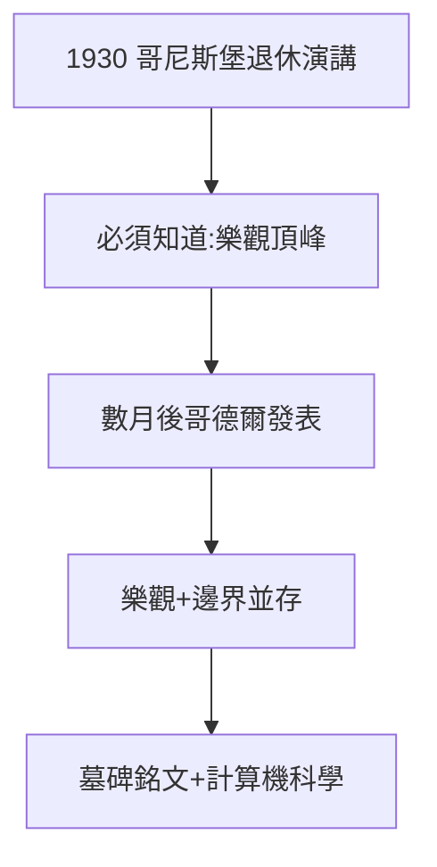

# 5.2 我們必須知道（1930）

## 退休演講

1930 年秋，希爾伯特在故鄉哥尼斯堡（也是康德的故鄉、他出生求學之地）發表退休演講，結尾是那句銘刻在墓碑上的話：

> Wir müssen wissen, wir werden wissen.
> 我們必須知道，我們將會知道。

說這話時，哥德爾的不完備定理尚未發表（幾個月後）——他站在人類樂觀主義的最後一刻。

## 墓碑

他要求把這句話刻在墓碑上。訪哥廷根的數學家至今去瞻仰：墓碑上的樂觀，與哥德爾的陰影並存——**人類的求知意志，不因不可判定而熄滅**。

## 樂觀的遺產

- 23 問題（3.1）多數已解，證明樂觀大體正確；
- 不完備定理劃出邊界，但邊界內仍是無垠樂園；
- 計算機科學（圖靈 1936）正源於對「可判定性」的追問——第 10 問題的餘波。

**因果**：1.1 的哥尼斯堡起點，1930 年的哥尼斯堡演講——68 年一個輪迴。起點是康德的故鄉，終點是康德問題（理性能知道什麼）的數學答案：能知道很多，但不能知道一切。下一節，謝幕。
