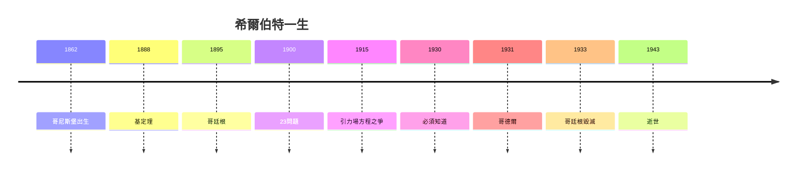

# 5.3 1943 逝世與遺產（1943）

1943 年 2 月 14 日，希爾伯特在哥廷根去世，享年 81 歲。葬禮冷清——納粹不許學術界隆重紀念， only 幾位老友送行。與 1900 年巴黎的萬眾矚目相比，恍如隔世。

## 遺產清單

| 領域 | 貢獻 |
|---|---|
| 代數 | 基定理，抽象代數之父 |
| 數論 | 數論報告，類域論綱領 |
| 幾何 | 公理化範式 |
| 分析 | 希爾伯特空間，泛函分析 |
| 物理 | 變分引力，諾特的伯樂 |
| 逻辑 | 形式主義，證明論之源 |
| 議程 | 23 問題，定義 20 世紀 |

## 哥廷根的重生

戰後庫朗（流亡美國者）在紐約建立庫朗研究所，弗里德里希斯等人重建哥廷根傳統。希爾伯特的學術血脈在美國開花——「識人磁石」（1.2）的最後效應：被驅散的人，把哥廷根帶到了全世界。

**因果閉環**：從哥尼斯堡（1.1）到哥廷根（2.1）再到空無一人的哥廷根（5.1）——他建造了世界數學的首都，又親眼看它毀滅。但 23 問題活著，希爾伯特空間活著，證明論活著。領航員死了，航線還在。
