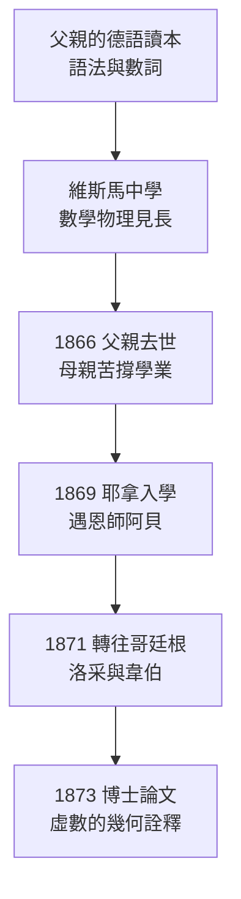

# 1.1 維斯馬童年與耶拿求學（1848–1873）

## 1848 年：革命之年誕生於波羅的海小城

1848 年 11 月 8 日，Gottlob Frege 出生於德國北部梅克倫堡的港市維斯馬（Wismar）。這一年歐洲革命風起雲湧，法蘭克福國民議會正在為德國憲政吵得不可開交，但波羅的海畔的維斯馬依然安靜。弗雷格全名 Friedrich Ludwig Gottlob Frege，父親 Alexander Frege 是維斯馬女子學校的創辦人兼校長，母親 Auguste Bialloblotzky 也在校中任教。宗教改革家約阿希姆·斯呂特（Joachim Slüter）是其母系先祖——路德傳統的學院氣息，自幼便浸潤著這個家庭。

父親曾寫過一本給少年用的德語讀本，其中討論「數詞如何從具體事物中抽象出來」。多年後弗雷格回憶，這本小書或許在他心中埋下了對語言與數之關係的第一顆種子。語言的邏輯結構——這條貫穿其一生的線索，正是從父親的語法課堂上開始的。

弗雷格家中還有兩個弟弟妹妹。弟弟 Arnold 後來從商並遠赴南美，妹妹 Auguste 早逝。家族中沒有第二個學者——弗雷格日後的學術道路，是一條無人引路的孤徑，而孤獨，將成為他一生的基調。

## 維斯馬：一座漢薩小城的底色

要理解弗雷格的性格，不能不提維斯馬這座城：

- **漢薩傳統**：自十三世紀起為漢薩同盟成員，商港的務實與秩序感滲入市民階層——弗雷格日後對「每一個符號都必須有明確所指」的執念，與這種務實精神一脈相承；
- **北德保守氣質**：梅克倫堡是德國最保守的邦國之一，路德宗虔誠、社會安靜。弗雷格終生不談政治、不出國門、不趨時髦，這種「北德式固執」在耶拿的講堂上被同事視為孤僻；
- **港灣的邊界感**：波羅的海是盡頭，也是出發點。弗雷格的整個人生，就是從這個盡頭出發、向最抽象的思想腹地的一次遠航。

## 1866 年：父親之死與求學轉折

1866 年，弗雷格十八歲，父親去世，家庭經濟頓失支柱。這一年正是普奧戰爭之年，北德意志的局勢因俾斯麥的擴張而劇變。母親 Auguste 獨力撐起學校與家計，並堅持讓天資卓越的長子繼續升學。

弗雷格先就讀父親參與創辦的維斯馬高級中學，最後兩年轉入梅克倫堡州立高級中學（Große Stadtschule），數學與物理成績名列前茅，德語作文也屢獲嘉獎。校長 Leo Sachse 對他影響甚深——弗雷格後來在《概念文字》中專門致謝，並以 Sachse 之名為形式系統中的定理命名（記法 "Sachse" 對應的定理序列）。這位中學校長大概不會想到，自己的名字有一天會出現在邏輯史上最重要的書頁裡。

## 1869 年：進入耶拿，遇見恩師阿貝

1869 年春，弗雷格進入耶拿大學。他在這裡待了兩年，修習數學、化學與物理，而對他一生最關鍵的相遇，是與物理學家恩斯特·阿貝（Ernst Abbe）。

- **阿貝**：耶拿物理學教授，後來的蔡司光學公司科學主管。他出身工人家庭，靠獎學金完成學業，最看重「有天分卻沒有後台」的學生——弗雷格正是這一類。阿貝成為弗雷格此後三十餘年在耶拿學界最主要的庇護人。
- **哲學課**：弗雷格也修了哲學家 Kuno Fischer 與 Ernst Laas 的課，接觸到康德觀念論與休謨經驗主義的對立——這場對立日後化為《算術基礎》中「算術是分析的還是綜合的」之爭（→ 詳見本章 2.1）。
- **化學實驗**：他甚至長期擔任化學實驗助理。日後他堅持「概念必須像化學物質一樣被嚴格界定，界線不清的概念不配進入科學」，或許正源於實驗室的洗禮。

## 1871–1873 年：哥廷根歲月與博士論文

1871 年，在阿貝的建議下，弗雷格轉往數學聖地哥廷根大學就讀三個學期。此時的哥廷根正是黎曼（Riemann）晚年任教之地（黎曼已於 1866 年去世，但其影響瀰漫全系），韋伯（Wilhelm Weber）主持物理實驗室，洛采（Hermann Lotze）執掌哲學講席。

- **洛采**：弗雷格正式的哲學指導教授。洛采反對心理主義、主張觀念（ideas）的客觀有效性，這條路線直接塑造了弗雷格「思想是客觀的、非心理的」之立場（→ 詳見 2.2 的「第三王國」）；
- **韋伯**：弗雷格修了韋伯的全部物理課程。實驗物理的嚴謹，強化了他「每一步推論都必須有明確規則」的信念；
- **1873 年博士論文**：《論虛數的一種幾何詮釋》（*Über eine geometrische Deutung der imaginären Zahlen*），在複數平面上為虛數給出幾何意義。論文最後一節已隱約提出：數學對象的「意義」問題比運算技術更根本——這正是他未來志業的預告。

值得對照的是：數年之後，同在哥廷根求學的希爾伯特（Hilbert，1880 年入學）將以完全不同的方式回應同一個基礎問題（→ 詳見《希爾伯特傳記》第 1 章）。哥廷根之於弗雷格是短暫的驛站，之於希爾伯特卻是畢生的根據地——兩人的起點交錯於此，終點卻天差地別。

## 事件關聯：一條從語法到邏輯的暗線

這段求學經歷的四個要素，缺一不可地匯成弗雷格日後的志業：

1. **父親的語法關懷** → 「語言的邏輯結構是可分析的」；
2. **阿貝的知遇** → 「再冷僻的學術志業，也要有人撐腰」——沒有阿貝，就沒有耶拿講席上的弗雷格；
3. **洛采的反心理主義** → 「思想與觀念是客觀對象，不繫於個人心靈」——這是《算術基礎》（→ 詳見 2.1）的哲學地基；
4. **哥廷根的數學嚴謹** → 「概念必須有明確意義」——博士論文的最後一節已是邏輯主義的遠因。

同時代的英國，年輕三歲的羅素尚在搖籃中；德國數學界正被克羅內克與魏爾施特拉斯的算術化浪潮席捲，魏爾施特拉斯「把數學還原為自然數」的綱領廣為人知。弗雷格卻反向而行：**不是把邏輯還原為算術，而是把算術還原為邏輯**。這一反轉，將改寫 20 世紀的心智史（→ 詳見《羅素傳記》第 1 章）。

## 一份假想的成績單

根據現存史料與課程記錄，我們可以重建弗雷格大學時代的知識構成：

| 領域 | 受教者 | 對其日後的影響 |
|------|--------|----------------|
| 數學 | 耶拿的 Schering、哥廷根數學系 | 分析學基本功，博士論文 |
| 物理學 | 阿貝（耶拿）、韋伯（哥廷根） | 實驗式嚴謹與規則意識 |
| 哲學 | Fischer、Laas（耶拿）、洛采（哥廷根） | 反心理主義、康德問題 |
| 語文學 | 中學的 Sachse | 語法結構敏感度 |

這份「跨科課表」解釋了為什麼弗雷格會成為那個時代唯一能同時讀懂數學與哲學、並動手鑄造符號工具的人——他不是在單一學科中長大的，而是在學科的縫隙裡長大的。

## 關鍵事件年表

| 年份 | 事件 | 意義 |
|------|------|------|
| 1848 | 11 月 8 日生於維斯馬 | 出生於革命之年，教師之家 |
| 1866 | 父親 Alexander 去世 | 家計轉困，母親獨力支持升學 |
| 1869 | 進入耶拿大學 | 遇見一生貴人恩斯特·阿貝 |
| 1871 | 轉學哥廷根 | 受教於洛采與韋伯 |
| 1873 | 以虛數幾何詮釋獲博士學位 | 確立「概念須有明確意義」的信條 |

## 小結

維斯馬給了弗雷格路德式學院家庭的底色，父親的語法讀本給了他語言與數的初始問題，阿貝給了他學術生涯的依靠，洛采給了他反心理主義的哲學立場。1873 年拿到博士學位的弗雷格，面臨的卻是嚴峻的現實：一個沒有大學教職、沒有學派、沒有人脈的青年數學家，下一步該往哪裡去？答案在耶拿——但講師之路遠比想像中崎嶇。下一節，我們看他如何在阿貝的蔭庇下，用一篇關於「量之擴充」的資格論文敲開大學之門。
