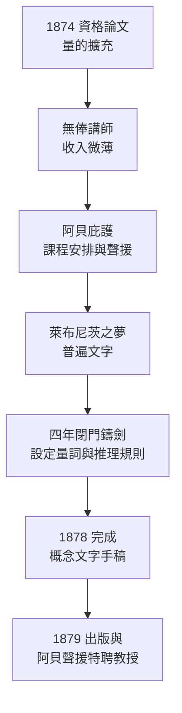

# 1.2 耶拿講師之路（1874–1878）

## 1874 年：資格論文與「量」的擴充

1874 年，二十六歲的弗雷格回到耶拿，提交大學授課資格論文（Habilitationsschrift）《基於量概念擴充的計算方法》（*Rechnungsmethoden, die sich auf eine Erweiterung des Größenbegriffes gründen*）。論文表面上研究的是把「量」（Größe）概念推廣到複數域、四元數乃至更一般的領域，骨子裡卻已透出他終身的方法：**用最一般化的概念統攝各種特殊計算，使推理本身的規則成為研究對象**。

這篇論文的思維結構值得細看：它不是為某一種計算（複數也好、四元數也好）另立規則，而是問——有沒有一套**最一般的概念框架**，使所有這些計算成為同一框架的特例？把「特殊性收攏為一般性」，正是《概念文字》對全部邏輯要做的事。資格論文因此可視為《概念文字》的熱身操。

通過資格審查後，弗雷格獲得耶拿大學「無俸講師」（Privatdozent）資格——沒有固定薪水，收入全靠選課學生的學費。這是德國學術金字塔的最底層：有課堂，無職位；有學生，無保障。

## 無俸講師的生存經濟學

要體會弗雷格 1874–1878 年的處境，得先看懂德國大學的等級制：

| 職級 | 收入 | 弗雷格的狀態 |
|------|------|--------------|
| 正教授（ordentlicher Professor） | 國家俸祿＋講座資源 | 終生未達 |
| 特聘教授（außerordentlicher Professor） | 無俸或微薄補貼 | 1879 年起，靠補貼度日 |
| 無俸講師（Privatdozent） | 純學費分成 | 1874–1879 |
| 學生 | 繳學費 | 1869–1873 |

同時期的希爾伯特（→ 詳見《希爾伯特傳記》第 1 章）正在哥廷根一路順風：1885 年完成資格，1888 年名聲鵲起，1895 年即獲正教授講席。同樣的學術階梯，弗雷格爬了四十四年仍停在第二級——差距不在才華，而在**學術資本**：人脈、學派、期刊網絡，弗雷格一樣都沒有。

## 恩師的庇護：阿貝的兩次關鍵出手

弗雷格能在耶拿存活，幾乎全賴阿貝。阿貝此時已是蔡司（Zeiss）光學公司的科學靈魂，1888 年更創立卡爾·蔡司基金會，使耶拿成為「光學之城」。他對弗雷格的照拂至少有兩次關鍵出手：

- **1879 年**：阿貝在校務會議上力陳弗雷格《概念文字》的價值，促成弗雷格越過正常梯次，被任命為特聘教授（außerordentlicher Professor）——雖仍無俸，但地位與開課權大增；
- **1884 年起**：阿貝持續為弗雷格爭取薪俸補貼，並安排他講授各種「填補空缺」的課程——從平面幾何到平面曲線的抽象理論，甚至「數學中的自然法則思想」。這些課程與弗雷格本人的研究毫不相干，純粹是給他找飯吃。

多年後阿貝回憶弗雷格時說：他「把一生獻給了思考」。但恩師也私下承認：弗雷格**不是一個好老師**——講課晦澀、板書混亂、對學生的遲鈍毫不寬容。選課人數常年只有三五人，有時僅一人。弗雷格在耶拿的課堂上，長年是對著空椅子演繹謂詞邏輯。

## 同時代氛圍：算術化浪潮與反向而行

1874 年前後的德國數學界，主流是魏爾施特拉斯學派的算術化綱領：把分析學奠基於自然數，再把自然數定義為邏輯上可疑的「類」。克羅內克則更極端地喊出「上帝創造了自然數，其餘皆是人造物」。

弗雷格走的是完全相反的方向：

- 魏爾施特拉斯：算術 ← 分析 ← 幾何，但**算術本身不再往下挖**——自然數是不可再分析的基石；
- 克羅內克：自然數是直觀的恩賜，無窮集合論是「偽數學」；
- 康托爾：正在鑄造超窮數，方向正確但地基可疑（弗雷格日後如此評價）；
- 弗雷格：算術 ← **邏輯**。算術的真理不是康德式的先天綜合判斷，而是純分析的、可由邏輯規則推出的真理。

四條路線在 1870 年代幾乎互不相識，卻將在 1900 年前後的數學基礎危機中正面相撞。弗雷格的路線當年最冷清，日後卻供養了整個數理邏輯（→ 詳見第 5 章）。

## 萊布尼茨之夢：四年閉門鑄劍

要證明「算術即邏輯」，弗雷格需要一件當時尚不存在的工具：一種能表達「所有」「存在」等量詞、能寫下多量詞推理的**符號語言**。萊布尼茨在十七世紀夢想的「普遍文字」（Characteristica universalis）——讓爭論雙方坐下來說「讓我們計算吧」——在兩百年間無人真正實現。

萊布尼茨的夢分為兩半：

1. **概念文字**（characteristica）：一套精確的符號，一符一義，無歧義；
2. **推理演算**（calculus ratiocinator）：一套機械規則，規定符號如何變形。

1874–1878 年，弗雷格一邊講課掙扎求生，一邊閉門鑄造這件工具。他的策略是先攻第二半：推理規則必須嚴格到「不需聰明，只需照做」，然後符號系統自然從規則中生成。這種「規則優先」的工程思路，與兩百年後程式語言的設計原則（→ 詳見 5.3）驚人地同構。

## 課堂上的寂寞與思想上的豐收

1874–1878 年的弗雷格，生活可用兩句話概括：**課堂冷清，書桌滾燙**。

- 他開設的課程橫跨解析幾何、代數曲線、力學基礎，聽者寥寥；
- 他與學界幾乎零通信、零旅行、零學會活動——終其一生，弗雷格不曾參加任何數學或哲學學會，不曾出國（僅 1904 年赴挪威旅行一次）；
- 但正是在這四年孤獨中，他完成了《概念文字》的全部核心創造：全稱量詞 $\forall$、存在量詞 $\exists$、謂詞-主目結構、以及從公理到定理的嚴格演繹系統。

今天任何一本邏輯教科書裡的一階謂詞邏輯，其骨架就是在耶拿某間無人聽課的教室背後、由一個失意講師鑄成的。布林（Boole）的代數邏輯（→ 詳見《布林傳記》）只能處理命題與類演算，無法表達關係推理；弗雷格的二維「概念線」記法雖然笨拙，表達力卻躍升了一個量級。

## 關鍵事件年表

| 年份 | 事件 | 意義 |
|------|------|------|
| 1874 | 提交資格論文《基於量概念擴充的計算方法》 | 獲無俸講師資格 |
| 1874–1878 | 講授數學各科，選課者寥寥 | 生計困頓，課堂寂寞 |
| 1874–1878 | 閉門研製邏輯符號語言 | 量詞與演繹系統成形 |
| 1878 | 《概念文字》手稿完成 | 謂詞邏輯誕生前夜 |
| 1879 | （承下節）阿貝聲援＋《概念文字》出版 | 獲特聘教授職 |

## 小結

1874–1878 年是弗雷格學術人生的「礦井期」：往下挖掘，不見天日，但挖出的是二十世紀邏輯的全部礦藏。無俸講師的貧寒、課堂的冷清、同行的無視，與阿貝的庇護形成殘酷的對照組——若無阿貝，這座礦可能永遠封存。而把萊布尼茨的兩半之夢（精確符號＋機械規則）合而為一，正是這四年真正的功業。1878 年手稿完成，1879 年《概念文字》問世，弗雷格將迎來人生唯一一次「高光時刻」與隨之而來的、更深的冷遇。下一節，我們走進這本薄薄的、卻重逾千鈞的《概念文字》。
