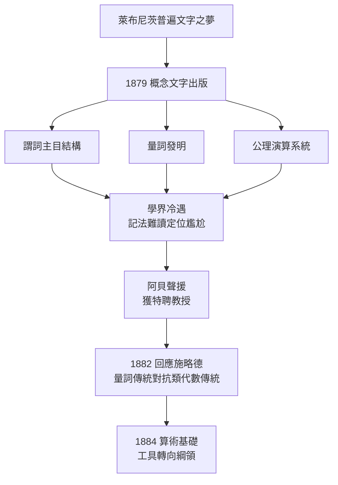

# 1.3 概念文字出版（1879）

## 一本薄書，一座分水嶺

1879 年，弗雷格的自費小書《概念文字：一種模仿算術語言構造的純思維的形式語言》（*Begriffsschrift, eine der arithmetischen nachgebildete Formelsprache des reinen Denkens*）在哈勒出版，全書不足百頁。就篇幅而言它是小冊子，就影響而言它是亞里士多德《工具論》之後邏輯史上最重要的著作：**現代謂詞邏輯在此誕生**。

書名 Begriffsschrift 直譯為「概念文字」。弗雷格的野心寫在副標題裡：這是一種「純思維的形式語言」——不是描寫思維的心理過程，而是刻畫思維的邏輯內容。萊布尼茨的普遍文字之夢（→ 詳見 1.2），兩百年後由一個耶拿講師付諸實現。

## 三項突破

### 1. 謂詞—主目結構：關係首次成為邏輯對象

亞里士多德邏輯只有「S 是 P」的主謂結構，無法表達「甲比乙高」「乙把丙給甲」這類關係。弗雷格把函數概念從數學移植到邏輯：謂詞是一個**不飽和的**函數，填入主目後得到真值。

$$\text{「x 愛 y」是一個雙元函數 } L(x,y),\quad L(a,b)\ \text{為真或為假}$$

命題不再是「主詞＋繫詞」，而是「函數＋主目」。這一步使關係推理、數學推理第一次獲得精確表達。萊布尼茨式的單稱詞邏輯、經院式的三段論，全都被這個結構吸收為特例——「所有人皆有死」不過是全稱量詞對一元函數的一次應用。

### 2. 量詞：邏輯的顯微鏡

弗雷格發明全稱量詞與存在量詞，使「所有人皆有死」「存在無理數」這類多重量詞命題獲得嚴格形式。他的二維記法中，量詞寫作帶有凹口的長線，條件線表示蘊涵：

$$\forall x\,\forall y\,\big((x < y)\to \exists z\,(x < z \wedge z < y)\big)$$

今日的 $\forall x\, (P(x) \to Q(x))$，正是弗雷格概念的線性化轉寫。**量詞是邏輯的顯微鏡**——弗雷格自己的比喻：有了它，人才能看清思想的最小結構。亞里士多德看不見的「存在」與「所有」的層層嵌套，在顯微鏡下一覽無遺。

### 3. 公理系統：邏輯推理的規則化

《概念文字》末章給出歷史上第一套命題邏輯與謂詞邏輯的公理演算，含九條（後修正為六條核心）公理與變形規則，並用嚴格演繹重推了從序列到數學歸納的骨幹推理。其中一條核心公理是：

$$(P \to (Q \to R)) \to ((P \to Q) \to (P \to R))$$

這套系統在 1930 年代被證明是完備的（哥德爾 1929，→ 詳見 5.1）——弗雷格的公理系統，半個世紀後被確認「不會漏掉任何邏輯真理」。

## 全書的結構地圖

| 章 | 內容 | 歷史地位 |
|----|------|----------|
| 序 | 哲學動機：萊布尼茨之夢、反心理主義 | 分析哲學方法論先聲 |
| 1 | 符號系統：判斷線、條件線、否定、量詞 | 二維記法 |
| 2 | 命題邏輯公理與演繹 | 歷史第一套命題演算 |
| 3 | 謂詞、關係、量詞的展開 | 謂詞邏輯誕生 |
| 4 | 應用：序列、數學歸納 | 邏輯主義的預演 |

值得注意的是第 4 章：弗雷格用概念文字重新推演「數列」「後繼」等概念——這正是《算術基礎》（→ 詳見 2.1）的第一次排練。工具與綱領在同一本書裡相遇。

## 為什麼無人喝彩？

《概念文字》出版後的反應近乎全面冷遇：

- **記法太怪**：二維線條排版昂貴、難讀，數學家嫌醜，哲學家嫌繁；
- **定位尷尬**：數學家認為它是哲學，哲學家看不懂其中的數學；
- **發行極少**：初版印量極小，書店難以購得；
- **時間太短**：弗雷格 1882 年給胡塞爾寫信承認，他還來不及在書出版後向學界充分闡釋其意圖。

同時代以符號化邏輯揚名的，是英國的布林—皮爾士—施略德（Schröder）代數傳統。施略德讀完《概念文字》後撰文批評，弗雷格回以《布林的邏輯演算與我的概念文字》（1882），指出代數邏輯「只模仿算術的形，不追問邏輯的質」——表達力上，量詞傳統完勝類代數傳統。兩條傳統的分野，正是二十世紀邏輯（弗雷格線）與計算機科學前身（布林線）的分岔口——而這兩條線最終在計算機裡重逢（→ 詳見 5.3 與《布林傳記》）。

## 阿貝的第二次出手

書出版後數月，阿貝在校務會議上力陳其價值，弗雷格越級獲聘特聘教授（außerordentlicher Professor）。這是弗雷格一生中唯一一次，其工作在當下獲得制度性回報。此後四十年，他的職級再未前進一步——耶拿的「正教授」講席與他終生無緣。

## 概念文字的遠期迴響

這本無人問津的小書，埋著此後一百年邏輯學的全部伏筆：

1. **邏輯主義的起點**：書末弗雷格宣稱，概念文字將用來「檢驗算術能否僅靠邏輯規則建立」——這正是《算術基礎》（→ 詳見 2.1）的預告；
2. **羅素的繼承**：1900 年羅素經皮亞諾間接吸收量詞概念，在《數學原理》（→ 詳見《羅素傳記》第 2 章 2.3）中承認弗雷格的先驅地位；
3. **維根斯坦的起點**：《邏輯哲學論》扉頁題辭致敬弗雷格——「本書受弗雷格與羅素的著作啟發」（→ 詳見《維根斯坦傳記》第 1 章）；
4. **希爾伯特的原料**：形式系統＋機械推理規則的組合，經希爾伯特元數學放大為「證明」本身可研究的對象（→ 詳見 5.1）；
5. **圖靈與計算機**：形式語言＋機械規則的另一個後代，是可計算性理論與程式語言（→ 詳見 5.2、5.3）。

## 1879 年的邏輯地圖：三條線的分岔

| 傳統 | 代表 | 能做到 | 做不到 |
|------|------|--------|--------|
| 亞里士多德三段論 | 學院傳統 | 一元謂詞推理 | 關係、多重量詞 |
| 布林代數 | 布林、施略德 | 類演算、命題運算 | 量詞嵌套、關係 |
| 弗雷格概念文字 | 弗雷格 | 全部以上＋多重量詞＋關係 | （當時無人知曉） |

歷史最終把三條線的功能全部收進「一階謂詞邏輯」一個名目下——而這個名目的內容，就是《概念文字》。

## 關鍵事件年表

| 年份 | 事件 | 意義 |
|------|------|------|
| 1879 | 《概念文字》自費出版 | 謂詞邏輯誕生 |
| 1879 | 阿貝聲援，獲特聘教授 | 一生唯一一次制度性回報 |
| 1882 | 撰文回應施略德，批評布林傳統 | 量詞邏輯對抗類代數 |
| 1882 | 致胡塞爾書信，闡釋概念文字意圖 | 首次對外說明哲學定位 |
| 1884 | 《算術基礎》以概念文字為綱領 | 工具轉向綱領 |
| 1893 | 《算術基本定律》以概念文字寫成 | 符號系統的終極應用 |

## 小結

《概念文字》的三件發明——函數式謂詞、量詞、公理演算——共同構成了現代邏輯的骨架。但 1879 年的弗雷格得到的不是掌聲，而是寂靜。他把寂靜轉化為動力：既然邏輯的工具已經鑄好，就該用它去幹最大的活——證明算術是邏輯。1884 年的《算術基礎》將展示這個綱領的第一次全面出擊。而在那之前，弗雷格還需要先向哲學界回答一個更根本的問題：什麼是一個「數」？
