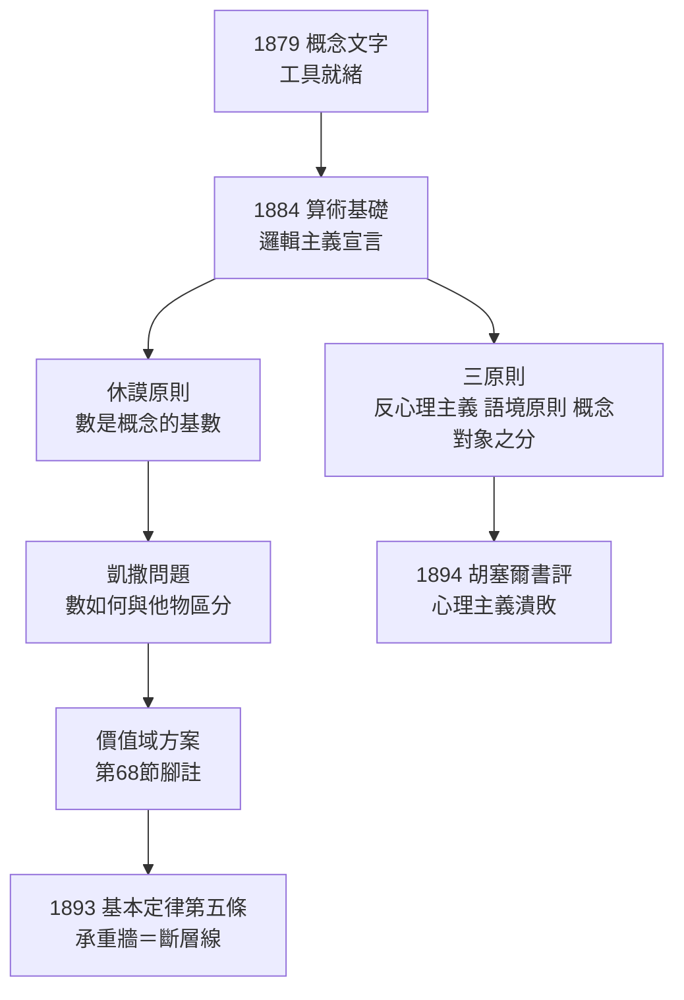

# 2.1 算術基礎（1884）

## 從工具到綱領：邏輯主義的宣言

《概念文字》（→ 詳見 1.3）鑄好了工具，1884 年弗雷格推出綱領之作《算術基礎：對數概念的邏輯—數學研究》（*Die Grundlagen der Arithmetik*）。這本小書不用一個數學符號——弗雷格刻意以日常德文寫成，「讓哲學家看得懂、數學家讀得進」——卻完成了兩件事：**界定數是什麼**，以及**宣告算術可還原為邏輯**。

書的序言開宗明義：數學的基礎至今懸而未決，「算術的真理是先驗綜合的（康德）還是經驗的（密爾）」，兩造皆錯。弗雷格的答案：**算術是分析的**——它的真理僅靠邏輯規則即可證明，不靠直觀、不靠經驗。

## 三條原則

弗雷格在序言中列出三條方法論原則，成為分析哲學的奠基文件：

1. **反心理主義**：不要把邏輯的與心理的混為一談。數不是觀念（ideen）——我的觀念是我的，數是公共的、客觀的；
2. **語境原則**：永遠不要孤立地追問一個詞的意義，只能在命題的語境中追問。「什麼是 3？」是壞問題；「『3』在『木星的衛星有 3 顆』中起什麼作用？」才是好問題；
3. **概念與對象分明**：永遠不要丟失概念（Begriff，第一層次的、不飽和的）與對象（Gegenstand，飽和的）之間的根本區別（→ 詳見 2.2）。

這三條原則日後經維根斯坦（→ 詳見《維根斯坦傳記》）與卡爾納普（→ 詳見《卡爾納普傳記》與本章 4.2）傳播，成為整個語言哲學的操作手冊。語境原則尤其深刻：它預示了結構主義與功能主義的思路——對象的同一性由其在命題網絡中的地位決定，而非由「戳指認領」決定。

## 康德問題的正面決戰

《算術基礎》的前半部是對康德與密爾的雙線作戰：

| 對手 | 主張 | 弗雷格的反駁 |
|------|------|--------------|
| 密爾（經驗主義） | 數來自對事物集合的歸納 | 「1+1=2」對一切對象成立，經驗無法解釋其普遍性 |
| 康德（直觀主義） | 算術是先天綜合判斷，基於時間直觀 | 算術推理全程可由邏輯規則機械檢查，無需直觀 |
| 歐幾里得傳統 | 幾何是空間直觀的科學 | 承認——所以幾何與算術本性不同，後者更純 |

弗雷格的證據是大數：「數到 10000 時，沒有任何直觀在場，只有推理規則在運轉。」這一論證策略——用極端案例逼出規則的本質——是典型分析哲學的思考實驗手法，比羅素早了整整二十年。

## 休謨原則：數是概念的基數

弗雷格對「什麼是數」的回答，用今日術語說是：

> 數是概念的性質——「概念 $F$ 的數」是與 $F$ 等數（一一同）的一切概念所共有的東西。

$$N_x Fx = N_x Gx \iff F \approx G$$

其中 $\approx$ 表示兩個概念的外延之間存在一一對應。這條等價式後世稱為**休謨原則**（Hume's Principle）：兩數相等，當且僅當所屬概念等數。弗雷格讚揚休謨最先觸及這一思路，並指出康托爾（Cantor）「集合的等價」正是同一觀念的重造——但康托爾把數當作抽象對象「創造」出來，弗雷格則從邏輯中「定義」出來。

有了休謨原則，弗雷格依序定義 0、後繼、自然數：

- **0** 是「不等於自身的東西」這一概念的數（$0 = N_x(x \neq x)$）；
- **1** 是「等於 0」這一概念的數；
- **後繼關係**：$n'$ 是「在自然數序列中直接跟隨 $n$」的概念之數。

整套定義只用到了邏輯（等價、一一對應、序列）——邏輯主義的藍圖第一次完整落地。

## 凱撒問題與價值域

但休謨原則留下一個漏洞：它說明什麼時候兩個數相等，卻沒說明數是否就是別的東西。**「概念 $F$ 的數」會不會恰好等於凱撒（Julius Caesar）？**——如果數只被相等條件界定，我們無法排除這種荒謬可能。這就是著名的**凱撒問題**。

弗雷格在《算術基礎》第 68 節給出臨時方案：數是**外延**（Wertverläufe，價值域）——概念的延伸物。這個方案在《算術基礎》中僅以腳註形式出現，但九年後的《算術基本定律》（→ 詳見 2.3）將把它提升為整座大廈的第五條基本定律。**凱撒問題的補丁，最終成為大廈的承重牆，也成為大廈崩塌的斷層線**——1902 年羅素來信，正是在這條斷層線上引爆（→ 詳見 3.1）。

## 同時代的對手與盟友

- **克羅內克**：算術必須建於自然數之上，而自然數是「上帝的恩賜」、不可再分析。弗雷格視此為蒙昧主義：「把基礎交給神學，就是把數學交給神秘。」
- **康托爾**：正在建立超窮數理論。弗雷格讚賞其一一對應的相等標準，但批評其「集合」概念不夠嚴格、帶有創造論色彩。兩人一生無私交，各走各的路——直到悖論同時燒到兩家（康托爾 1899 年已在信中向希爾伯特表達類似顧慮）；
- **皮亞諾**：1889 年發表算術公理系統，記法優美卻未回答「數是什麼」。弗雷格批評皮亞諾「只造了房子的骨架，沒打地基」——而皮亞諾的學生（以及透過皮亞諾認識弗雷格的羅素）將成為他思想的轉運站。

## 1884 年的冷遇，與多年的慢熱

《算術基礎》的遭遇比《概念文字》更冷清：出版後數年內，德國數學界幾乎無人置評，書店裡根本買不到。弗雷格晚年（1924）回憶：「我這一生的著作，都像種在荒地裡。」但種子並未死——幾位未來的傳承者都先後讀到了它：

- **胡塞爾**在《算術哲學》（1891）中走心理主義路線，弗雷格撰寫書評（1894）予以嚴厲批判；胡塞爾日後自承由此轉向反心理主義。這場書評是弗雷格一生唯一一次正面擊中對手的回力球；
- **羅素** 1900 年讀畢《算術基礎》，自述「這是我智識生涯的轉捩點」（→ 詳見《羅素傳記》第 1 章 1.3）。

## 關鍵事件年表

| 年份 | 事件 | 意義 |
|------|------|------|
| 1884 | 《算術基礎》出版 | 邏輯主義綱領完整宣言 |
| 1884 | 三條方法論原則問世 | 分析哲學奠基文件 |
| 1884 | 休謨原則與數的定義 | 數＝概念的基數 |
| 1884 | 第 68 節引入價值域 | 凱撒問題的補丁，埋下斷層線 |
| 1889 | 皮亞諾算術公理 | 骨架與地基之分 |
| 1891 | 胡塞爾《算術哲學》出版 | 引爆反心理主義論戰 |
| 1894 | 弗雷格書評胡塞爾 | 心理主義在德語哲學中潰敗 |
| 1900 | 羅素讀《算術基礎》 | 智識轉捩點，邏輯主義第二波 |

## 小結

《算術基礎》用最樸素的德文，回答了最古老的問題「數是什麼」，並給出三條至今仍在使用的哲學原則。它同時埋下兩顆種子：一顆長成《算術基本定律》的宏偉大廈，一顆（價值域）長成 1902 年的災難。弗雷格接下來的十年做了一件事：把《算術基礎》的哲學論證，翻譯成《概念文字》的嚴格符號——但在完成之前，他先要解決一個更深的語言問題：一個名字如何「指到」它的對象？1892 年的《論涵義與指稱》將給出二十世紀語義學的開山答案。
