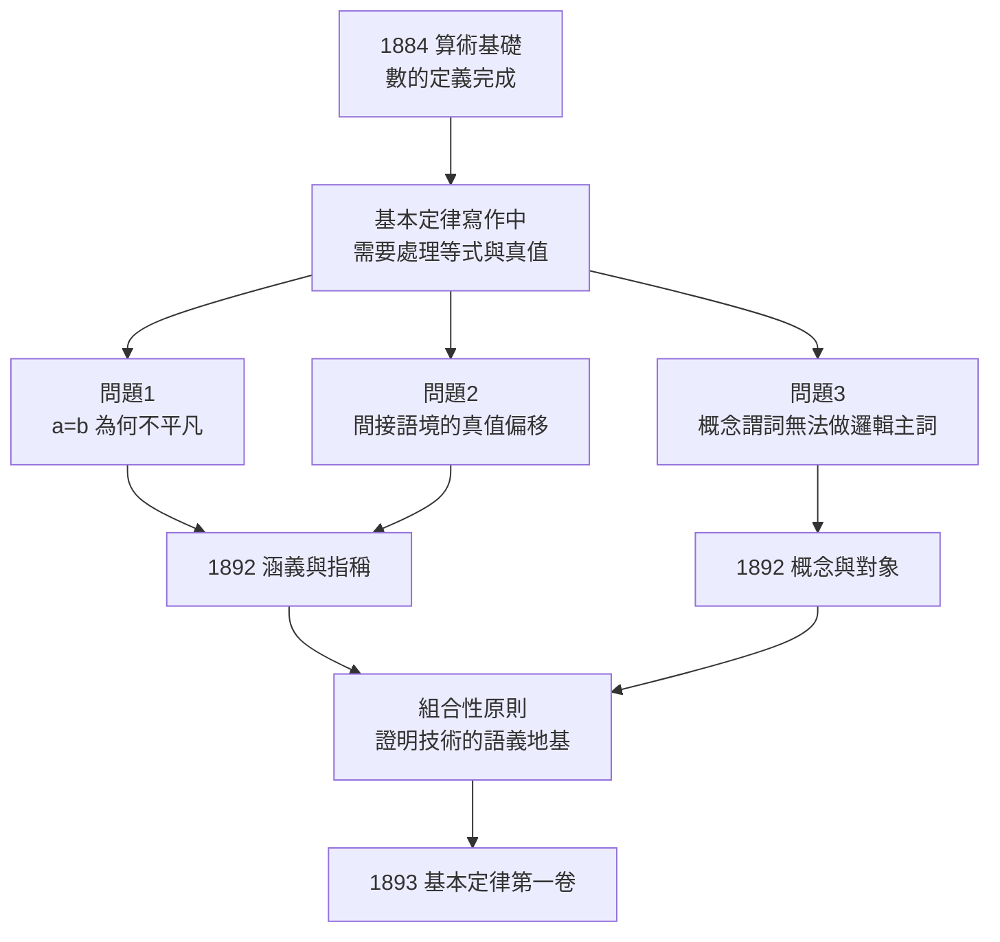

# 2.2 涵義與指稱（1892）

## 一個被誤解的等號

《算術基礎》（→ 詳見 2.1）之後，弗雷格在《算術基本定律》（→ 詳見 2.3）的寫作中撞上一個看似技術性的問題：**等式 $a = b$ 與 $a = a$ 究竟差在哪裡？**

- $a = a$ 是先驗真理，無需經驗；
- $a = b$（如「晨星 = 昏星」）卻常常是有價值的、需要天文觀測才能確立的知識。

如果 $a = b$ 只是說「兩個記號指同一個對象」，那麼這條等式應該與 $a = a$ 一樣平凡——但顯然不是。弗雷格曾在《算術基礎》中以「辨識力」（Erkennbarkeit）一詞勉強處理，但不滿意；1879 年《概念文字》初版甚至以「內容」一詞混同涵義與指稱。13 年後，1892 年，他在《哲學與哲學批判月刊》發表《論涵義與指稱》（*Über Sinn und Bedeutung*），用一對新術語解開了這個死結：

- **指稱**（Bedeutung）：名字所指的對象。「晨星」與「昏星」的指稱都是金星；
- **涵義**（Sinn）：名字呈現對象的方式。「晨星」是「早晨天邊最亮的星」，「昏星」是「傍晚天邊最亮的星」——涵義不同，指稱同一。

> 「晨星就是昏星」有知識價值，因為兩個名字**涵義不同**；這句話為真，因為它們**指稱同一**。

這個問題的歷史其實更長：弗雷格早在 1882 年致胡塞爾的信、1891 年《函數與概念》講演中已逐步逼近這對區分——《論涵義與指稱》是六年醞釀的最終定稿。

## 涵義的客觀性：第三王國

涵義既非心理觀念（同一涵義可為眾人共享），也非物理事物，而是**客觀的、公共的、非時空的**抽象實體。弗雷格晚年將這個層面稱為「第三王國」（das dritte Reich，→ 詳見 3.3）：

| 層次 | 性質 | 例子 |
|------|------|------|
| 觀念（主觀） | 私有、屬於個人心靈 | 我此刻的金星印象 |
| 涵義（客觀・非時空） | 公共、可被把握 | 「晨星」的呈現方式 |
| 指稱（客觀・時空中） | 可指認的對象 | 金星本身 |

這與《算術基礎》的反心理主義原則（→ 詳見 2.1）一脈相承：洛采式的客觀觀念論，經涵義—指稱之分獲得精確表達。**思想（der Gedanke）就是句子的涵義，句子的指稱是真值**——真與假本身成為對象，這一「真值即對象」的設定，後來成為所有外延語義學的公理。

第三王國的設定同時是一次哲學轉向：真理的討論從「心靈如何運作」轉到「公共的思想內容是什麼」。這一步使哲學從心理學中解放——胡塞爾的轉向（受弗雷格書評刺激）、維根斯坦的命題理論、卡爾納普的語義學，全部站在這個轉向的另一側。

## 組合性原則：語義學的引擎

《論涵義與指稱》的第二項貢獻是**組合性原則**（compositionality）的首次明確表述：

> 複合表達式的涵義，由其部分的涵義與組合方式決定；複合表達式的指稱，由其部分的指稱與組合方式決定。

形式地說，若 $\llbracket \cdot \rrbracket$ 表示指稱函數，則：

$$\llbracket f(a) \rrbracket = \llbracket f \rrbracket(\llbracket a \rrbracket)$$

這條原則是現代語義學的全部引擎：蒙塔古語法、範疇語法、形式語義學（→ 詳見 4.3）都是它的後代。在邏輯內部，它還直接支撐了《算術基本定律》的證明技術——只有當整個句子的真值由部分的指稱機械地決定，演繹才能成為純形式的操作。

組合性原則也是一項**反形上學**武器：既然複合意義由部分意義組合，就不需要任何「神秘整體」——意義的來源被完全定位在有限的詞彙與明確的規則裡。維根斯坦《邏輯哲學論》的「命題是基本命題的真值函項」（→ 詳見《維根斯坦傳記》第 1 章）就是這條原則的極端化。

## 疑難案例：間接引語與信念語境

弗雷格敏銳地處理了一個組合性原則的表面反例：**間接引語**。

> 「哥白尼相信晨星是金星。」

在這個句子裡，「晨星」顯然不指金星本身——哥白尼可能弄錯天體身份。弗雷格的方案：在 that-從句（間接語境）中，名字的**涵義升格為指稱**——「晨星」在此指其平常涵義（呈現方式），而非金星。

$$\text{直接語境：名字} \to \text{對象} \qquad \text{間接語境：名字} \to \text{涵義}$$

這個「涵義層級」的設定解釋了信念語句、引號語句、命题態度句的真值偏移，並成為二十世紀心靈哲學「命題態度」討論的起點。疑難案例驅動理論修正——這一工作方式本身就是範式：克里普克、卡普蘭、劉易斯此後的所有語義學創新，走的都是弗雷格開闢的「疑難案例 → 語義結構修正」之路。

## 同年雙聯作：概念與對象

1892 年弗雷格還發表姊妹篇《論概念與對象》（*Über Begriff und Gegenstand*），回應《算術基礎》三原則之第三條（→ 詳見 2.1）：

- **概念**是不飽和的、第一層次的函數：「$x$ 是人」需要主目才能成真或假；
- **對象**是飽和的：金星、3、蘇格拉底；
- **二階概念**：如「存在」不是一階謂詞——說「存在馬」，是說「馬這一概念被例示」，而非馬具有「存在」性質。

「存在不是謂詞」這一論斷，重創了傳統本體論證明（安瑟倫式），並成為二十世紀分析形上學的標準立場。康德用整部《純粹理性批判》駁斥本體論證明，弗雷格用一個語法區分就完成了同樣的工作——這是「以邏輯做哲學」的範式革命。

## 為何此時寫作：背後的推動力

《論涵義與指稱》不是閒筆，而是被三股壓力共同逼出的：

1. **技術壓力**：《算術基本定律》的形式系統需要精確的真值語義，等式的平凡性問題首當其衝；
2. **哲學壓力**：間接引語中名字的指稱似乎偏移，需要一個能容納偏移的統一框架；
3. **論戰壓力**：與胡塞爾（1894 書評前夕）、與施略德學派的交鋒，都要求把「意義」的層次講清楚。

## 關鍵事件年表

| 年份 | 事件 | 意義 |
|------|------|------|
| 1879 | 《概念文字》以「內容」混同意義層次 | 問題的伏筆 |
| 1884 | 《算術基礎》以「辨識力」處理等式 | 未滿意的過渡方案 |
| 1891 | 《函數與概念》講演 | 函數概念從數學擴展到邏輯 |
| 1892 | 《論涵義與指稱》發表 | 涵義/指稱之分，組合性原則 |
| 1892 | 《論概念與對象》發表 | 「存在不是謂詞」，二階概念 |
| 1892–1895 | 與胡塞爾、施略德學派論戰 | 反心理主義陣地鞏固 |
| 1893 | 《算術基本定律》第一卷出版 | 涵義理論成為系統語義基礎 |
| 1918 | 《思想》定稿第三王國理論 | 涵義理論的晚年總結 |

## 小結

1892 年的兩篇論文，把《概念文字》的句法（→ 詳見 1.3）配上《算術基礎》的哲學（→ 詳見 2.1），鑄成了完整的語義學：句法—涵義—指稱三層結構，組合性原則貫穿其中，間接引語的疑難案例預留了理論的擴展接口。維根斯坦的《邏輯哲學論》、卡爾納普的《語言的邏輯語法》、塔斯基的真定義、蒙塔古語法，全部生長在這對區分之上（→ 詳見 4.3）。句法與語義既備，弗雷格終於可以動工他一生最大的工程——用純邏輯符號，把整個算術從地基砌到屋頂。1893 年，《算術基本定律》第一卷問世。
