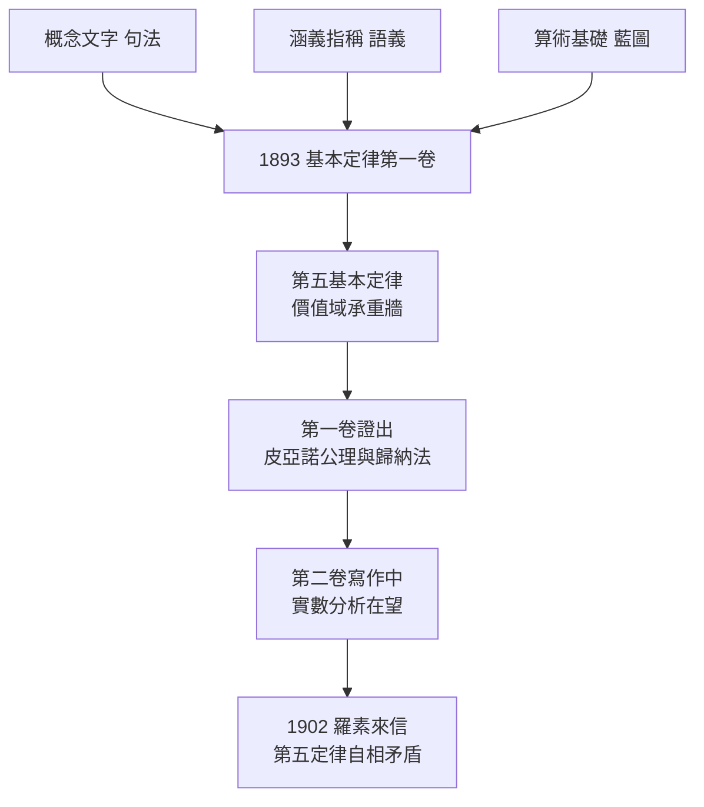

# 2.3 算術基本定律第一卷（1893）

## 大廈動工：從哲學到符號

《算術基礎》（→ 詳見 2.1）給了藍圖，《論涵義與指稱》（→ 詳見 2.2）給了語義，《概念文字》（→ 詳見 1.3）給了工具。1893 年，弗雷格把三者熔鑄成他畢生最大的工程：《算術基本定律》（*Grundgesetze der Arithmetik*）**第一卷**在耶拿出版。

計畫的規模：三卷本。第一卷給出形式系統與自然數算術，第二卷處理實數與分析學，第三卷（規劃中）處理一般量論。這是要在紙面上重建整個數學大廈——而且每一塊磚都必須由邏輯燒製。弗雷格在序言中直言挑戰所有懷疑者：「如果有人發現我的證明中有任何錯誤，我的原則站不住腳，那麼我的著作的全部價值就化為烏有。」——這句話在十年後一語成讖。

## 系統的骨架：五條基本定律

《基本定律》以《概念文字》的二維記法寫成，公理化為十八條初始規則與**五條基本定律**（Grundgesetze）。前四條是命題邏輯與量詞邏輯的標準公理（如第一卷第一條：$P \to (Q \to P)$），真正的建築材料是第五條：

$$\hat{f}(x) = \hat{g}(y) \iff \forall a\,\big(f(a) = g(a)\big)$$

**第五基本定律**（Grundgesetz V）說：函數 $f$ 與 $g$ 的**價值域**（Wertverlauf，概念的外延）相等，當且僅當兩函數對一切主目取值相同。這正是《算術基礎》第 68 節腳註（→ 詳見 2.1）的正式化——凱撒問題的補丁，如今成為承重牆。

有了第五定律，弗雷格可以：

1. 把「價值域」當作邏輯對象自由引用，從而解決數的同一問題；
2. 定義 $N_x Fx$（概念 $F$ 的數）為價值域表達式；
3. 導出**休謨原則**，再依《算術基礎》的路線定義 0、1、後繼、自然數；
4. 第一卷結尾，證出自然數的皮亞諾公理與數學歸納原理——**算術被邏輯地重造了**。

## 技術上的巔峰

《基本定律》第一卷的嚴格程度在當時無出其右：

- **完全形式化**：從公理到定理，每一步都依明確的變形規則，不訴諸任何直觀。弗雷格甚至為「證明檢查」本身制定了規則——一個受過訓練的檢查者無需理解證明，只需逐行核對；
- **元語言自覺**：弗雷格區分系統內的表達式與談論系統的德文元語言，這是元數學（希爾伯特，→ 詳見《希爾伯特傳記》第 2 章）的先聲；
- **證明論式推理**：他引入了處理規則應用的推理規則（「我的規則 18」），接近今日的完備性/可靠性意識；
- **徹底性**：連「定理 N.」「證明長度」都以系統內的記號標注——證明成為一件可以編號、複製、檢驗的**產品**。

羅素 1910 年的《數學原理》（→ 詳見《羅素傳記》第 2 章 2.3）在系統細節上遠不及此書精緻——懷特海與羅素的記法後來大量簡化，但核心構想（邏輯主義＋外延抽象）正是弗雷格式的。

## 石沉大海的第二回

然而 1893 年的學術界，再次還給弗雷格一片寂靜：

- 第一卷**只賣出寥寥數十本**，出版社幾乎沒做任何推廣；
- 唯一認真的書評來自數學家 Otto Stolz，讚許其嚴格，卻完全沒有跟進；
- 皮亞諾學派在《數學評述》上對弗雷格的記法評論苛刻，認為二維記法「不可能被採用」；
- 康托爾則在通信中直言：弗雷格的價值域概念與其集合論相比「太笨重」。

弗雷格在給友人的信中自嘲：「在數學家那裡，我是個哲學家；在哲學家那裡，我是個數學家——兩邊都不當人。」這句話成為跨界學者的千年墓誌銘。

## 為什麼沒有學派

對照同期學者，弗雷格的孤立有結構性原因：

| 學者 | 學術環境 | 弗雷格 |
|------|----------|--------|
| 希爾伯特 | 哥廷根，弟子雲集（→ 詳見《希爾伯特傳記》） | 耶拿孤校，博士寥寥 |
| 胡塞爾 | 哈勒—哥廷根，現象學運動成形 | 無追隨者，書評罵走僅有讀者 |
| 皮亞諾 | 都靈，國際學會與期刊網絡 | 無期刊、無學會、無旅行 |
| 弗雷格 | —— | 一人、一校、一種無人可讀的記法 |

弗雷格以極嚴苛聞名，且終生未參加任何學術會議。耶拿的講堂（→ 詳見 1.2）常年三五人——直到 1910 年，一個名叫魯道夫·卡爾納普的學生才走進來（→ 詳見 4.2）。

## 石墨與火藥：第五定律的雙重身份

回頭看，第五基本定律同時是：

1. **天才的樞紐**：一條公理解決凱撒問題、定義所有自然數、支撐整個邏輯主義；
2. **災難的火藥**：無限制的外延抽象正是羅素悖論（→ 詳見 3.1）的引信。

一條公理同時扮演承重牆與火藥桶——這種「單點失效」的結構，使弗雷格系統的崩塌格外徹底：第五定律一倒，第一卷的每一頁都隨之失效。弗雷格自己後來承認：「我不能容忍這種結構上的脆弱，但我當時沒有別的出路。」

## 關鍵事件年表

| 年份 | 事件 | 意義 |
|------|------|------|
| 1893 | 《算術基本定律》第一卷出版 | 算術的形式邏輯重建 |
| 1893 | 第五基本定律正式化 | 凱撒問題補丁成承重牆 |
| 1893 | 證出自然數公理與歸納原理 | 邏輯主義第一階段完成 |
| 1893–1902 | 學界冷遇，銷量慘淡 | 無學派、無弟子、無論戰回響 |
| 1894 | 弗雷格書評胡塞爾《算術哲學》 | 唯一有聲量的論戰 |
| 1895 | 回應施略德，深化量詞邏輯對比 | 對布林傳統的最後一擊 |
| 1902 | （承下節）羅素來信 | 大廈斷層引爆 |

## 小結

《基本定律》第一卷是十九世紀邏輯學的技術巔峰：完全形式化的系統、元語言的覺悟、從公理到皮亞諾公理的全程演繹。但它在問世時無人喝彩，因為弗雷格建築大廈的方式超前了他的時代——紙上的大廈需要讀者，而讀者還沒出生。第一卷印出時，承重牆（第五基本定律）內已藏著裂縫；第二卷寫作正酣，一封來自英國劍橋的信即將抵達耶拿。1902 年 6 月，弗雷格將收到他一生最短也最致命的一封信。
