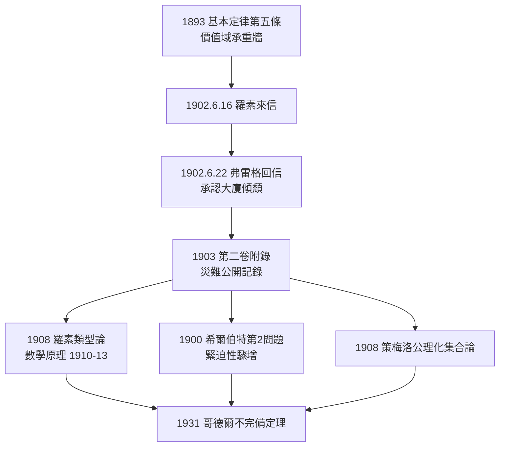

# 3.1 羅素來信（1902）

## 1902 年 6 月 16 日：一封拆台信

1902 年 6 月 16 日，耶拿的弗雷格收到一封來自英國劍橋的信，寄信人是三十歲的伯特蘭·羅素（→ 詳見《羅素傳記》第 2 章 2.1）。信的開頭近乎客套：

> 「親愛的同行：允許我感謝您《算術基礎》與《算術基本定律》第一卷給予我的極大啟發……您的著作使我在方法上免於長年的迷途。」

接著話鋒直轉：

> 「但在一點上我遇到了困難——您的第五基本定律。……既然一個概念的價值域本身又是一個函數的值域，那麼設函數『不屬於自身的值域』……」
>
> 令 $W$ 為「所有不包含自身的類的類」。問：$W$ 是否包含自身？
> $W \in W \iff W \notin W$

矛盾。**羅素悖論**正面命中第五基本定律（→ 詳見 2.3）：價值域的「論域無限制」使 $W$ 這種表達式合法存在，而它自指即毀。

## 弗雷格的回信：邏輯史上最痛苦的誠實

弗雷格的回信（1902 年 6 月 22 日）是科學史上罕見的坦白：

> 「您的發現使我震驚，甚於任何事物……我的第五基本定律動搖了，因為人們可以用它證明我的系統中每個類都屬於自身……當一項工作長年建成之際看到它傾頹，對一個科學工作者而言是莫大的不幸。」

但他接著說：「您的問題——當基礎動搖時數學是否還能立足——將推動邏輯學邁進，我對此幾乎沒有懷疑。」

同一封信裡，弗雷格做了一件更具風骨的事：**邀請羅素為《基本定律》第二卷寫一則附錄**，親自記錄這個矛盾。災難的見證人，由發現災難的人執筆——這是學術史上的絕筆奇觀。兩人此後通信至 1902 年 8 月，羅素甚至寄去自己嘗試的類型論草案，弗雷格回以技術性討論——拆台者與被拆者，開始了短暫而真誠的合作。

## 矛盾的技術核心

第五基本定律允許從任意函數 $f(x)$ 造出價值域 $\hat{x}f(x)$。設：

$$f(x) \;=\; \neg\big(x \in \hat{y}f(y)\big)$$

即「$x$ 不屬於它自己的價值域」。取 $x$ 為 $\hat{y}f(y)$ 本身：

$$\hat{y}f(y) \in \hat{y}f(y) \iff \hat{y}f(y) \notin \hat{y}f(y)$$

用弗雷格系統的變形規則，這一對蘊涵式可在兩行內推出矛盾。問題的根源不在記法、不在推理規則，而在**論域不設限**——一切函數皆可有價值域，一切價值域又都是論域成員。這正是康托爾樸素集合論共享的病灶：康托爾 1899 年已在通信中向希爾伯特提出「不一致總體」的顧慮（→ 詳見《希爾伯特傳記》第 2 章），比羅素的信早三年。

值得注意的是：弗雷格系統只需兩行即崩，皮亞諾—羅素的非形式系統同樣中招，而《概念文字》的命題邏輯部分毫髮無傷——**塌的是外延抽象，不是謂詞邏輯**。這一區分成為二十世紀邏輯學「形式系統內部安全性」研究的起點。

## 兩位當事人的餘波

- **弗雷格**：時年五十三歲，大廈完工前夜。第二卷清樣在印（→ 詳見 3.2），他被迫加印附錄、承認系統失效。此後他再未恢復系統建設的野心；
- **羅素**：悖論成為他智識人生的轉軸。他先嘗試類型論自救，與懷特海合著《數學原理》（1910–1913，→ 詳見《羅素傳記》第 2 章 2.2–2.3），該書在序言中明言：「在所有邏輯分析的問題上，我從弗雷格的著作受益最大。」

來信—回信—附錄，短短六個星期的通信，把兩個素未謀面的人焊成學術史上最奇特的一對：**拆台者與被拆者，互為成就**。

## 連鎖反應：第三次數學危機

羅素悖論不只是弗雷格個人的災難，它是「第三次數學危機」的開場槍：

1. **希爾伯特**聽聞悖論後，把「算術的相容性」推上研究日程核心（→ 詳見 5.1），三十年後由哥德爾以不完備定理改寫其結局；
2. **策梅洛** 1908 年公理化集合論，用限制概括原理取代樸素概括——「不讓 $W$ 這種東西合法存在」；
3. **羅素**用類型論封鎖自指——「不讓 $x$ 之於 $\hat{y}f(y)$ 的自指合法」；
4. **布勞威爾**則讀出更深的訊息：邏輯本身不可靠，數學必須回到構造。

四條路徑都從 1902 年 6 月那封信出發。弗雷格的大廈崩了，崩塌聲卻震出了整個二十世紀的數學基礎研究。

## 學術誠實的範本

弗雷格在這場災難中的行為，成為科學倫理的教科書案例：

| 情境 | 常見反應 | 弗雷格的反應 |
|------|----------|--------------|
| 收到致命反駁 | 辯護、拖延、貶低對手 | 兩天內承認，感謝發現者 |
| 著作已付印 | 隱瞞、偷偷修改 | 保留原書＋親撰附錄記錄錯誤 |
| 搶修方案 | 宣布成功以保聲望 | 公開承認搶修「只是推遲問題」 |
| 對發現者 | 視為敵人 | 邀請對方執筆附錄，維持終身通信 |

正是這份風骨，使「弗雷格」三字在羅素此後所有著作中都佔有一席之地——羅素不欠弗雷格任何東西，卻終身致謝；兩人的友誼建立在崩塌的廢墟上，反而比建立在成功上的友誼更牢固。

## 關鍵事件年表

| 年份 | 事件 | 意義 |
|------|------|------|
| 1901 | 羅素發現悖論（5 月） | 康托爾集合論矛盾化 |
| 1902 | 6 月 16 日羅素致信弗雷格 | 命中第五基本定律 |
| 1902 | 6 月 22 日弗雷格回信 | 承認系統崩塌，邀羅素作附錄 |
| 1902 | 通信持續至 8 月 | 兩人討論修正方案與類型論草案 |
| 1903 | 《基本定律》第二卷附錄 | 悖論正式載入出版物 |
| 1908 | 策梅洛公理化、羅素類型論 | 兩大自救方案問世 |
| 1931 | 哥德爾不完備定理 | 危機的最終定局 |

## 小結

1902 年 6 月的來信，是弗雷格人生最殘酷的時刻，也是他最光榮的時刻：被一位後輩用兩行符號擊倒，卻以兩頁回信示範了什麼是科學誠實。他把災難公開印在自己的書裡，邀發現者執筆——這份風骨比邏輯主義本身更有生命力。但承認崩塌是一回事，收拾殘骸是另一回事。下一節，我們看弗雷格如何在第二卷的附錄裡搶修承重牆，以及這場搶修為何終告失敗。
