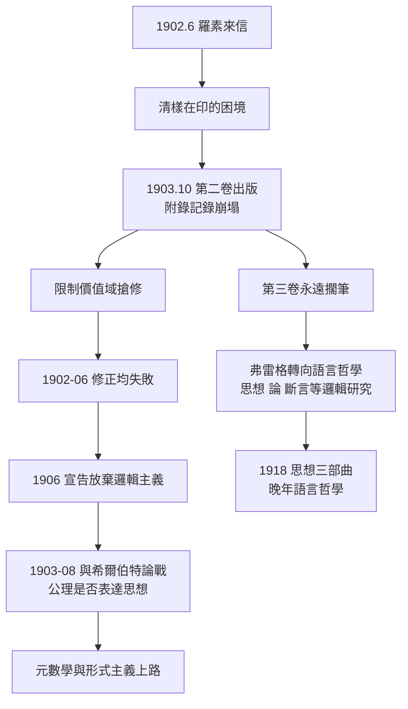

# 3.2 修正嘗試與第二卷出版（1903）

## 清樣在印，災難在途

1902 年 6 月收到羅素來信（→ 詳見 3.1）時，《算術基本定律》**第二卷**的清樣已在印刷廠。這卷處理實數與分析學，弗雷格為此工作近十年。他面臨兩難：

- **如期出版**：書以失效的第五基本定律為地基，印出即過時；
- **撤稿重寫**：重建系統需要新的基本定律，但這正是多年心血的整體翻修。

弗雷格選擇第三條路：**照印，加附錄**。1903 年 10 月第二卷問世，末尾多出約四十頁的〈附錄：論基本定律第五條〉——由羅素悖論開篇，以搶修方案結束。這是科學出版史上最罕見的一幕：作者在自己的巨著卷末，親手記錄該書核心的崩塌。

## 搶修方案：限制價值域

附錄中弗雷格提出的修正是對第五基本定律加限定：不再承認**一切**函數都有價值域，只有滿足特定條件的函數才有。他設想一個修正規則：

> 函數 $f$ 有價值域，僅當對所有 $x$、$y$，若 $f(x) = f(y)$ 則……（某種可判定的條件）

問題隨即而來：要說清「哪些函數例外」，就需要一個**更高層次的判定程序**，而這一程序本身又會引出自指——羅素在通信中（1902 年 8 月起）已指出，弗雷格的第一版修正仍可導出矛盾。弗雷格在附錄裡坦承：

> 「即使這個修正成功了，問題也只是被推遲：對『可允許函數』的界定本身，是否又會產生新的矛盾？」

## 1903–1906：從搶修到放棄

此後三年，弗雷格在信件與遺稿中反覆嘗試多種修正：

| 嘗試 | 思路 | 結局 |
|------|------|------|
| 限制價值域生成 | 只有「可判別」函數有外延 | 判別條件自指，仍生矛盾 |
| 效仿羅素類型論 | 分層禁止自指 | 弗雷格認為違反其概念分層的自然性，且需重寫全部系統 |
| 回到《算術基礎》路線 | 拋棄價值域，以休謨原則為公理 | 凱撒問題（→ 詳見 2.1）無解，數的對象性失據 |
| 幾何主義嘗試 | 算術也許應奠基於幾何 | 1906 年後遺稿中反覆動搖，終未定案 |

有趣的是，第 3 條路線正是 1980 年代新邏輯主義（neo-logicism）重新採用的方案（→ 詳見 4.3）——弗雷格 1906 年的「退路」，在後人眼中竟是「出路」。他當年的悲觀，恰恰是因為他比後人更清楚凱撒問題的深度。

1906 年，弗雷格在一封信中承認：「我已放棄把算術奠於邏輯的企圖……現在以為找到了正路的，未必是對的。」**邏輯主義綱領，在其創始人手中正式停工。** 規劃中的第三卷（量論）永遠沒有動筆。

## 與希爾伯特的平行戰線

搶修邏輯主義的同時，弗雷格還在另一條戰線上作戰：1903–1908 年他與希爾伯特展書信論戰（→ 詳見 5.1）。兩場戰爭相互加壓：

- 希爾伯特的形式主義宣稱「公理是隱定義」，公理系統只要相容即合法；
- 若此說成立，弗雷格的畢生信念（公理表達**思想**、思想有客觀真假）就失去了根基；
- 換言之，羅素悖論從內部炸塌了大廈，希爾伯特的形式主義則從外部拆掉了重建大廈的理由。

弗雷格兩頭作戰、兩頭皆墨：對羅素，承認系統失效；對希爾伯特，抗議意義被掏空。這雙重挫敗，解釋了他 1906 年後的全面沉默。

## 為什麼他不再出書

1903 年之後，弗雷格沒有再出版任何專著。原因有三層：

1. **信心崩塌**：一生只信「每一步都有根據」的人，無法在根基動搖時繼續砌牆；
2. **無人對話**：耶拿孤校、零學派、零通信網絡，修正工作只能獨自進行；
3. **時代轉向**：希爾伯特的元數學（→ 詳見《希爾伯特傳記》第 2 章 2.2）、羅素的類型論、布勞威爾的直覺主義先後登場，弗雷格與所有新綱領都格格不入——他堅持「思想本身」優先於「系統的元性質」，這與形式主義路線正面衝突。

## 附錄的歷史身價

弔詭的是，第二卷因附錄而身價倍增：

- 它是**弗雷格系統崩塌的第一手記錄**，邏輯史學者視為核心史料；
- 附錄中的修正嘗試，是今日新邏輯主義討論休謨原則時的起點文本（→ 詳見 4.3）；
- 1976 年起，《基本定律》兩卷在學界重印、英譯，引用率遠超弗雷格生前總和。

## 1903 年的連鎖圖

## 三卷計畫的最終結算

| 卷 | 計畫內容 | 結局 |
|----|----------|------|
| 第一卷 | 形式系統＋自然數算術 | 1893 出版，因第五定律失效 |
| 第二卷 | 實數與分析學 | 1903 出版，含崩塌附錄 |
| 第三卷 | 一般量論 | 永遠擱筆 |

一座規劃三卷的大廈，兩卷帶傷落成，一卷永未動工。但這兩卷帶傷的大廈，反而比任何完好無損的建築更長久地佔據邏輯史——因為它的傷口本身，就是二十世紀邏輯的出生證明。

## 關鍵事件年表

| 年份 | 事件 | 意義 |
|------|------|------|
| 1902 | 羅素來信後持續通信討論修正 | 多版修正方案往復 |
| 1903 | 10 月《基本定律》第二卷出版 | 附錄親錄悖論與搶修 |
| 1903 | 修正方案遭自指反駁 | 搶修未果 |
| 1903–1908 | 與希爾伯特書信論戰 | 對抗形式主義的公理觀 |
| 1906 | 信中宣告放棄邏輯主義 | 綱領停工，第三卷擱筆 |
| 1910–1913 | 羅素懷特海《數學原理》出版 | 類型論路線取代弗雷格系統 |
| 1976 | 《基本定律》重印與英譯 | 死後身價的歷史性翻轉 |

## 小結

第二卷的附錄，是弗雷格以學術誠實寫下的訃聞——訃聞對象是他自己的畢生之作。1906 年放棄邏輯主義後，弗雷格沒有沉默：他轉向更根本的問題——思想是什麼？否定是什麼？這些晚年小論（→ 詳見 3.3）成為語言哲學的新起點。但耶拿的講堂越來越冷清，學界的新星（希爾伯特、羅素、維根斯坦）都在別處升起。1918 年，七十歲的弗雷格退休，離開任教四十四年的耶拿——孤獨的晚年開始了。
