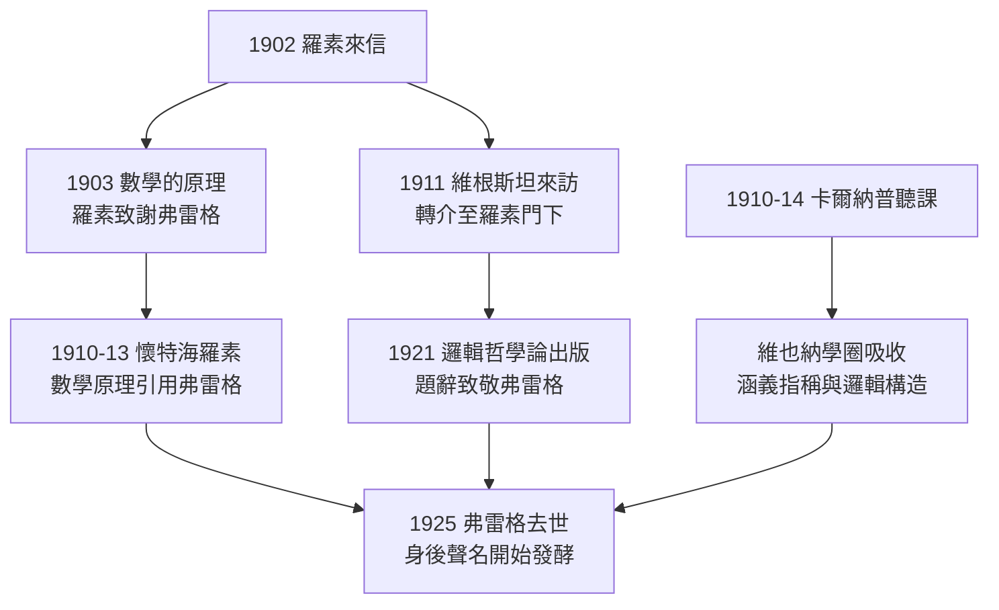

# 3.3 孤獨的晚年（1918）

## 1918 年：離開耶拿

1918 年，七十歲的弗雷格從耶拿大學退休。此時的一戰已進入最後一年，德國經濟瀕臨崩潰，通貨膨脹即將吞沒他微薄的退休金。弗雷格離開任教四十四年的耶拿，遷回故鄉附近的小鎮**巴特克萊嫩**（Bad Kleinen）——距離出生地維斯馬不過幾十里。**從維斯馬出發，繞行邏輯世界一週，最後回到維斯馬旁邊**——弗雷格的地理軌跡，劃了一個近乎完美的圓。

個人生活的記載極少，僅知：

- 1887 年與 Margarete Lieseberg 結婚，妻子 1905 年去世；
- 兩人親生子女皆早夭，弗雷格收養了兒子 Alfred；
- 弗雷格終身幾乎不參與社交，晚年與兒子相依，經濟依賴養子與出版稅收；
- 他一生只有一次出國——1904 年赴挪威短暫旅行；
- 戰時與戰後，他堅持閱讀、寫作、聽音樂（他喜愛瓦格納），偶爾在信中抱怨物價與報紙。

這份稀薄的生活記錄本身，就是「孤獨」二字最好的注腳：一個把全部生命投入思想客觀性的人，留下的私人痕跡幾乎為零。

## 晚年的思想爆發：邏輯研究三部曲

退休沒有讓他停筆。恰恰相反，1918–1923 年，弗雷格發表了他最可讀、影響最深遠的一組哲學論文——**邏輯研究**（Logische Untersuchungen）三部曲：

| 年份 | 篇名 | 主題 |
|------|------|------|
| 1918 | 《思想》（*Der Gedanke*） | 思想是第三王國的客觀實體；斷言與思想之分；真之不可定義 |
| 1919 | 《否定》（*Die Verneinung*） | 否定是思想間的關係，非語言的外在操作 |
| 1923 | 《思想的組合》（*Gedankengefüge*） | 複合思想的組合性，涵義層次的分層 |

《思想》是二十世紀語言哲學的經典開篇：

> **思想**（der Gedanke）不是思維的行為，不是心象，而是可以為真或假的客觀內容。它屬於「第三王國」——既非外在物理世界，亦非內在心理世界。

這一區分沿著《論涵義與指稱》（→ 詳見 2.2）的路線走到底，並被他的課堂學生卡爾納普帶往維也納學圈（→ 詳見 4.2）。今日分析哲學中「命題是抽象對象」的標準立場，文本源頭就是 1918 年這篇論文。

### 為何晚年反而多產

1906 年放棄邏輯主義（→ 詳見 3.2）後，弗雷格卸下了系統建設的重負。條件的三重變化催生了晚年的豐收：

1. **卸下證明包袱**：不再需要兩行一步的符號演繹，可以用自然語言直陳哲學洞見——於是論文第一次「可讀」；
2. **退休清閒**：離開講席與校務，時間完全屬於寫作；
3. **問題升綱**：從「如何用邏輯重建數學」退到「邏輯本身是什麼」——思想、否定、斷言這些更底層的問題。

悲劇性的巧合是：當他終於寫出了人人可讀的哲學，讀者依然寥寥——語言哲學的時代要到 1930 年代才真正來臨。

## 晚年的兩件小事

弗雷格晚年留給學史的記錄稀薄而珍貴：

- **日記**：1918 年前後寫有政治日記，表露強烈的保守與反猶立場。這些日記 1994 年整理出版，使「弗雷格其人」與「弗雷格其學」之間的張力成為學術討論課題——哲學家的客觀思想王國與其私人偏見並存，這一事實本身恰可作為「涵義≠觀念」的殘酷例證：第三王國的思想可以被任何人（包括思想有缺陷的人）把握，而這正是它的客觀性所在；
- **最後的教學**：1910–1914 年間，卡爾納普（→ 詳見 4.2）選修其課，是弗雷格教學生涯唯一一次有「名學生」聽課。卡爾納普的聽課筆記，成為今日重建弗雷格課堂的最好史料；
- **1911 年的訪客**：維根斯坦曾到耶拿拜訪，弗雷格建議他去劍橋找羅素——這次建議間接造就了《邏輯哲學論》（→ 詳見 4.1）。

## 1925 年：謝幕

1925 年 7 月 26 日，弗雷格在巴特克萊嫩去世，享年七十六歲。訃聞極短，學界反響極小。他遺囑囑咐將遺稿交給養子 Alfred，並附言：

> 「我的遺稿將來或許值得一看，尤其未必不值得。」（*meine Schriften mögen vielleicht einmal beachtet werden, insbesondere sind sie es vielleicht nicht unwert.*）

這句克制到近乎悲傷的遺言，寫出了他對身後聲名的清醒估計與最後一絲信心。

## 他生前看到的世界

弗雷格死前，能看到哪些自己的影響？

- **羅素**系統地在著作中致敬，弗雷格之名開始進入英語世界（→ 詳見《羅素傳記》第 2 章）；
- **維根斯坦**的《邏輯哲學論》扉頁印著致敬題辭，但弗雷格讀過手稿後回信坦言大部分讀不懂——師承與決裂同時完成；
- **卡爾納普**帶著聽課筆記走向維也納（→ 詳見 4.2）；
- 但《基本定律》依然絕版，《算術基礎》依然買不到，他本人依然名不見經傳。

弗雷格生前看到的三點微光，死後三十年內將燎原為整個分析哲學與數理邏輯的火場（→ 詳見第 4 章、第 5 章）。

## 關鍵事件年表

| 年份 | 事件 | 意義 |
|------|------|------|
| 1905 | 妻子 Margarete 去世 | 家庭重擔轉向獨處 |
| 1910–1914 | 卡爾納普選修其課程 | 一生最重要的名學生 |
| 1911 | 維根斯坦來訪 | 轉介至羅素，間接成就《邏輯哲學論》 |
| 1918 | 自耶拿退休，遷居巴特克萊嫩 | 任教四十四年落幕 |
| 1918 | 《思想》發表 | 第三王國理論定稿 |
| 1919 | 《否定》發表 | 否定的邏輯地位釐清 |
| 1923 | 《思想的組合》發表 | 組合性原則的涵義層表述 |
| 1925 | 7 月 26 日去世 | 遺言期許身後被閱讀 |
| 1994 | 政治日記整理出版 | 「其人與其學」的張力公開 |

## 小結

弗雷格的晚年是「思想豐產而學界沉默」的最後一幕：離開講席反而寫出最流暢的哲學，最可讀的論文寫給了還不存在的讀者。1925 年他帶著「或許有一天」的期許離世——而這一天來得比他敢想的更徹底：他在世時看似沉沒，身後卻成為整個分析哲學與數理邏輯的源頭活水。下一章，我們沿著三條傳承線——羅素與維根斯坦、卡爾納普、現代語義學——追蹤弗雷格思想如何在其死後三十年間席捲英語哲學。
