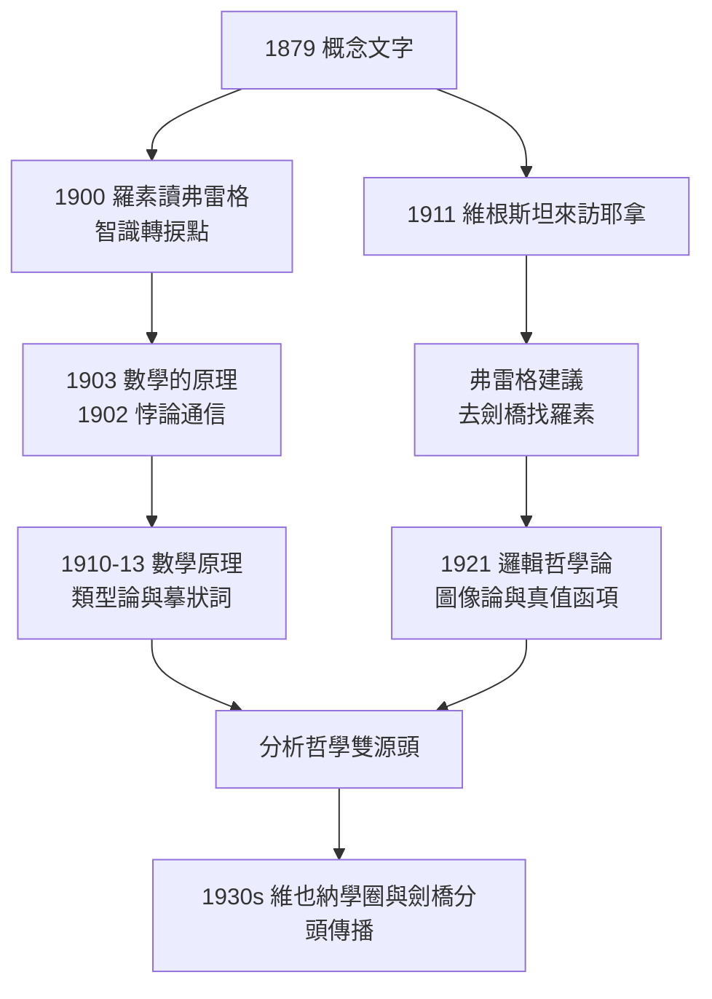

# 4.1 對羅素與維根斯坦的影響

## 死者教導生者：影響的兩條河道

弗雷格生前名不見經傳，但他思想的兩條河道——**羅素的邏輯主義**與**維根斯坦的語言批判**——都在其生前即已開鑿。本章追蹤第一條河道：弗雷格如何塑造羅素與維根斯坦，兩人又如何各自改造他的遺產。

## 羅素：從皮亞諾轉向弗雷格

羅素接觸弗雷格的路徑頗為迂迴：

1. **1900 年 7 月**：羅素在巴黎國際哲學會議上聽皮亞諾演講，驚為天人，旋即鑽研皮亞諾記法（→ 詳見《羅素傳記》第 1 章 1.3）；
2. **1900 年秋**：他讀到弗雷格《算術基礎》，自述「這是智識生涯的轉捩點」——弗雷格對「數」的邏輯分析，遠比皮亞諾的公理骨架深；
3. **1902 年**：讀完《基本定律》第一卷，發現羅素悖論，寫下那封拆台信（→ 詳見 3.1）。

羅素在《數學的原理》（*Principles of Mathematics*, 1903）中專章評述弗雷格，並在《數學原理》（*Principia Mathematica*, 1910–1913，與懷特海合著，→ 詳見《羅素傳記》第 2 章 2.2–2.3）序言中承認：

> 「在所有邏輯分析的問題上，我們主要受惠於弗雷格。」

### 繼承與改造

| 方面 | 弗雷格 | 羅素的改造 |
|------|--------|-----------|
| 記法 | 二維概念線 | 線性皮亞諾式符號 |
| 矛盾處理 | 限制價值域（失敗） | 分支類型論 |
| 概念與對象 | 二層：一階概念／對象 | 二層擴為無窮類型階梯 |
| 摹狀詞 | 名字皆有涵義與指稱 | 摹狀詞理論：限定摹狀詞非名字 |
| 存在 | 二階概念「被例示」 | 沿用，經摹狀詞理論強化 |
| 類 | 價值域（外延抽象） | 類即邏輯構造，非實體 |

最關鍵的改造是**摹狀詞理論**（1905）：弗雷格認為「當今法國國王」這類空缺名詞仍有涵義（故句子仍有意義），羅素則主張摹狀詞須經改寫消去——

$$\text{「當今法國國王是禿頭」} \leadsto \exists x\,\big(\text{King}(x) \wedge \forall y(\text{King}(y) \to y{=}x) \wedge \text{Bald}(x)\big)$$

句子為假且有意義，因為它只是複合量詞式。這一改造開啟了分析哲學的**邏輯構造**傳統：表面語法欺人，邏輯分析還其真面目。兩人分歧的根源值得注意：弗雷格要求每一個名字都有涵義，是為了保住「思想永不落空」的邏輯完滿性；羅素消去摹狀詞，是為了讓本體論承諾可計算——**同一套邏輯，一個用它守護意義，一個用它清理本體**。

## 維根斯坦：從耶拿的一次建議說起

1911 年秋，二十二歲的維根斯坦（→ 詳見《維根斯坦傳記》第 1 章）帶著航空螺旋槳的數學問題到耶拿拜訪弗雷格。弗雷格聽完後說：你在邏輯上需要真正的訓練，**去劍橋找羅素**。維根斯坦依言而行，數學工程師就此轉向哲學。

弗雷格對維根斯坦的影響有三層：

1. **概念文字的啟發**：《邏輯哲學論》的圖像論與「命題是世界的邏輯描畫」之構想，直接脫胎於弗雷格的涵義—指稱結構（→ 詳見 2.2）；
2. **真值函項的繼承**：《邏輯哲學論》把命題處理為基本命題的真值函項，弗雷格在 1879 年即已奠基（→ 詳見 1.3）；
3. **題辭致敬**：1921 年《邏輯哲學論》扉頁印著：「本書或許唯有將其與弗雷格與羅素的偉大著作相對照時，才能真正理解。」

### 分道：思想的邏輯與語言的邏輯

弗雷格把邏輯當作**思想王國**的自然律，維根斯坦則把邏輯當作**語言對世界**的界限。弗雷格相信涵義是公共的第三王國，維根斯坦認為意義即使用、不可說的必須沉默。兩人只在一次通信中正面交鋒（1919 年）：維根斯坦寄去《邏輯哲學論》手稿，弗雷格回信表示大部分讀不懂。師承與決裂，同時完成。

分道後的兩條路線在 1930 年代各自開花：弗雷格—卡爾納普線成為邏輯實證主義與形式語義學的正統；維根斯坦線（晚期《哲學研究》）成為日常語言哲學的旗幟——而兩條線的哲學家們終身都在重讀同一批弗雷格文本（→ 詳見 4.3）。

## 三人張力：同一遺產的三種讀法

- **弗雷格**：邏輯是客觀思想的科學，哲學即邏輯的延伸；
- **羅素**：邏輯是通往數學本體的構造工具，哲學分析即邏輯構造；
- **維根斯坦**：邏輯劃定語言的界限，哲學是澄清而非理論。

三種讀法各自開枝散葉：羅素線經卡爾納普、奎因進入美國分析哲學；維根斯坦線經《哲學研究》轉向日常語言哲學；而弗雷格本人的涵義—指稱理論，在兩條線之間保持獨立生命力（→ 詳見 4.2 與 4.3）。

## 影響的接收時間表

值得驚訝的是，弗雷格的兩個最大「學生」都不是他的學生——影響的接收是分批完成的：

| 時期 | 羅素吸收了什麼 | 維根斯坦吸收了什麼 |
|------|----------------|---------------------|
| 1900–1902 | 邏輯主義、數的定義 | （尚未接觸） |
| 1903–1910 | 《基本定律》的系統技術 | 概念文字的圖像性 |
| 1911–1921 | （已完成繼承） | 真值函項、涵義結構 |
| 1920s– | 摹狀詞理論改造涵義論 | 《哲學研究》全面批判 |

弗雷格從未親自指導過兩人中任何一人——他的影響是**文本性的**、非制度性的。這在思想史上極為罕見：一個孤懸於耶拿的講師，用文字同時改寫了劍橋的兩代人。

## 關鍵事件年表

| 年份 | 事件 | 意義 |
|------|------|------|
| 1900 | 羅素讀《算術基礎》 | 智識轉捩點 |
| 1902 | 羅素—弗雷格悖論通信 | 拆台信與誠實回信 |
| 1903 | 羅素《數學的原理》專章評述 | 弗雷格首次獲英語世界介紹 |
| 1905 | 羅素發表摹狀詞理論 | 對涵義理論的關鍵修正 |
| 1911 | 維根斯坦拜訪弗雷格 | 轉介羅素，哲學人生轉向 |
| 1910–1913 | 《數學原理》出版 | 「主要受惠於弗雷格」 |
| 1919 | 維根斯坦寄手稿，弗雷格回信 | 師承與決裂並至 |
| 1921 | 《邏輯哲學論》出版並致敬 | 弗雷格進入維也納—劍橋主流 |

## 小結

弗雷格對羅素是「被繼承的基礎」，對維根斯坦是「被超越的起點」。羅素把他的邏輯主義改造成類型論的《數學原理》，維根斯坦把他的涵義結構翻轉為語言界限的圖像論。兩條河道在 1930 年代的維也納匯流成分析哲學的主流，而把弗雷格思想直接帶進這場匯流的，是耶拿講堂上唯一認真記筆記的學生——魯道夫·卡爾納普。下一節，我們看課堂傳承的奇蹟：一個晦澀的講師，如何經由一個學生的筆記本，影響了整個二十世紀哲學。
