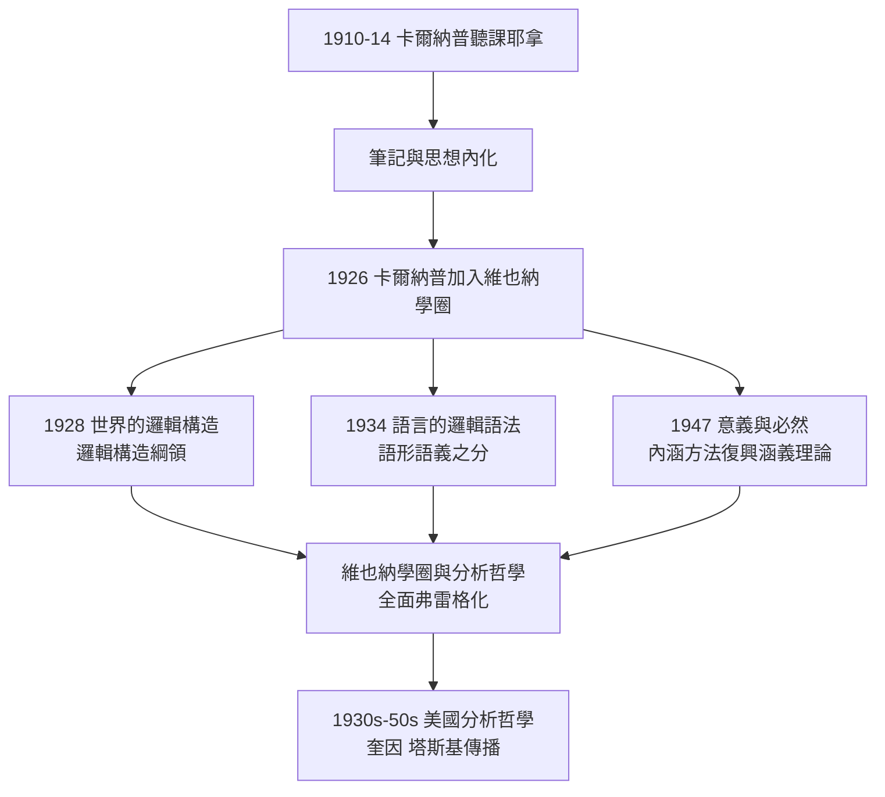

# 4.2 卡爾納普的課堂傳承

## 1910 年：空蕩講堂走進一個學生

1910 年冬季學期，耶拿大學。弗雷格的邏輯課像往常一樣冷清，但這學期選課名單上出現了一個十九歲的名字：**魯道夫·卡爾納普**（Rudolf Carnap，1891–1970，→ 詳見《卡爾納普傳記》）。這個來自巴爾門-多爾斯多夫的年輕人主修數學、物理與哲學，在 1910–1911、1913、1914 年先後選修弗雷格的「概念文字」「數學中的邏輯」「邏輯的基本概念」等課程。

卡爾納普晚年回憶：

> 「弗雷格講課時目光幾乎不看學生，只注視窗外。開始只有三五人，後來只剩兩三人。……但他是我在哲學上真正唯一的老師。」

這句「唯一的老師」，出自日後維也納學圈（Wiener Kreis）的旗手之口——弗雷格孤獨四十四年的講堂，終於結出了它最重要的果實。

## 課堂上學到了什麼

卡爾納普的聽課筆記（1910–1914，今存並已整理出版）顯示，弗雷格課堂上有三個日後成為卡爾納普畢生綱領的核心思想：

### 1. 反心理主義與客觀思想

弗雷格在課堂上反覆強調：邏輯研究的是**思想的客觀內容**，不是思維的心理過程。概念、涵義、真值都是公共對象。卡爾納普日後的「內涵方法」與語義學（→ 詳見 4.3）正是這一立場的形式化。

### 2. 概念的構造

弗雷格課上講過：科學的任務是**從簡單概念構造複雜概念**，正如幾何從點線出發構造一切。卡爾納普把這條線發展為《世界的邏輯構造》（*Der logische Aufbau der Welt*, 1928）——用原初經驗關係邏輯構造出整個認知世界。這是弗雷格「從邏輯重建科學」綱領的認識論放大版：弗雷格重建數學，卡爾納普重建全部知識。

### 3. 語形與語義之分

弗雷格區分表達式的**給出方式**（涵義）與**被指者**（指稱）。卡爾納普 1934 年《語言的邏輯語法》將之分為**語法**（形成規則與變形規則）與**語義**（真值條件與指稱）兩個層面，並直言：「這一區分的基本思想來自弗雷格。」

## 從耶拿到維也納：傳承的接力

弗雷格本人從未到過維也納，與維也納學圈也沒有直接交往。傳承是通過兩個環節完成的：

1. **卡爾納普 1926 年**應石里克之邀加入維也納學圈，將弗雷格式反心理主義帶進這個以馬赫、彭加勒為閱讀起點的團體；
2. **1930 年代**卡爾納普與塔斯基（Tarski）的交往，使弗雷格—塔斯基真值語義學路線成形；塔斯基 1933 年的真定義，被普遍視為對弗雷格「句子指稱是真值」的形式化（→ 詳見 5.3）；
3. **1947 年**卡爾納普《意義與必然》（*Meaning and Necessity*）提出以「內涵」（intension）與「外延」（extension）重述涵義與指稱，並自注：「內涵—外延之分即弗雷格的涵義—指稱之分。」

## 卡爾納普對弗雷格的兩處偏離

傳承不是複印。卡爾納普在兩處明確離開了老師：

- **對形上學的態度**：弗雷格相信「第三王國」是實在的思想領域，卡爾納普則以可證實性原則把形上學判為無意義——他從老師的反心理主義出發，走向了更激進的反形上學；
- **對數學基礎的結論**：弗雷格至死堅持邏輯主義，卡爾納普接受哥德爾不完備定理（1931）後改持「語言框架」約定論——數學命題的真假取決於語言規則的選取，而非邏輯真理本身。

有趣的是，正是這場偏離讓弗雷格的**語義工具**（而非他的數學結論）獨立存活：卡爾納普把涵義理論從邏輯主義中拆出，單獨打磨成哲學語義學的標準裝備。老師的結論死了，老師的方法活了——這是思想傳承最常見也最深刻的形態。

## 課堂傳承的歷史意義

| 環節 | 人物 | 貢獻 |
|------|------|------|
| 源頭 | 弗雷格（耶拿 1910–1914） | 反心理主義、涵義指稱、邏輯構造 |
| 樞紐 | 卡爾納普（耶拿→維也納→洛杉磯） | 語形語義之分、內涵方法、學圈傳播 |
| 匯流 | 維也納學圈＋塔斯基 | 邏輯實證主義與模型論真值語義 |
| 遠播 | 奎因、丘奇（→ 詳見 5.2） | 美國分析哲學與可計算性 |

弗雷格一生只有一位「名學生」，但這一位學生的放大率，超過了任何學派——**課堂的寂寞，最終以幾何級數償還**。

## 課堂筆記的特殊身價

卡爾納普的弗雷格課堂筆記今日已成為重要史料，原因有三：

1. 它記錄了弗雷格**公開出版物中沒有**的課堂表述——如關於邏輯的多元語言觀、對無窮的討論；
2. 它顯示弗雷格晚年（1913–1914）已在課堂上討論羅素悖論與系統修正——這些討論與其遺稿互相印證；
3. 它證明「弗雷格講課晦澀無人聽」的敘事需要修正：冷清的課堂上，坐著的是未來維也納學圈與美國分析哲學的締造者。

## 關鍵事件年表

| 年份 | 事件 | 意義 |
|------|------|------|
| 1910–1914 | 卡爾納普在耶拿選修弗雷格課程 | 弗雷格唯一的名學生 |
| 1926 | 卡爾納普加入維也納學圈 | 弗雷格思想進入學圈 |
| 1928 | 《世界的邏輯構造》出版 | 邏輯構造綱領成形 |
| 1934 | 《語言的邏輯語法》出版 | 語形語義之分正式化 |
| 1947 | 《意義與必然》出版 | 內涵—外延重述涵義—指稱 |
| 1950s | 卡爾納普執教 UCLA | 分析哲學在美國制度化 |

## 小結

弗雷格與卡爾納普的師生緣，是思想史上「一對一放大」的奇觀：晦澀講師 × 學圈旗手 = 分析哲學主流。卡爾納普沒有繼承老師的邏輯主義結論，卻繼承並升級了老師的全部語義裝備。與此同時，另一條更技術化的血統——從弗雷格的概念文字到丘奇的 λ 演算與類型論——正在普林斯頓成形（→ 詳見 5.2）。涵義與指稱的理論本身，則將在戰後語義學中迎來第二次生命。下一節，我們看這場跨越百年的理論遠征。
