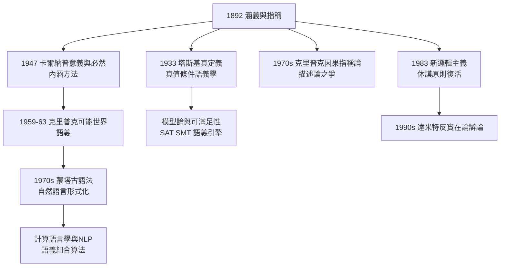

# 4.3 涵義指稱與語義學的現代發展

## 從 1892 到蒙塔古：一條語義學主幹道

《論涵義與指稱》（→ 詳見 2.2）給出三層結構——**表達式 → 涵義 → 指稱**——與組合性原則。戰後語義學的全部主幹道都鋪設在這塊基石上：

$$\llbracket f(a) \rrbracket = \llbracket f \rrbracket(\llbracket a \rrbracket)$$

### 塔斯基：真值條件語義學

塔斯基 1933 年《形式化語言中的真概念》用後設語言給出真謂詞的遞迴定義，直接回應弗雷格「句子指稱是真值」的洞見（→ 詳見《卡爾納普傳記》語義學章節）。模型論（Tarskian model theory）從此成為數理邏輯的標準語義——弗雷格 1879 年只有句法，1933 年之後，句法終於配上了嚴格的語義。

### 蒙塔古：英語即邏輯

理查德·蒙塔古（Richard Montague, 1930–1971）1960–70 年代完成「蒙塔古語法」：自然語言片段可與邏輯語言同構處理，每一個詞項都配備內涵邏輯的語義值。他的口號是「英語與形式語言之間沒有任何重要的理論差別」——這正是弗雷格組合性原則的極端化。內涵邏輯中的 $\lambda$ 抽象用於合成複雜謂詞：

$$\lambda x\,\neg\Diamond\,(\text{Horse}(x))$$

### 可能世界語義學：涵義的模型化

克里普克（Saul Kripke，→ 詳見《維根斯坦傳記》第 4 章）1959–1963 年建立可能世界語義學，使卡爾納普 1947 年的內涵方法獲得嚴格數學形式（→ 詳見 4.2）：

- **外延**：表達式在**一個**可能世界中的指稱；
- **內涵**：表達式**從每個可能世界到其外延的函數**——即弗雷格涵義的函數化替代品。

「晨星 = 昏星」（→ 詳見 2.2）在這套語義中釐清為：兩個名字的外延（金星）相同，內涵（呈現方式）不同。弗雷格 1892 年的兩難，在 1963 年獲得完形。

## 當代語義學中的弗雷格遺產

| 領域 | 弗雷格源頭 | 現代形態 |
|------|-----------|----------|
| 形式語義學 | 組合性原則 | 蒙塔古語法、類型邏輯語義學 |
| 指稱理論 | 涵義—指稱之分 | 描述論 vs 直接指稱之爭 |
| 心靈哲學 | 思想即命題 | 命題態度的邏輯分析 |
| 語用學 | 間接指稱（思想層次） | 信念語境與態度動詞語義 |
| 認知語義 | 概念即函數 | 分支量詞、動態語義學 |
| 數學哲學 | 休謨原則 | 新邏輯主義 |

### 描述論 vs 直接指稱之爭

弗雷格用涵義（呈現方式）解釋名字如何指稱，羅素用摹狀詞改寫（→ 詳見 4.1），這條路線被唐納蘭與克里普克 1970 年代挑戰：「名字是嚴格指示詞，直接釘住對象，不經描述。」克里普克—帕特南的因果指稱論席捲一時，但反方（如 Searle、Evans）指出：不經涵義，名字的**認知價值**（為何「晨星=昏星」有信息量？）仍需弗雷格式答案。這場論戰至今未決——**它是弗雷格 1892 年問題的直接延續**。

### 新邏輯主義：休謨原則的復活

1983 年 Crispin Wright 與 Bob Hale 重讀《算術基礎》（→ 詳見 2.1）：弗雷格其實不必需要第五基本定律（→ 詳見 2.3），**休謨原則本身**即可推出二階算術的全部公理，而且休謨原則被證明與羅素悖論**相容**（休謨原則＋任何價值域抽象原則可同真）。這場「新邏輯主義」（neo-logicism）運動，使弗雷格的算術哲學在死後六十年重新成為數理邏輯的前沿課題——1906 年弗雷格的「退路」（→ 詳見 3.2），後人走成了「出路」。

### 分析哲學的「弗雷格轉向」

達米特（Michael Dummett, 1925–2011）1973 年《弗雷格：語言哲學》提出一個影響深遠的史觀：

> 分析哲學運動的起點，是弗雷格 1884 年執行語境原則的那一刻——**意義的探詢從對象轉向語言**。

達米特的兩卷本弗雷格研究使弗雷格成為英語哲學的「共同文本」，並將其思想延伸為反實在論綱領。弗雷格的身後聲名，一半是羅素與維根斯坦的傳播（→ 詳見 4.1），一半是達米特的重新發掘。

## 弗雷格式問題的持續生產力

語義學的每一次升級，都在重新回答弗雷格的三個老問題：

1. 一個表達式**如何**指到它的對象？（涵義的機制）
2. 兩個指同一對象的表達式**為何**不互換？（認知價值）
3. 整句的意義**如何**由部分組合而成？（組合性）

## 關鍵事件年表

| 年份 | 事件 | 意義 |
|------|------|------|
| 1892 | 弗雷格《論涵義與指稱》 | 三層語義結構與組合性原則 |
| 1933 | 塔斯基形式真概念 | 真值條件語義學誕生 |
| 1947 | 卡爾納普《意義與必然》 | 內涵—外延方法的弗雷格化 |
| 1959–1963 | 克里普克可能世界語義 | 內涵的嚴格數學化 |
| 1970–1973 | 蒙塔古語法；達米特《弗雷格》 | 自然語言形式化；弗雷格成為共同文本 |
| 1970s | 克里普克因果指稱論 | 描述論之爭爆發 |
| 1983 | 賴特、黑爾新邏輯主義 | 休謨原則獨立於第五定律復活 |
| 1990s– | 動態語義、計算語義 | 組合性進入計算機科學 |

## 小結

涵義與指稱的區分，是二十世紀語義學的單一起源點：塔斯基、卡爾納普、克里普克、蒙塔古、達米特各自取其一環，鑄成真值條件語義學、內涵方法、可能世界語義、形式語法與反實在論。弗雷格 1892 年的兩難——晨星為何不等於昏星——至今仍在描述論之爭中被重新翻案。而在更技術的另一側，他的概念文字正在孕育另一場革命：從希爾伯特的元數學到丘奇的 λ 演算，再到今日的程式語言與 AI。下一章，我們沿著計算之路，看弗雷格的邏輯如何成為機器的語言。
