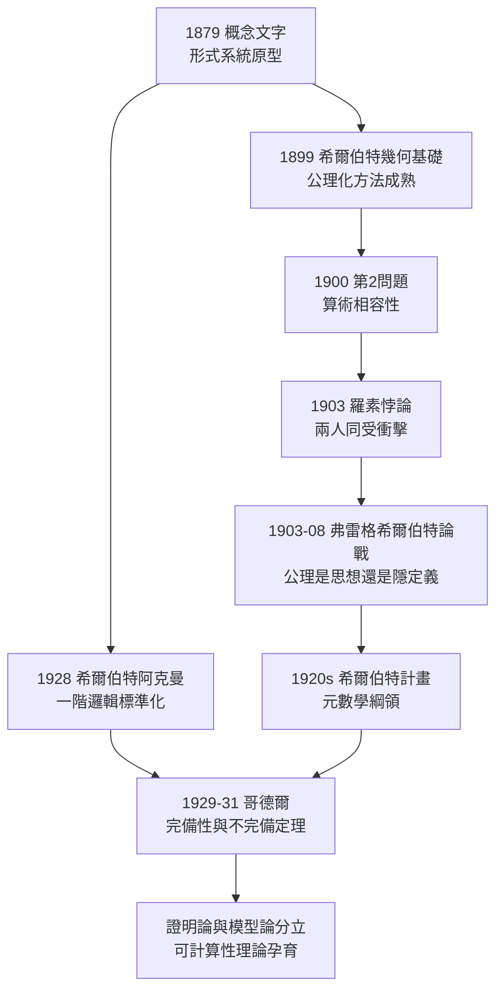

# 5.1 希爾伯特計畫的邏輯基礎

## 同一問題的兩代答案

1900 年 8 月，巴黎第二屆國際數學家大會，哥廷根的大衛·希爾伯特（David Hilbert，1862–1943，→ 詳見《希爾伯特傳記》第 1 章）提出 23 個問題，**第 2 問題**直指弗雷格畢生的戰場：

> 「算術公理的相容性。……必須為算術公理系統給出嚴格的、同時也是最一般的相容性證明。」

弗雷格比希爾伯特年長十四歲，兩人面對同一問題卻給出對立的答案：

- **弗雷格**：算術的相容性無需證明——它們是**邏輯真理**，邏輯不可能有矛盾；
- **希爾伯特**：邏輯本身也需公理化，相容性必須作為**數學證明的對象**，用受限的元數學方法證出。

1903 年羅素悖論（→ 詳見 3.1）同時動搖兩人：弗雷格的「邏輯當然相容」破產，希爾伯特的第 2 問題驟然緊迫。

## 弗雷格—希爾伯特論戰（1903–1908）

論戰在書信與《幾何學基礎》的爭議中展開，核心分歧是「**公理是什麼**」：

| 立場 | 弗雷格 | 希爾伯特 |
|------|--------|----------|
| 公理 | 表達**思想**，真假獨立於系統 | **隱定義**（implicit definition），界定詞項的意義 |
| 一致性 | 思想的屬性，先驗可信 | 需要元數學**證明**的屬性 |
| 幾何 | 綜合先驗的真理系統 | 公理遊戲：「桌子上、椅子上、啤酒杯上皆可代點」 |
| 意義 | 先於系統，來自涵義（→ 詳見 2.2） | 從系統的公理關係中獲得 |

希爾伯特的名言——公理系統中「點、線、面」可以換成任何詞，只要公理仍相容——在弗雷格看來是**取消意義**：沒有涵義的符號如何談論真理？這正是涵義—指稱理論（→ 詳見 2.2）的立場底牌。希爾伯特則回敬：正因為符號可以意義中立，數學才能成為**純形式的遊戲**，相容性才是可研究的數學對象。

弗雷格的論戰書信寫得克制而鋒利，他反覆追問：「如果『點』不指任何東西，『點在線上』表達的是什麼思想？」希爾伯特則以《幾何學基礎》的實際成功回應——公理化方法在數學內部的生產力，使哲學抗議顯得蒼白。論戰無果而終，但歷史站在了兩邊各取一半：**弗雷格供給了句法與語義的區分，希爾伯特供給了元數學的證明技術**。

## 希爾伯特計畫中的弗雷格元件

1920 年代，希爾伯特與 Bernays、Ackermann 系統化元數學綱領（→ 詳見《希爾伯特傳記》第 5 章 5.1），其技術骨架的三個部分，每一個都有弗雷格的簽名：

1. **形式系統的概念**：希爾伯特的形式主義系統（公理＋形成規則＋變形規則）完全是弗雷格《概念文字》（→ 詳見 1.3）與《基本定律》（→ 詳見 2.3）的推廣——希爾伯特在《數學基礎》中明言弗雷格與羅素是形式化的先驅；
2. **一階謂詞邏輯的標準化**：希爾伯特—阿克曼《理論邏輯基礎》（1928）把弗雷格的量詞邏輯整理為今日教科書中的一階邏輯；
3. **完備性問題**：1928 年希爾伯特把「弗雷格系統是否完備」列為正式問題——**哥德爾 1929 年的博士論文證明其一階邏輯完備**，1930 年又證明算術不完備。前者是弗雷格系統的加冕，後者是邏輯主義與希爾伯特計畫的雙重句點（→ 詳見《希爾伯特傳記》第 5 章）。

哥德爾不完備定理對兩位先驅各有一判：弗雷格的夢想（算術＝邏輯真理全體）被證明不可完全實現，但弗雷格的工具（一階謂詞邏輯）被證明完美無缺。**夢碎而工具不朽**——這是對弗雷格遺產最精確的判詞。

## 論戰的意外收穫：可滿足性與模型論

弗雷格與希爾伯特爭執中產生的概念——**系統內的真理**（弗雷格式）與**相對於解釋的可滿足性**（希爾伯特式）——日後分化為兩大分支：

- **證明論**（proof theory）：把證明本身當作符號串研究——弗雷格的演繹規則成為研究對象；
- **模型論**（model theory）：把解釋與真值賦值當作數學結構——希爾伯特的「桌子上的點」成為結構的定義。

哥德爾完備性定理把兩者焊死：**弗雷格系統的定理，恰好是在一切結構中為真的語句**。句法與語義在 1929 年重逢——弗雷格若能看到這條定理，會承認這是他「涵義決定指稱」的最高形式化。

## 對計算科學的遠期饋贈

希爾伯特計畫雖然在 1931 年被哥德爾終結，但它的「失敗產品」卻成為計算機科學的資產：

- 為相容性證明定義的「機械證明程序」，被圖靈（→ 詳見《圖靈傳記》）1936 年證明不存在——但這個否定性結果同時定義了**通用圖靈機**；
- 希爾伯特—伯奈斯—哥德爾式的證明論技術，成為今日**證明助手**（Lean、Coq）的祖先；
- 一階邏輯的完備性＋算術的不完備性，劃定了**一切自動推理系統**的能力邊界（→ 詳見 5.3）。

弗雷格—希爾伯特論戰的雙方，就這樣共同簽署了計算時代的出生證明。

## 關鍵事件年表

| 年份 | 事件 | 意義 |
|------|------|------|
| 1899 | 希爾伯特《幾何學基礎》 | 公理化方法與隱定義 |
| 1900 | 希爾伯特第 2 問題 | 算術相容性成為正式問題 |
| 1903 | 羅素悖論 | 邏輯主義與形式主義共同起跑 |
| 1903–1908 | 弗雷格—希爾伯特書信論戰 | 公理觀的世紀對決 |
| 1920s | 希爾伯特計畫成形 | 元數學綱領系統化 |
| 1928 | 希爾伯特—阿克曼一階邏輯 | 弗雷格系統標準化 |
| 1929–1931 | 哥德爾完備性與不完備性 | 弗雷格句法＋希爾伯特語義的合流與極限 |
| 1936 | 圖靈論文 | 希爾伯特判定問題的否定解答與通用計算誕生 |

## 小結

希爾伯特計畫表面上是弗雷格的對立面——一個要證明相容性，一個認為無需證明——實際上是弗雷格遺產的最大規模工程化：形式系統、演繹規則、量詞邏輯全部來自耶拿，元數學視角來自哥廷根。哥德爾在 1929–1931 年同時加冕與終結了這個計畫，而下一代的邏輯學家丘奇，將從計畫的廢墟中撿起弗雷格的另一件遺物——函數概念——鑄成 λ 演算。下一節，我們追蹤這條通往可計算性的血統。
