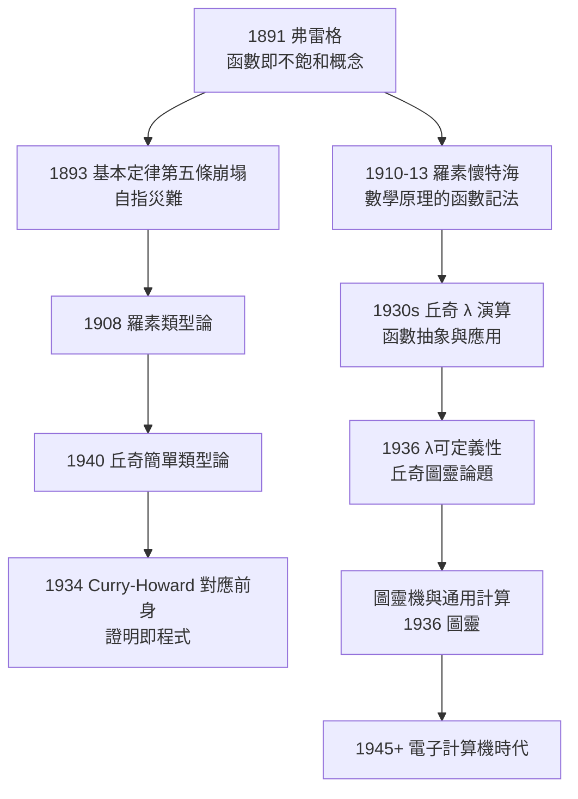

# 5.2 丘奇 Lambda 演算與型別理論中的弗雷格血統

## 函數概念的遠征

弗雷格 1891 年《函數與概念》把數學函數徹底推廣：函數是**不飽和的**、可逐級抽象的運算模式——從 $x+1$ 到「$x$ 是人」，再到取函數為主目的二階函數。這個推廣是兩場革命共同的種子：

- **邏輯革命**：謂詞即函數，量詞即二階函數（→ 詳見 1.3）；
- **計算革命**：可計算函數、λ 演算、型別系統——本節的主題。

## 丘奇：從弗雷格—羅素類型到 λ 演算

阿隆佐·丘奇（Alonzo Church，1903–1995，→ 詳見《丘奇傳記》）在普林斯頓的博士訓練直接浸潤於《數學原理》傳統。他 1930 年代發明 λ 演算，初衷正是**為弗雷格—羅素的函數概念給出最經濟的記法**：

$$\lambda x.\,(x+1) \qquad \text{——「將 } x \text{ 映射到 } x+1 \text{ 的函數」}$$

- $\lambda x.\,M$ 是函數抽象（弗雷格的「不飽和」被記號化）；
- $M\,N$ 是函數應用（弗雷格的「飽和」）；
- 一切邏輯與算術對象皆可由 λ 項構造——這是**運算版的邏輯主義**。

### 簡單類型論：對悖論的技術回答

裸的 λ 演算會產生自指災難：$(\lambda x.\,x\,x)(\lambda x.\,x\,x)$ 化簡永不終止——這正是羅素悖論的計算版。丘奇 1940 年《型別論的公式化》引入**簡單類型論**（simple theory of types）：

> 每個項都有型別，函數只能應用於型別匹配的主目——自指在型別層面上**不可表達**。

$$\sigma \;::=\; \iota \mid o \mid (\sigma \to \tau)$$

型別 $\sigma \to \tau$ 的函數吃 $\sigma$ 吐 $\tau$。這條路線的譜系清晰可辨：

$$\text{弗雷格的概念分層} \;\to\; \text{羅素分支類型論} \;\to\; \text{丘奇簡單類型論} \;\to\; \text{現代型別系統}$$

弗雷格 1892 年「概念與對象不可混淆」（→ 詳見 2.2）的哲學戒律，在 1940 年成為編譯器的靜態檢查——哲學的誡命變成機器的鐵律，這是弗雷格血統中最長的一支。

## 丘奇—圖靈論題：計算的可定義性

1936 年，丘奇用 λ 可定義性刻畫「能有效計算」，圖靈（Alan Turing，1912–1954，→ 詳見《圖靈傳記》）用圖靈機刻畫同一概念，兩者被證明等價——**丘奇—圖靈論題**成立。弗雷格的鏈條在這裡閉合：

## Curry–Howard 對應：證明即程式

1934 年 Curry 觀察到 λ 演算與直覺主義命題邏輯的規則同構；1969 年 Howard 系統化為 **Curry–Howard 對應**：

$$\text{證明} \equiv \text{程式}， \qquad \text{命題} \equiv \text{型別}， \qquad \text{化簡} \equiv \text{求值}$$

弗雷格公理 $P \to (Q \to P)$（→ 詳見 1.3）在對應中就是恆等函數的型別——**弗雷格 1879 年的公理，在 1969 年讀出了程式語義**。這條對應是今日證明助手（Coq、Lean、Agda）與函數式程式設計的理論脊柱。

## 型別理論的弗雷格基因清單

| 現代技術 | 弗雷格源頭 | 中間環節 |
|----------|-----------|----------|
| λ 演算 | 函數即不飽和實體（1891） | 羅素記法、Curry 組合邏輯 |
| 靜態型別檢查 | 概念／對象不可混淆（1892） | 羅素分支類型論（1908） |
| 依值型別 | 二階函數、概念的數（1884） | Martin-Löf 類型論（1971） |
| 組合子邏輯 | 組合性原則（1892） | Curry 1920s–30s |
| 歸納類型 | 數學歸納的形式化（1893） | 直覺主義類型論 |
| 形式化數學 | 《基本定律》的機械化證明 | Lean、Coq 的證明助手 |

依值型別（dependent types）尤其值得注意：Martin-Löf 1971 年的類型論允許型別依賴於項——「$n$ 維向量的型別」隨 $n$ 而變。這正是弗雷格「概念的數 $N_x Fx$」這種二階構造（→ 詳見 2.1）的類型論轉世：弗雷格用價值域捕捉概念，依值型別用型別族捕捉概念——兩者都被同一個困境驅動：**如何把性質本身變成可操作的對象**。

## 從悖論到工程：弗雷格災難的產業化

弗雷格系統 1902 年的崩塌（→ 詳見 3.1），百年後直接供養了三個產業：

1. **程式語言**：ML（1973）、Haskell（1990）的型別系統拒絕一切「型別不匹配」的表達式——羅素悖論成為編譯錯誤；
2. **硬體驗證**：晶片與協定用機器檢查的形式規格描述，底層是一階邏輯與型別論；
3. **數學的形式化**：Lean 數學庫把《基本定律》式的夢想（全部數學機械可查）重新拾起——這次地基用的是依值類型論，不再是無限制的價值域。

弗雷格若地下有知，大概會說：**大廈要重建，但這次得先立好樑柱**——型別正是樑柱。

## 關鍵事件年表

| 年份 | 事件 | 意義 |
|------|------|------|
| 1891 | 弗雷格《函數與概念》 | 函數概念徹底推廣 |
| 1932–1936 | 丘奇建立 λ 演算 | 函數抽象的形式系統 |
| 1936 | 丘奇—圖靈論題 | 可計算性的標準刻畫 |
| 1940 | 丘奇簡單類型論 | 型別防自指 |
| 1934/1969 | Curry–Howard 對應 | 證明即程式 |
| 1971 | Martin-Löf 依值類型論 | 邏輯主義的構造主義轉生 |
| 1973/1990 | ML、Haskell | 型別系統進入工程 |
| 1980s– | Coq、Lean、Agda | 證明助手與形式化數學 |

## 小結

從耶拿的「不飽和函數」到普林斯頓的 λ 項，再到依值型別的證明助手，弗雷格的函數概念完成了一場百年遠征：它先是邏輯的（謂詞即函數），後是數學的（型別論），最後成為工程的（程式語言）。而弗雷格的謂詞邏輯本身，還有一條更接近日常工程的血統——SQL 的查詢、Prolog 的推理、知識圖譜的表示。下一節，我們看謂詞邏輯如何成為程式語言與人工智慧的底層語言。
