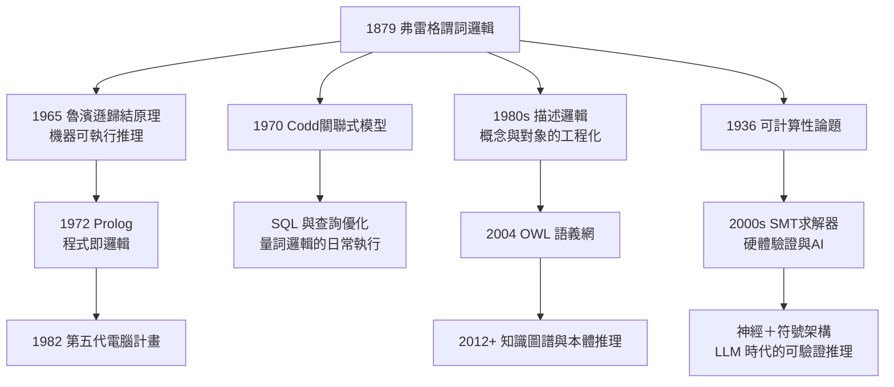

# 5.3 謂詞邏輯成為程式語言與 AI 知識表示的基礎

## 從量詞到查詢：邏輯成為機器語言

弗雷格 1879 年鑄造謂詞邏輯（→ 詳見 1.3）時，夢想的是「思維的形式語言」。他沒有夢到的是：一百三十年後，這門語言每天被數十億次機器執行——在資料庫查詢、在程式驗證器、在 AI 的推理引擎裡。本節追蹤謂詞邏輯的四條工程血統：**邏輯程式設計、關聯式資料庫、知識表示、自動推理與驗證**。

## 血統一：Prolog 與邏輯程式設計

1972 年，馬賽的 Alain Colmerauer 與愛丁堡的 Robert Kowalski 各自發展出一個激進想法：**程式即邏輯子句，執行即證明**。這就是 Prolog（Programming in Logic）：

```prolog
parent(tom, mary).
parent(mary, ann).
ancestor(X, Y) :- parent(X, Y).
ancestor(X, Y) :- parent(X, Z), ancestor(Z, Y).
?- ancestor(tom, ann).   % true
```

- 事實與規則就是霍恩子句（Horn clauses）——量詞邏輯的受限片段；
- 查詢 `?- ancestor(tom, ann)` 的求值過程，就是**歸結（resolution）證明**；
- 證明論（→ 詳見 5.1）從元數學變成了執行模型。魯濱遜 1965 年的歸結原理，把弗雷格—根岑的演繹規則壓縮成一條機器可執行規則。

**第五代電腦計畫**（1982–1992，日本）把 Prolog 推上國家戰略，雖然目標未竟，卻使「邏輯即計算」深入人心。Kowalski 的口號「算法 = 邏輯 + 控制」正是弗雷格式思想的編程版本：**寫下什麼為真（邏輯），機器自己找出怎麼算（控制）**。

## 血統二：SQL 與關聯式資料庫

1970 年，IBM 的 E. F. Codd 發表關聯式模型：資料是**關係**（relation），查詢是**謂詞邏輯公式**。Codd 明言其數學基礎是一階謂詞演算：

```sql
SELECT name FROM emp
WHERE salary > 50000
  AND EXISTS (SELECT 1 FROM dept
              WHERE dept.id = emp.dept_id AND city = 'Jena');
```

這句 SQL 正是下式的語法糖：

$$\exists d\,\big(\text{Dept}(d) \wedge d.\text{city} = \text{'Jena'} \wedge \text{Emp}(e) \wedge e.\text{salary} > 50000 \wedge e.\text{dept} = d\big)$$

- **關係代數**與**關係演算**被 Codd 證明等價——演算的那一半就是弗雷格的量詞邏輯；
- 今日每一筆 SQL 查詢，本質上都是一次量詞邏輯求值；
- **查詢優化器**的核心問題（查詢蘊含、可滿足性檢查）直接是邏輯問題（→ 詳見 5.1 的模型論分支）。

## 血統三：AI 知識表示

人工智慧的「知識表示與推理」（KR&R）傳統，把弗雷格邏輯當作知識的通用編碼：

| 系統 | 年代 | 邏輯基礎 |
|------|------|----------|
| 邏輯理論家（紐厄爾—西蒙） | 1956 | 命題邏輯證明器 |
| 描述邏輯（DL） | 1980s– | 一階邏輯可判定片段 |
| OWL 語義網本體語言 | 2004 | 描述邏輯的 Web 標準化 |
| 知識圖譜（Google 等） | 2012– | 三元組＋蘊含推理 |
| SMT 求解器（Z3 等） | 2000s– | 一階邏輯可滿足性模理論 |

**描述邏輯**是最佳範例：它用「概念（類）＋角色（關係）＋公理」表示本體，正是弗雷格概念—對象之分（→ 詳見 2.2）的工程化。OWL 語句：

$$\text{Professor} \sqsubseteq \text{Person} \sqcap \exists\,\text{teaches}.\text{Course}$$

（教授是被「教授」這一概念包含、且教授課程的人）——語法是描述邏輯，語義仍是一階模型論。2023 年以降的大型語言模型浪潮並未淘汰這條血統，反而凸顯其價值：LLM 負責語言生成，符號邏輯負責可驗證的推理——「神經＋符號」架構中的符號一側，依然是弗雷格的遺產。

## 血統四：自動推理與形式驗證

1936 年圖靈證明希爾伯特判定問題無解（→ 詳見 5.1），但這個否定結果內藏建設性：

- **半可判定**：一階邏輯的有效式可以列舉——自動定理證明器因此可能（歸結原理 1965）；
- **可判定片段**：描述邏輯、霍恩子句、可判定算術理論——SMT 求解器（Z3 等）靠這些片段驗證晶片、協定與編譯器；
- **證明助手**：Lean、Coq 用依值類型論（→ 詳見 5.2）把「弗雷格式機械可查的證明」變成日常工具，數學家已用它形式化了素數定理與液態晶體的存在定理。

## 三條血統的合流圖



## 為什麼是弗雷格的邏輯勝出

工程史選擇謂詞邏輯而非其他形式系統，有三個弗雷格式理由：

1. **表達力恰好**：一階邏輯足以表達關係、量詞、組合結構，又比高階邏輯可判定性好——這個「恰到好處」的系統正是弗雷格 1879 年定下的範圍；
2. **組合性可機械化**：語義由部分機械決定（→ 詳見 2.2），這才可能有解析器、優化器、求解器；
3. **句法語義分離**：證明（句法）與真理（語義）的分離（→ 詳見 5.1），使「程式正確性」本身成為可證明的數學命題。

## 關鍵事件年表

| 年份 | 事件 | 意義 |
|------|------|------|
| 1879 | 弗雷格謂詞邏輯 | 一切工程血統的源頭 |
| 1936 | 圖靈機與 λ 可定義性 | 邏輯與計算合流（→ 詳見 5.2） |
| 1956 | 邏輯理論家程式 | AI 用邏輯推理起家 |
| 1965 | 魯濱遜歸結原理 | 自動定理證明的引擎 |
| 1970 | Codd 關聯式模型 | 資料庫奠基於一階邏輯 |
| 1972 | Prolog 誕生 | 邏輯程式設計成形 |
| 1982 | 日本第五代電腦計畫 | 邏輯推理的國家級賭注 |
| 1980s | 描述邏輯成形 | 知識表示的可判定基礎 |
| 2004 | OWL 成為 W3C 標準 | 語義網落地 |
| 2012– | 知識圖譜、LLM 時代 | 符號邏輯與神經網路互補 |

## 小結

弗雷格鑄造謂詞邏輯，是為了讓思想有一種無歧義的語言；工程世界拿走這門語言，讓機器執行思想。SQL 每秒數百萬次的查詢、OWL 本體裡的每條公理、SMT 求解器驗證的每片晶片，都是 1879 年那本無人問津小書的後裔。弗雷格生前說他的著作「或許有一天值得一看」（→ 詳見 3.3）——這一天不僅來了，而且是以他無法想像的形態到來：他的邏輯不再只是被閱讀，而是被**執行**。從維斯馬的港灣到矽谷的晶片，這條邏輯之路走了近一百五十年，而且仍在延伸。
