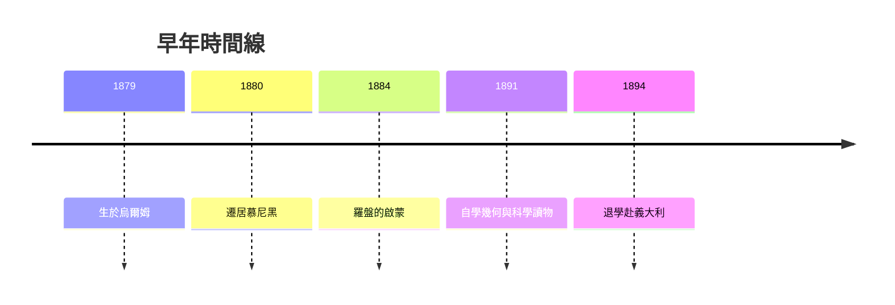

# 1.1 烏爾姆與慕尼黑的童年（1879–1894）

1879年3月14日，愛因斯坦出生於德國烏爾姆的一個猶太中產家庭，翌年全家遷至慕尼黑。父親赫爾曼與叔叔雅各布經營電氣工廠，家中瀰漫著新興電氣工業的氣氛——這與他日後終生關注電磁理論有微妙的淵源。幼年時他並不早慧，說話遲緩，但對機械與幾何表現出強烈的好奇。五歲時父親給他的羅盤，讓他第一次體會到「隱藏在事物背後的規律」：指針的偏轉必然由某種看不見的場所致。這個「場」的概念，將貫穿他的一生。

十歲前後，家中邀請的猶太醫學生塔爾穆德帶來通俗科學讀物與伯恩斯坦的《自然科學大眾讀本》，少年愛因斯坦因此自學了數學與力學。十二歲那年，他得到一本歐幾里得幾何，自稱經歷了「神聖的幾何小書」帶來的精神震撼——由少數公理出發可以推出確定無疑的結論，這種演繹之美成為他終身的思維範式。

然而學校經驗恰恰相反。慕尼黑的盧伊特波爾德中學崇尚軍事化的死記硬背，與他崇尚自由探究的天性格格不入。1894年家中工廠因經營不善遷往義大利帕維亞，十五歲的愛因斯坦隨即設法退學赴義大利與家人團聚，放棄了德國國籍。這次逃離既是他個人自由的選擇，也埋下了他日後拒絕德意志威權文化、自認世界公民的種子。

## 因果分析

童年的三個關鍵事件構成因果鏈：羅盤引發對「場」的好奇 → 幾何小書建立公理化演繹的思維習慣 → 死板學校教育逼他離開體制自學。前者決定了他終生追問「看不見的規律」的研究方向（後來的電磁場與重力場），中者決定了他的研究方法（從原理出發的演繹而非歸納），後者則塑造了他反權威的性格。三者的合力，使他能夠在日後敢於質疑牛頓的絕對時空——那是當時所有受體制教育者不敢或不能質疑的公理。
