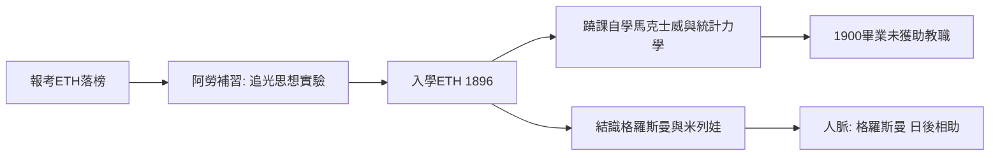

# 1.2 蘇黎世聯邦理工學院的求學時代（1895–1900）

1895年，十六歲的愛因斯坦以同等學力報考蘇黎世聯邦理工學院（ETH），雖因法文、生物等科目落榜，但數學與物理的卓越成績使他被推介至阿勞州立中學補習一年。阿勞的自由教育讓他如魚得水，並在這一年誕生了一個著名思想實驗：若以光速追趕一束光，會看到什麼？按牛頓力學應看到凍結的波形，但馬克士威方程不允許這樣的解。這個矛盾在他心中埋藏十年，成為狹義相對論的起點。

1896年他正式入學蘇黎世聯邦理工的數學物理師資培養部，目的是取得教師文憑。他與同學格羅斯曼結為摯友——後者在廣義相對論的數學關頭將再次扮演關鍵角色；他也結識了同班同學米列娃·馬里奇，日後的第一任妻子。大學時代的愛因斯坦並非「模範生」：他常蹺掉韋伯的物理課，自學馬克士威、赫茲、玻爾茲曼等當時尚未進入正課的理論，靠格羅斯曼的筆記應付考試。

這種「課堂之外的自學」在當時看似懶散，實則是精準的投資：1900年時，德語物理界的正統是牛頓—韋伯式的力學綱領，而愛因斯坦把時間押在電磁理論與統計力學這兩門邊緣學科上。1900年他以平均成績尚可的表現畢業，卻因與教授韋伯關係不佳，成為同屆唯一未獲助教職位的畢業生。

## 因果分析

這一節的因果核心是「自學清單決定了問題清單」。因為課堂給的是力學正統，他自學的卻是電磁學與統計力學——這兩者恰好是1905年三大論文的雙引擎：電磁學催生了狹義相對論，統計力學催生了布朗運動與光量子論文。而追光悖論在十六歲的提出，顯示他早年在阿勞的自由環境允許他保存這個「不合理」的問題達十年之久。畢業即失業則是反面的推力：正因被學院拒於門外，他才能以局外人身分，不受權威框架束縛地重寫物理學的基礎。
