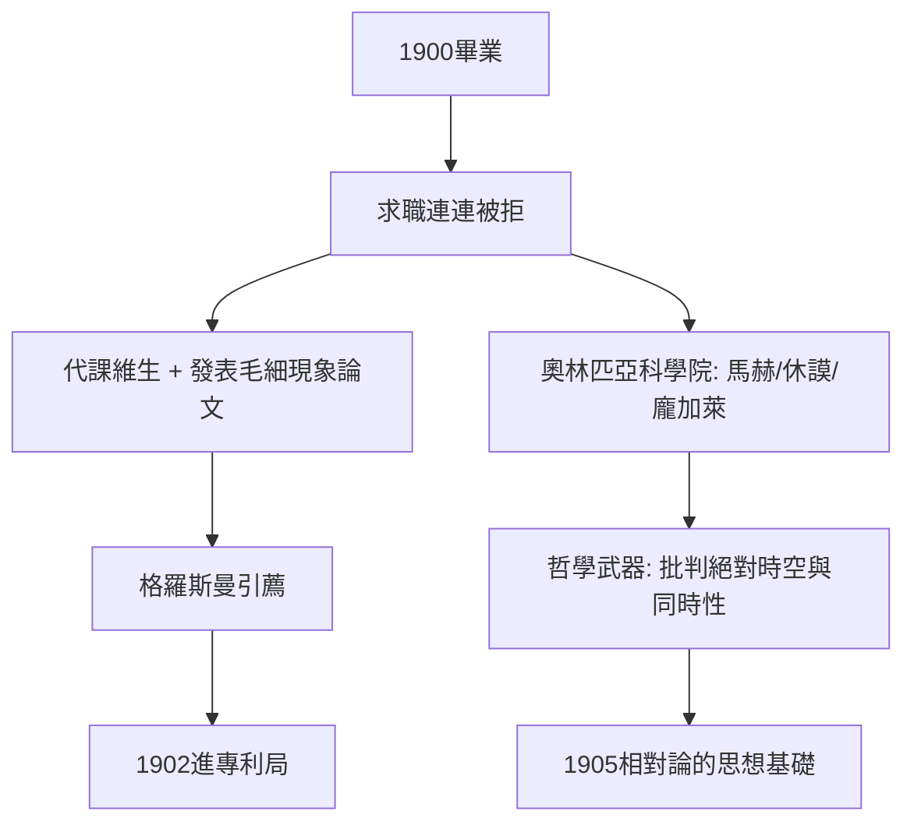

# 1.3 畢業即失業：馬克士威方程的陰影（1900–1902）

1900年畢業後，愛因斯坦陷入長達近兩年的求職失敗。他申請蘇黎世、哥丁根等地的大學助教職皆被拒，一說與其特立獨行的風格及和韋伯的交惡有關，也有證據指向當時瑞士學術圈潛在的反猶氛圍。期間他入籍瑞士（1901年取得國籍），靠臨時代課維生，卻始終沒有放棄理論物理：1901年他發表了第一篇論文，探討毛細現象，試圖用分子力統一重力與內聚力——這個統一之夢從此一生未竟。

這段失業期並非純然的挫折，而是思想上的深潛。正是在這段顛簸歲月，他系統地重讀馬克士威與洛倫茲的電動力學，並在1901—1902年間與義大利朋友貝索、索洛文、哈比希特組成自嘲的「奧林匹亞科學院」，輪流研讀馬赫、休謨、龐加萊與斯賓諾莎。馬赫對牛頓絕對時空的批判、休謨對「同時性」等概念依賴操作定義的提醒、龐加萊《科學與假設》中對「同時性的定義」的討論，都直接餵養了1905年的相對論論文——愛因斯坦晚年承認，這些哲學閱讀使他「有自由批判的基本概念之權利」。

1902年6月，命運出現轉機：格羅斯曼透過父親的人脈，把他推薦到伯恩瑞士專利局擔任三級技術員。這份「體面的公務員工作」讓他第一次有了穩定收入與大量業餘時間。

## 因果分析

這一節展示了「失敗如何轉化為條件」。因果鏈有二：其一，求職受挫 → 淪為邊緣人 → 反而完整消化了馬赫與休謨的批判哲學，這使他能把「絕對同時性」這條所有物理學家視為不言自明的公理拉出來檢驗；其二，學院之路被堵 → 靠摯友引薦進專利局 → 獲得收入與閒暇的雙重保障。若他1900年順利當上助教，很可能被捲入正統課題，1905年的奇蹟年便未必發生。失業期的哲學閱讀與專利局的日常，共同構成了奇蹟年的前因。
