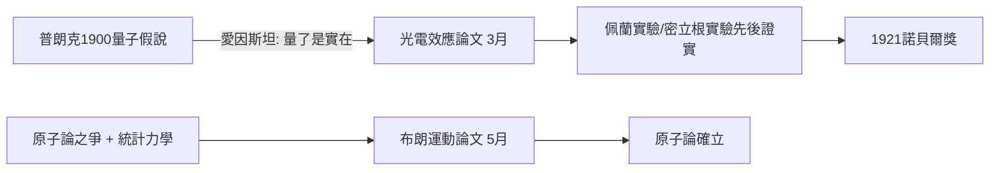

# 2.2 1905奇蹟年：光電效應與布朗運動（1905 上）

1905年，愛因斯坦在《物理年鑑》發表了改變物理學面貌的系列論文。這一年他完成了博士學位論文（測定分子大小的新方法），以及三篇各自足以名垂青史的論文。理解奇蹟年，必須看到它們的內在統一：全部源自他對**漲落與不連續性**的執著——物質由原子構成、能量由量子構成、時空由事件構成。

第一篇是3月的**光量子假說**。普朗克1900年提出能量量子化，只是為了推導黑體輻射公式的數學技巧；愛因斯坦則是第一個把它當作**物理實在**的人：光本身由能量為 $E=h\nu$ 的量子組成。這一假說乾脆利落地解釋了光電效應為何存在截止頻率：若光能量以整份量子傳遞，電子獲得的動能便為

$$E_k = h\nu - \phi$$

（$\phi$ 為逸出功）。這篇論文是量子力學的真正起點之一，也將為他贏得1921年諾貝爾獎。

第二篇是5月的**布朗運動**。當時原子論仍受馬赫與奧斯特瓦爾德一派質疑。愛因斯坦證明：若原子真實存在，懸浮粒子必因分子熱運動而做可計算的隨機行走，其均方位移為 $\langle x^2\rangle = 2Dt$。佩蘭1908年的實驗精确證實了這些預測，原子論從此塵埃落定。

## 因果分析

奇蹟年的上篇因果鏈是「接受一個前提，推到底」。普朗克只把量子當工具，愛因斯坦把量子當實在 → 光電效應獲得定量解釋 → 為量子論戰埋下種子（第4章）。統計力學的功底 → 布朗運動的預測 → 實驗證實 → 原子論獲勝。兩條鏈的共同源頭是他大學時代自學玻爾茲曼的選擇（1.2節），而專利局的閒暇（2.1節）提供了時間條件。可見奇蹟年不是天才的靈光，而是長鏈前因的收成。
