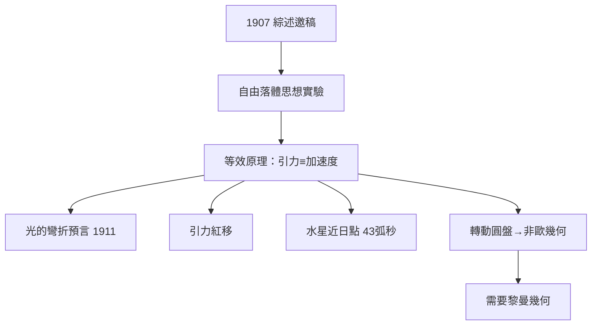

# 3.1 等效原理與重力之謎（1907–1911）

1907 年 11 月，應《放射學年鑑》之邀撰寫相對論綜述時，愛因斯坦追問：如果引力也該服從某種相對性原理，該從何入手？他想起了「畢生最快樂的思想」：一個從屋頂自由下落的人，感覺不到自己的重量。自由落體系中引力消失，這意味著引力與加速度在局部不可區分——等效原理誕生。

從這一原理出發，他能夠把引力問題化約為加速參考系中的物理學。第一個推論是光的彎折：若火箭向上加速，射入的光線在艙內看來是彎曲的；等效原理要求真實引力場中的光也必須彎曲。1911 年他在布拉格計算出太陽使掠過光線偏折 $0.83''$ （牛頓式的「光微粒」值）；因為他當時尚未完成完整理論，還不知道空間彎曲會再貢獻一倍，最終值應為 $1.75''$ 。第二個推論是引力紅移：在引力勢較低處的時鐘走得慢，光從太陽表面射出時頻率會降低。第三個推論出現於 1907 年的論文：水星近日點每世紀 $43''$ 的異常進動無法用牛頓理論解釋——他立即意識到這是檢驗任何引力新理論的試金石。

1911–1912 年，他把等效原理與先前對剛性轉動圓盤的分析結合，得到一個驚人的認識：加速圓盤上的尺在切向收縮，導致盤面幾何不再是歐氏幾何。既然引力場等價於加速系，那麼引力場中的空間本身就是非歐的。物理問題就此轉化為數學問題：描述彎曲時空需要什麼幾何？

## 因果分析

等效原理是連接兩個相對論的樞紐：它把「引力」從一種「力」降格為時空結構的表現，因此一切引力效應（光彎折、紅移、進動）都成為該原理的演繹結果，而非附加假設。因果鏈十分清晰：綜述邀稿（外部需求）→ 快樂的思想（內部資源）→ 三大可檢驗預言 + 一個幾何學缺口。而 1911 年 $0.83''$ 的「錯誤一半」預言，反而成為日後 1919 年日食觀測的戲劇性伏筆——完整理論必須給出加倍的答案，這個差異將在 1919 年成為報紙頭條。
