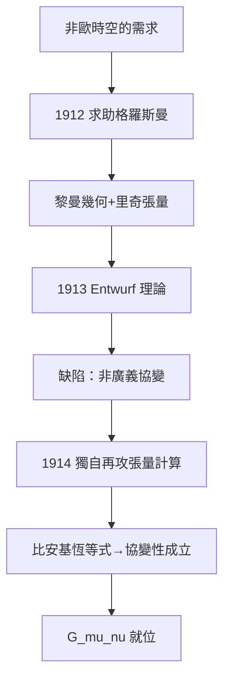

# 3.2 與格羅斯曼的合作及數學困境（1912–1915）

1912 年 8 月，愛因斯坦從布拉格回到蘇黎世，目的明確：尋找能描述彎曲時空的數學。他向老同學、此時已是 ETH 幾何學教授的格羅斯曼求助：「格羅斯曼，你一定要幫我，否則我會發瘋！」格羅斯曼指向黎曼幾何，以及里奇與列維塔-奇維塔發展的張量分析——一種在坐標變換下保持形式的語言，恰好符合廣義協變性的要求。

1913 年，兩人合作發表《廣義相對論與引力理論綱要》，給出了第一個場方程的草案（後稱「Entwurf 理論」）。但這個理論有一個致命缺陷：它不是廣義協變的，只能在特定坐標系中成立。愛因斯坦與格羅斯曼錯誤地相信「廣義協變的引力方程不可能存在」（他們誤讀了 Levi-Civita 的數學），於是忍受著理論的不完備。1913–1914 年他為此付出了沉重代價：先在維也納演講時被數學家批評，又與哥廷根的希爾伯特通信爭論概念基礎。

1914 年他移居柏林，婚姻同時破裂，米列娃帶著孩子返回蘇黎世。孤獨之中，他埋頭重讀里奇-列維塔的張量計算，並在 1914 年底逐漸認清：當年拒絕廣義協變是錯的。關鍵突破來自對「比安基恆等式」的運用——二階比安基恆等式保證由里奇張量構成的縮併量 $G_{\mu\nu}=R_{\mu\nu}-\tfrac{1}{2}Rg_{\mu\nu}$ 自動滿足 $\nabla^\mu G_{\mu\nu}=0$ ，這正是把能量-動量守恆 $\nabla^\mu T_{\mu\nu}=0$ 編入場方程所需要的數學性質。至此，方程的左邊（幾何）已經就位，只剩係數的確定。

## 因果分析

這段歷史展示了數學與物理的雙向驅動：物理直覺（等效原理）迫使愛因斯坦進入陌生的黎曼幾何，而數學的嚴格性（廣義協變、比安基恆等式）反過來塑造了物理方程的形式。1913 年的失敗並非浪費——正是 Entwruf 理論的侷限逼他重新理解張量的協變性質。個人生活也參與其中：柏林的孤獨與婚姻破裂切斷了他與蘇黎世的牽絆，把全部精力壓縮到方程上。因果鏈的下一環已經上膛：協變場方程一旦寫下，水星近日點的檢驗與 1915 年 11 月的決戰便水到渠成。
