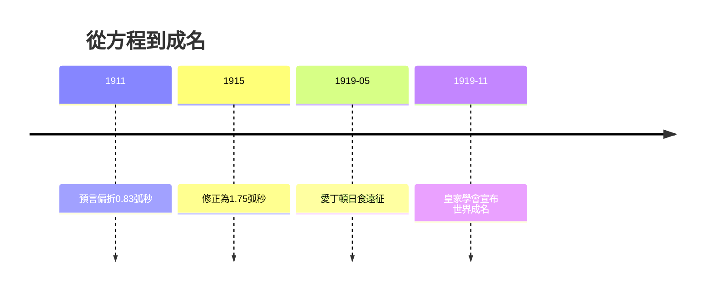

# 4.1 1919日食：一夜之間的世界名人（1915–1919）

1915年場方程完成後，愛因斯坦給出三個檢驗：水星近日點每世紀 $43''$ 進動、引力紅移、光線偏折。第三項最具戲劇性：廣義相對論預言掠過太陽的光偏折 $1.75''$ ，恰為牛頓粒子說 $0.83''$ 的兩倍，兩者差異可用日食觀測裁決。

英國天文學家愛丁頓抓住這一機會。第一次世界大戰剛結束，英德科學界亟需和解象徵，一位英國貴格會信徒驗證德國物理學家的理論，本身即具政治意義。1919年5月29日，愛丁頓率隊分赴西非普林西比與巴西索布拉爾拍攝日全食星場，測得偏折值約 $1.61''$ 至 $1.98''$ ，支持愛因斯坦而排除牛頓。

11月6日皇家學會宣布結果，《泰晤士報》以牛頓宇宙觀被推翻為題連日頭條，愛因斯坦一夜成名，髮型與舌頭成為時代符號。

## 因果分析

1919年的成名是科學、技術與政治三鏈交匯的結果。科學上，兩倍偏折值的可分辨差異使判決成為可能，若無1911年錯誤預言的對照，戲劇性將大減。技術上，日食攝影與星表精度恰好足以分辨一角秒量級效應。政治上，戰後英德和解需求放大了宣傳效應，媒體把複雜的張量理論簡化為天才神話。成名反過來改變了他的命運：柏林的聲望帶來美國之行的邀約，也帶來反猶勢力的嫉恨，為第5章的流亡埋下遠因。
