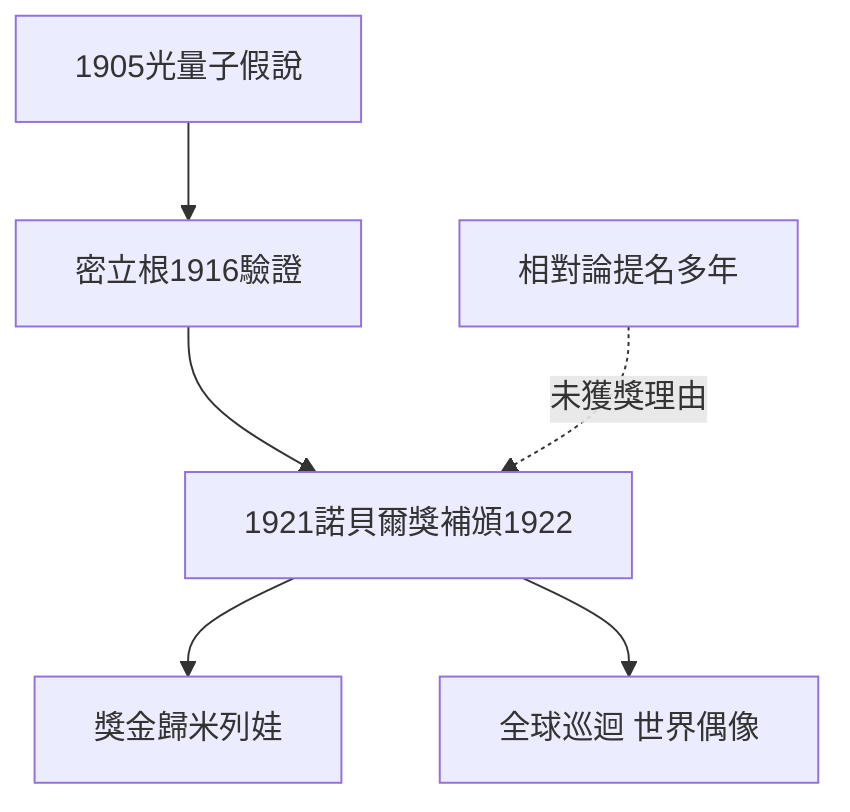

# 4.2 諾貝爾獎與光量子（1919–1923）

功成名就之後，諾貝爾獎的到來卻姍姍來遲且出人意料。愛因斯坦自1910年起年年被提名，但評委對相對論心存疑慮：實驗證據僅有水星進動與一次日食，且理論過於數學化。1921年的獎項空缺一年後，於1922年補頒給他，理由不是相對論，而是1905年的光電效應定律：

$$E_k = h\nu - \phi$$

瑞典科學院的頌詞刻意迴避相對論，只表彰他對光電效應與理論物理的貢獻。這背後是密立根1916年的精密實驗：他本想推翻光量子說，卻測得普朗克常數 $h$ 與愛因斯坦公式完全吻合，使光量子從假說變為定律。

獎金十五萬瑞典克朗依離婚協議全數轉給前妻米列娃，保障了她與兩子的生活。領獎後他赴日本、巴勒斯坦與西班牙巡迴演講，所到之處萬人空巷，科學家首次成為全球偶像。

## 因果分析

諾貝爾獎的授獎邏輯呈現保守與前衛的拉扯：因是光量子獲獎，果卻強化了量子力學的正統地位，反而使愛因斯坦日後質疑量子完備性時立場尷尬。評委迴避相對論，恰恰證明1919年的媒體狂熱不等於學界共識。而獎金歸米列娃的安排，把私人婚姻的債務轉化為科學榮譽的分配，解釋了他為何對獎項本身淡然處之。此獎既是對奇蹟年的遲來確認，也為下一節他與波耳的論戰設定了舞台：以量子之父身分反對量子機率詮釋。
