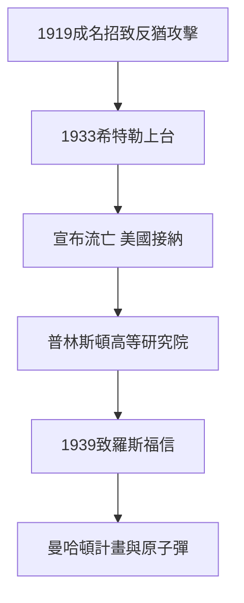

# 5.1 納粹崛起與流亡美國（1930–1935）

1920年代愛因斯坦已是德國科學的象徵，但反猶暗流從未止息。1921年諾貝爾獎後，納粹報刊把相對論貶為猶太物理學，1922年外交部長拉特瑙遇刺後他一度躲避追殺。1933年1月希特勒上台時，他正在美國加州理工訪問，隨即宣布不再返德，財物被沒收，著作在柏林焚書廣場上化為灰燼。

同年10月，他接受普林斯頓高等研究院聘書，與哥德爾、馮諾伊曼為同事，得以終身免除教學專心研究。流亡的代價是雙重的：他失去了柏林的實驗合作網絡，卻獲得了美國的輿論講壇。1939年，在西拉德勸說下，他致信羅斯福警告德國可能研製原子武器，信中依據正是 $E=mc^2$ 蘊含的巨大能量，直接促成曼哈頓計畫。

## 因果分析

流亡是名聲與仇恨同源的結果：1919年的世界性聲望使他成為納粹攻擊猶太知識分子的最佳標靶，科學成就反而轉化為政治風險。而 $E=mc^2$ 在1905年只是能量質量的哲學統一，經由納粹核計畫的威脅，轉化為改變戰爭的技術因果。諷刺的是，終身奉行和平主義的他因一封信捲入核武誕生，此後餘生都為此自責並轉向反核運動，這直接導向羅素宣言的最終抉擇。物理公式、政治迫害與個人良知在此形成閉環。
