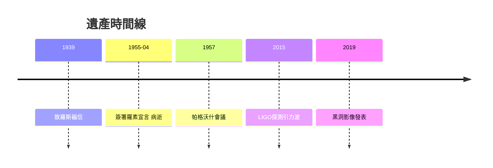

# 5.3 羅素-愛因斯坦宣言與身後遺產（1954–1955及後）

1954年比基尼核試的輻射塵震驚世界，1955年2月羅素致信愛因斯坦，邀請聯名警告核戰。抱病中的他欣然應允，4月11日簽署宣言定稿，呼籲科學家記住人性、摒棄戰爭。這是他一生最後的簽名，一週後的4月18日，他因腹主動脈瘤破裂在普林斯頓病逝，享年七十六歲，遺囑將大腦捐供研究、骨灰撒於無名之地。

宣言發表於7月9日，促成1957年帕格沃什會議，成為冷戰科學家干政的典範。科學遺產則在身後加速兌現：1965年彭齊亞斯發現宇宙微波背景，證實膨脹宇宙；1971年引力紅移被原子鐘精確驗證；2015年LIGO探測到引力波，波形與場方程預言分毫不差；黑洞影像與全球定位系統的鐘差修正，使 $E=mc^2$ 與彎曲時空成為日常技術。

## 因果分析

宣言是全書因果鏈的收束：1905年 $E=mc^2$ 導致核能，1939年致信導致原子彈，廣島原爆導致終身愧疚，愧疚驅使最後一週仍為反核簽名。科學因果轉化為道德責任，完成了從專利局職員到人類良知的蛻變。而廣義相對論從1919年一次冒險驗證，到百年後成為引力波天文學的工程基礎，證明基礎理論的果往往遲到半世紀。愛因斯坦以一人之生，串起了馬克士威、量子、核能與宇宙學四個時代。
