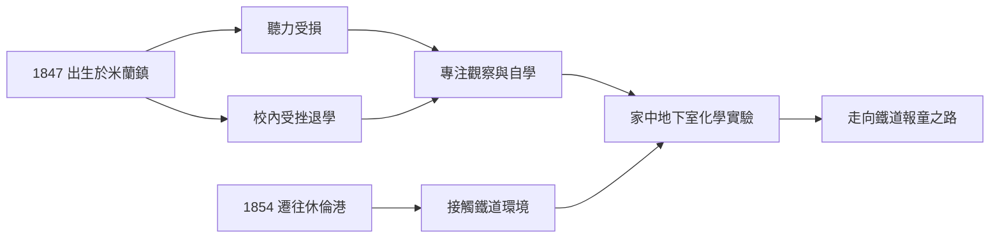

# 1.1 俄亥俄與密西根的童年

1847年2月11日，愛迪生出生於俄亥俄州米蘭鎮。父親塞繆爾經營木材與屋頂生意，母親南希曾任教師。1854年因鐵路興起使運河城鎮沒落，全家遷往密西根州休倫港，這一搬遷將他推向鐵道與電報的世界。

愛迪生幼年聽力受損，原因可能是猩紅熱或中耳疾病。聽障迫使他專注觀察與自學，也使他日後偏好以電報、文字與機器溝通。他在校就讀僅約三個月，被師長視為「遲鈍」，母親遂在家中親自教他閱讀與自然科學。他自述十二歲前讀完《羅馬帝國衰亡史》與化學、物理著作，並在家中的地下室做化學實驗。

這段童年的關鍵在於三個條件的累積：一是家庭搬遷帶來的鐵道環境，二是聽障造成的自學習慣，三是母親的教育支持。三者共同塑造了一個善於動手、習慣獨立思考的少年，為其後的報童與電報員經歷奠定基礎。

因果分析：若非米蘭鎮因鐵路取代運河而衰落，愛迪生不會搬離而接觸鐵路沿線的商業與訊息網絡；若非聽障與短期退學，他不會養成靠閱讀與實驗自我驗證的習性。童年的「劣勢—補償」機制，成為其一生以實驗代替理論、以實物代替言語的工作方法的最初來源。

