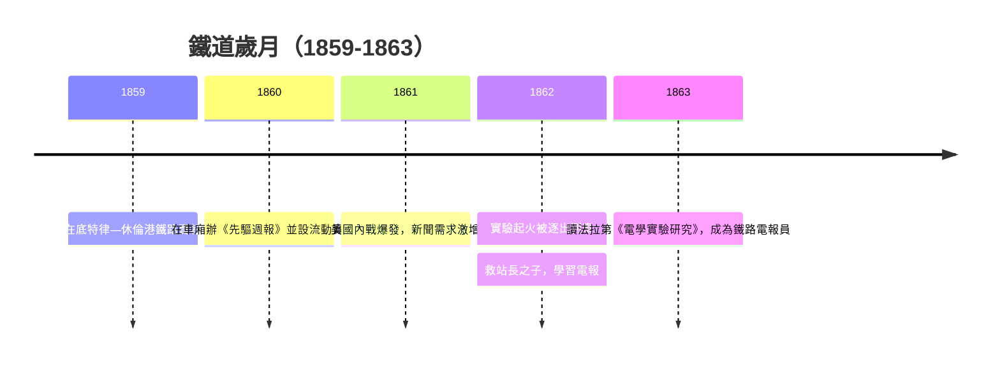

# 1.2 鐵道上的報童與化學實驗

十二歲起，愛迪生在休倫港與底特律之間的鐵路上賣報紙與糖果。他很快展現商業頭腦：僱用其他少年代售、在列車上排印自己的《先驅週報》（Grand Trunk Herald），成為在火車上辦報的第一人。報導內容多取材自電報傳來的新聞，使他日復一日接觸電報訊息的價值。

他同時把行李車廂一角改為流動化學實驗室，做磷、酸類實驗。某次磷掉落起火，燒壞車廂，管理員將他的儀器扔下列車，並據稱打了他的耳光，使聽力更差。1862年前後，他救下車站站長之子免遭貨車輾斃，站長以教導鐵路電報作為回報，這是他正式踏入電信業的起點。十五歲前後，他又從底特律舊書攤購入法拉第《電學實驗研究》，反覆研讀，確立了「以實驗檢驗一切」的信念。

此階段的因果鏈極為清晰：報童生意訓練了市場直覺——他學會判斷「人們願意付錢買什麼」；車上實驗與法拉第之書給了他技術手段；救人換來的電報訓練則提供了職業出口。三者疊加，使一個鄉村少年具備了成為電報員的全部條件。

因果分析：內戰時期新聞需求暴增，讓鐵路報童有利可圖，愛迪生因而得以累積資本購買實驗器材；實驗引發火災遭逐，反而逼他把注意力轉向更安靜、可在室內從事的電報工作。看似挫折的事件，實際上完成了從「流動商販」到「技術人員」的身分轉換。

