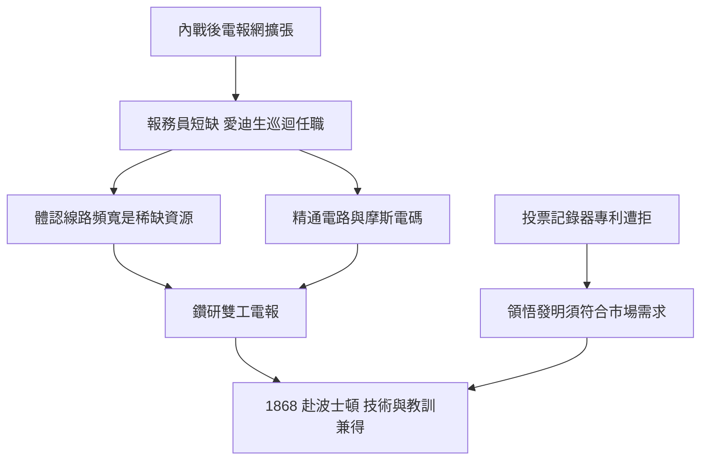

# 1.3 電報員生涯與雙工電報

1863至1868年間，愛迪生輾轉於密西根、印第安納、俄亥俄、肯塔基與東部各大城市，擔任巡迴電報員。內戰後電報業急速擴張，熟練報務員供不應求，使他得以頻繁換職謀生。他夜班值守時以斷續信號代替人力呼叫同事，被發現後一度失業；在辛辛那提與路易維爾，他則以抄寫迅速、發報精準聞名。

電報員生涯是他真正的技術學院。其一，他精通摩斯電碼與電路實務，理解繼電器、電池與線路損耗；其二，他親身體會「訊息就是商品」，同一線路載送愈多電報，公司獲利愈高——這直接指向多工電報的發明方向；其三，他結識了同行與設備商，建立業界人脈。夜班空閒時，他反覆試驗能讓一條線同時收發兩路電報的「雙工」裝置，這項研究在波士頓任職時趨於成熟，成為他第一項重大發明。

1868年他在波士頓取得第一項專利——電子投票記錄器，卻遭國會議員婉拒：議員反而需要拖延表決的工具。這次挫折給了他終生受用的教訓：發明必須迎合市場需求，而非僅追求技術巧妙。

因果分析：電報網的商業邏輯（線路昂貴、頻寬有限）催生了多工需求，愛迪生身處操作第一線，最能察覺此痛點，故其最早的重大發明皆圍繞電報改良。投票記錄器的失敗則反向教育他「需求先於發明」，此原則貫穿其後留聲機與電燈的研發策略。

