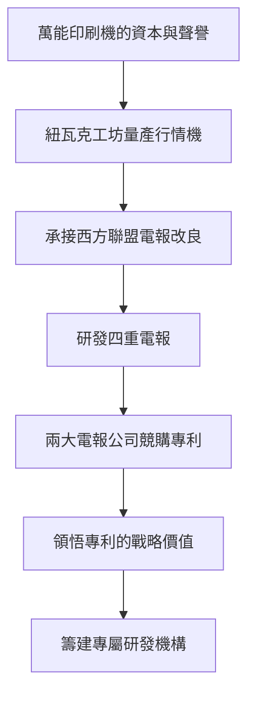

# 2.2 紐瓦克工坊與四重電報

1871至1876年，愛迪生在紐瓦克經營工坊，僱工最多逾百人，主力產品是股票行情機與電報改良設備。他在此度過「幾乎不眠」的數年：婚禮當天仍回工坊工作；同時展開讓一條電報線同時收發四路訊號的「四重電報」研究。

四重電報的原理是在同一線路上以差動電流與極性切換，使兩個雙工系統疊加。1874年他完成可實用的樣機，隨即捲入西方聯盟與大西洋—太平洋電報公司的商業暗戰：兩大公司爭相收購其專利，最終西方聯盟以約一萬美元取得權利，並聘他為顧問。這場競標讓愛迪生學到關鍵一課：專利的價值不在技術本身，而在它能改變產業競爭格局。

紐瓦克時期他也建立了初步的團隊分工：機械師負責製作，他本人主攻構想與試驗，助手記錄實驗數據。他開始意識到，隨手可得的助手與儀器，比單打獨鬥更能提高發明速度——這一認識直接催生了門洛帕克實驗室。

因果分析：萬能印刷機帶來的資本與商譽，使他敢於承接電報業最核心的多工難題；四重電報的成功引發兩大電報公司競購，證明「戰略性專利」可獲高額回報，於是他把全部收益再投入更大規模的研發組織。紐瓦克是從「發明者」走向「發明工廠主」的過渡階段。

