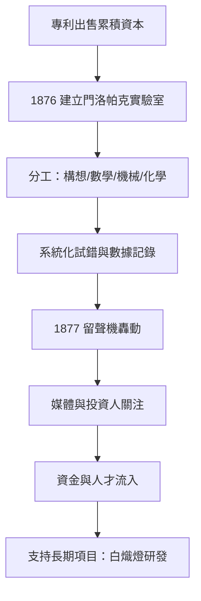

# 3.1 門洛帕克實驗室的誕生

1876年，愛迪生利用出售四重電報等專利的資金，在新澤西州門洛帕克建造專屬實驗室，設有辦公樓、圖書館、機械車間與木工房，並有玻璃吹製與化學設備。他宣稱要「每十天一項小發明、每半年一項大發明」。這是史上第一座有組織、以商業產出為目標的工業研究實驗室。

門洛帕克的運作方式是「發明的工廠化」：愛迪生擔任總指揮，下轄精通數學的 Francis Upton、機械總管 John Kruesi、玻璃與化學專家 Ludwig Böhm 等人；實驗以系統化的試錯進行——先設定目標，再排列組合材料與參數，逐一記錄於筆記本。留聲機（1877）與白熾燈（1879）都是這套體制的產物。愛迪生自稱「發明是百分之一的靈感加百分之九十九的汗水」，正是團隊試錯方法的寫照。

實驗室的資金來源構成良性循環：留聲機的名聲吸引媒體與投資人，股票行情機與電話專利的分成提供現金流，使電燈這種耗時兩年的長期研發得以持續。

因果分析：紐瓦克時期「人多好辦事」的經驗使其確信團隊化研發的效率；四重電報與傳聲器的專利收益提供了購地建廠的資本；留聲機的轟動效應則帶來社會資本。三者匯聚，使門洛帕克成為可能——而門洛帕克又反過來使電燈、電力系統這種單一發明家無法完成的系統工程成為可能。這是「企業化研發」模式的起點，直接預示了二十世紀貝爾實驗室等機構。

