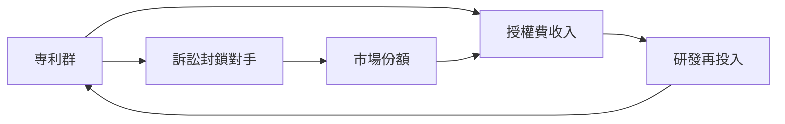

# 4.1 直流系統的擴張與愛迪生通用電氣

珍珠街示範成功後，照明業務急速擴張，愛迪生的商業版圖重組為兩層：一是1880年成立的愛迪生電燈公司，掌管燈泡與系統專利的授權；二是1889年合併各營運與製造公司而成的愛迪生通用電氣公司。此外，專利代理與檢測機構構成第三層，形成專利、製造、營運與授權的金字塔。

其專利策略的核心是以系統性專利群包圍競爭者：不僅保護碳化燈絲本身，更涵蓋燈座、開關、電表、配電制式與發電機改良。訴訟成為常態武器，最具代表性的是與威斯汀豪斯就燈絲專利的纏訟，最終法院確認愛迪生專利有效。可用商業閉環表示：

同時期，愛迪生個人角色也在轉變：他不再直接管理日常營運，將公司交給職業經理人打理，自己回到實驗室。這種發明者與經營者分離的安排，是十九世紀末美國大企業形態的縮影。

## 因果分析

示範網成功為因，資本湧入與公司規模化為果，專利成為護城河是策略選擇，訴訟確立法律地位帶來壟斷租金，租金又支持再研發形成反饋。然而倚賴直流專利群也使公司對交流電採取防禦姿態，組織利益開始反向扭曲技術判斷，為電流戰爭的爆發提供了內部動因。
