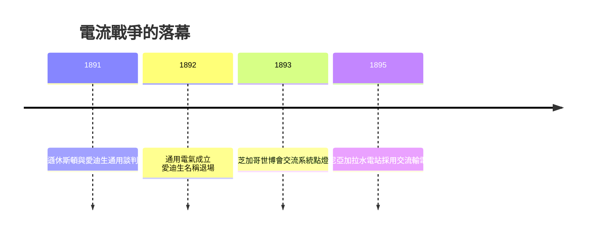

# 4.3 合併為通用電氣與失去主導權

電流戰爭的敗局首先反映在財務結構。愛迪生通用電氣擴張過快，而1890年前後的金融緊縮使其債台高築；持續堅守直流系統又限制了新訂單。金融資本方以湯姆遜休斯頓公司的支持者為核心推動合併：1892年，愛迪生通用電氣與湯姆遜休斯頓合併為通用電氣，總部設於紐約州斯克內克塔迪，實際主導權落在科芬等人手中，公司名稱中愛迪生的名字消失。

對愛迪生個人而言，這是象徵與實質的雙重退場：他持有的股權比例被稀釋，亦不再參與電力業務經營。他在自述中承認對交流電的判斷錯誤，並逐漸將注意力轉向鐵礦選礦與水泥等新事業。公司層面則相反：通用電氣保留其專利遺產，吸納交流技術路線，成為美國電氣產業的巨頭。

## 因果分析

財務過度擴張與技術路線錯判為因，資本方主導合併為果，愛迪生喪失電力業務主導權是進一步的果。反向觀察，資本的所有權邏輯最終凌駕於發明者聲望，證明企業化研發體系中資本結構才是最終仲裁者。此挫敗同時釋放了愛迪生本人：脫離組織束縛後，他得以在下一階段自建西奧蘭治實驗室，重返獨立發明者與創業者的軌道，構成第5章的前因。
