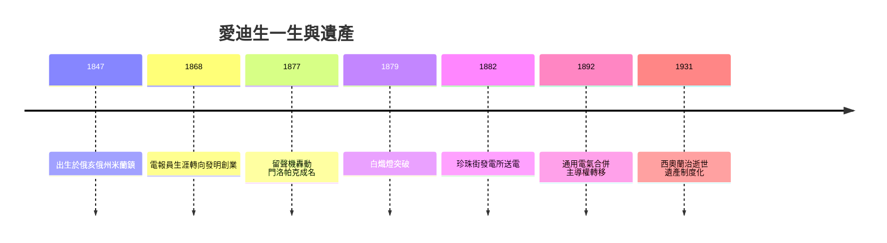

# 5.3 晚年、故逝與歷史遺產

1920年代，愛迪生已是美國發明的象徵。他與福特、哈定等人交往密切，1929年在福特重建的門洛帕克園區接受金色五十週年慶典致敬。晚年他仍每日在西奧蘭治工作，研究橡膠替代原料與電池改良。1931年10月18日，他因糖尿病併發症在西奧蘭治逝世，享年八十四歲。美國各地一度熄燈一分鐘致哀，通用電氣各廠鳴燈示意。

他一生取得美國專利一千零九十三件，涵蓋電報、電話、留聲機、電燈、配電、電影、電池與水泥機械。其歷史地位不在單一發明，而在三項制度遺產：一是門洛帕克開創的團隊化、系統化工業實驗室模式，直接啟發貝爾實驗室；二是白熾燈加配電網的系統工程思維；三是專利群加製造加授權的企業化研發閉環。

## 因果分析

全書因果至此收束：電報員經歷賦予電學素養與市場直覺，為留聲機與電話改良之因；留聲機聲望吸引資本，為門洛帕克與電燈之因；電燈系統的直流限制，為電流戰爭之因；戰爭失敗迫使其退出電力，為西奧蘭治多元化之因；多元事業的成敗經驗，最終沉澱為企業化研發制度之果。個人天才驅動組織，組織成敗又重塑個人軌跡，互為因果，構成美國第二次工業革命的縮影。
