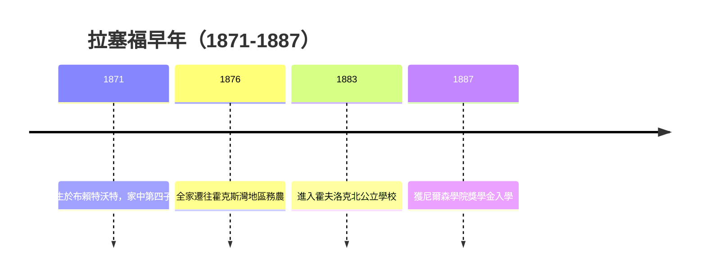

# 1.1 布賴特沃特農家與大家庭

1871年8月30日，歐尼斯特·拉塞福出生於紐西蘭南島布賴特沃特附近的鄉村，父親詹姆斯是蘇格蘭移民出身的農夫兼車輪匠，母親瑪莎是英格蘭移民之女，曾任鄉村教師。拉塞福在家中十二個孩子裡排行第四，自幼在農場勞動中長大，幫忙修理機械、照料牲口，練就一雙靈巧的手與不怕吃苦的體魄。紐西蘭殖民地物質匱乏卻民風樸實，家庭教育重視勤奮、誠實與自立，母親尤其堅持每個孩子都要讀書識字。

這樣的邊陲環境反而成為優勢。由於遠離歐洲學術中心，拉塞福從小習慣自己動手解決問題，農具壞了自己修，實驗器材不足就自己造。這種動手能力後來成為他實驗風格的標誌。同時大家庭的競爭與互助培養了他的領導氣質，他既是弟妹的榜樣，也在兄弟間學會爭取資源。邊陲少年的出發點雖低，卻因此沒有學院派的包袱，敢於用最簡單的裝置追問最根本的問題。

## 因果分析

- **殖民地農家出身** ⟹ 動手能力強且不畏艱苦，形塑日後以簡陋儀器做出重大發現的實驗風格。
- **母親的教師背景** ⟹ 對讀書的堅持，使農家子弟得以透過獎學金體系向上流動。
- **大家庭競爭環境** ⟹ 培養自信與領導力，為日後帶領曼徹斯特與劍橋團隊埋下伏筆。
