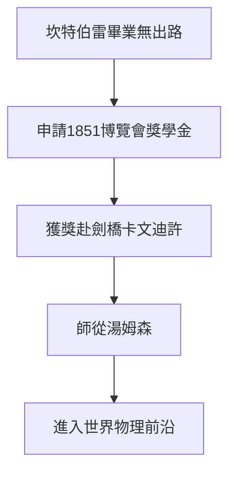

# 1.3 博覽會獎學金與遠赴劍橋

1895年是拉塞福人生的轉折點。他贏得1851年博覽會獎學金，這是英國為紀念萬國博覽會而設、專門資助殖民地優秀畢業生赴英深造的最高榮譽。二十四歲的拉塞福帶著簡單的行李與自製的磁性檢波器，遠渡重洋前往劍橋大學卡文迪許實驗室，師從約瑟夫·湯姆森。當時湯姆森正處於發現電子的前夜，實驗室雲集世界各地的年輕人，拉塞福是第一批來自海外殖民地的研究學生之一。

這次遷移具有決定性意義。若留在紐西蘭，他至多成為中學教師或地方學院講師，接觸不到陰極射線、倫琴射線與放射性等前沿課題。而劍橋提供了三樣故鄉沒有的東西：世界一流的導師、最靈敏的儀器傳統，以及與朗之萬、湯姆森等人的日常切磋。殖民地青年的樸素與自信反而讓他在人才濟濟的實驗室脫穎而出，湯姆森很快發現這位新學生不僅理論紮實，更能把故障儀器修到比原來更好。

## 因果分析

- **博覽會獎學金** ⟹ 打破地理隔絕，將邊陲人才直接輸送到帝國科學中心，是整部傳記的關鍵分岔點。
- **卡文迪許的環境** ⟹ 提供前沿課題與同儕刺激，使無線電波研究迅速轉向離子化與放射性。
- **殖民地出身的反差優勢** ⟹ 勤奮樸素的作風贏得湯姆森信任，獲得獨立課題與發表機會。
