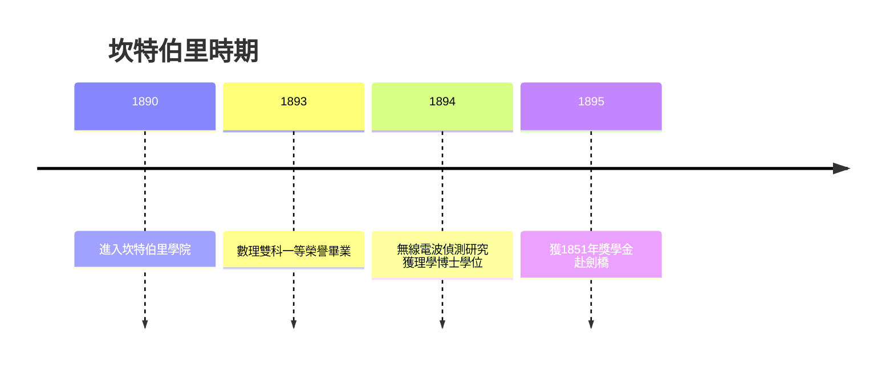

# 1.3 坎特伯里學院的早期研究

1890年起，拉塞福在坎特伯里學院（Christchurch）攻讀，雙修數學與物理科學，1893年以雙科一等榮譽畢業，隨後留校攻讀碩士。他早期的科學工作是檢測高頻交流電對鐵絲磁化的效應，並在1894年成功偵測到極高頻的無線電波（赫茲波）傳播，製作出當時世界上靈敏度最高的無線電波接收器之一，信號可跨越數百碼。這項成果讓他在1894年成為坎特伯里學院首位取得理學博士學位的學生，也為他贏得了申請1851年展覽獎學金的資本。

值得注意的是他的方法：在沒有正規實驗室的條件下，他把羊毛棚改造成工作間，自製感應線圈與天線。這種「土法煉鋼」的成功，再次印證了農家訓練與殖民地資源匱乏共同塑造的自立風格。同時，無線電波研究使他在「看不見的波」領域積累了偵測微弱訊號的技術——這正是日後偵測放射性射線所需的核心技能。

這段時期還有一個關鍵人物：他的未婚妻瑪麗·喬治，以及鼓勵他留校研究的導師畢克頓。當1895年1851年獎學金揭曉時，他名列第二，原與劍橋無緣；但第一名因結婚放棄資格，拉塞福得以補遞赴劍橋。這是繼納爾遜之後第二次「補遞改變命運」，而能使偶然再次垂青的，是他已用無線電波研究寫出了足以打動劍橋評審的成果。

**因果分析**：羊毛棚裡的無線電實驗是整條科學之路的樞紐——它既以成果贏得1851年獎學金（通往劍橋的門票），又以偵測微弱訊號的技藝預備了放射性研究的方法論。沒有坎特伯里的自製收發報機，就沒有卡文迪許實驗室裡那雙能「聽見」α粒子聲響的耳朵。
