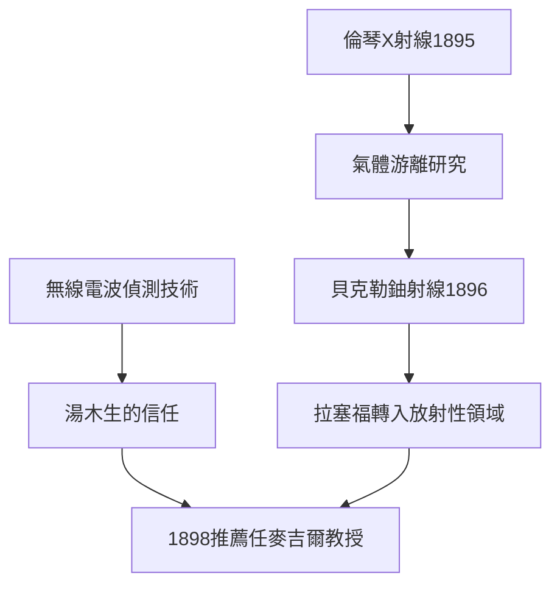

# 2.2 無線電波研究與湯木生的知遇

在卡文迪許初期，拉塞福延續無線電波研究，改進磁化率偵測法，使接收距離與靈敏度大幅提升，並於1896年在皇家學會展示。這項工作雖未使他成為無線電商業化的贏家（馬可尼的系統後來居上），卻在兩個層面產生了深遠的後果：第一，它使湯木生徹底信任這位殖民地青年的實驗才能，開始把更重要的課題交給他；第二，偵測微弱高頻訊號的技術，成為他後來偵測放射性、計數粒子的看家本領。

1896年前後，科學界爆發了震驚世界的事件：倫琴發現X射線（1895），貝克勒發現鈾射線（1896）。湯木生本人立即投入X射線導致的氣體導電研究，並寫出《論電通過氣體》的經典工作。拉塞福作為助手參與其中，迅速掌握了「X射線使氣體分子游離」的測量方法。這段訓練讓他意識到：游離現象是探測一切「看不見射線」的通用工具。

1898年，湯木生向麥吉爾大學強力推薦拉塞福出任物理教授，推薦信中寫道：「在獨創性的科學觀念上，我從未見過比他更出色的學生。」這封推薦信，是無線電與游離研究的直接果實，也是拉塞福獨立掌舵的起點。無線電研究看似「半途而廢」，實則是通往放射性的必要橋樑。

**因果分析**：無線電研究提供「手段」，湯木生的信任提供「機會」，X射線與鈾射線的發現提供「舞台」——三者匯流，使拉塞福在27歲時就獲得獨立實驗室與教授職位。這說明科學生涯的躍升從不靠單一因素：個人技藝、師長提攜與時代機遇，必須同時到位。

