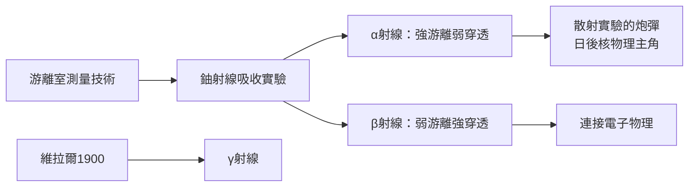

# 2.3 鈾射線與α、β射線的分類

1898年，離開劍橋前夕，拉塞福完成了他的第一項放射性經典研究：以游離室測量鈾射線的吸收，發現射線實由兩種穿透力迥異的成分構成。被約0.002厘米鋁箔即完全吸收者，他命名為α射線；穿透力強百倍者，命名為β射線。次年（1899年）發表後，這套命名沿用至今。幾乎同時，維拉爾發現了不受磁場偏轉、穿透力更強的第三種成分，即γ射線。

這項看似簡單的分類，實際上是整個核物理的地基。分類之所以可能，靠的是他在卡文迪許練就的游離測量技術——用吸收厚度作為「篩子」，把混合射線分開。更重要的是，這一分類立刻驅動了一連串後續研究：α射線弱穿透但強游離，暗示它攜帶大能量、大質量，成為日後散射實驗與化學鑑定的主角；β射線後被證明是高速電子，連接了放射性與電子物理。

分類工作也確立了拉塞福的方法論信條：「分類—定量—溯源」。他不滿足於現象描述，總要追問射線的本性。正是這種執念，驅使他多年後窮追α射線的本質（氦核），並用α粒子打出原子核。離開英國赴蒙特婁時，他已手握打開原子世界的第一把鑰匙。

**因果分析**：射線分類是因，放射性化學與核物理是果。α與β的區分，使後續研究者能分別追蹤兩條線索：α線引向原子核與人工核反應，β線引向電子與量子理論。一次成功的分類，等於為整個領域劃分了兩大研究綱領——這正是拉塞福影響力超越個人論文的所在。
