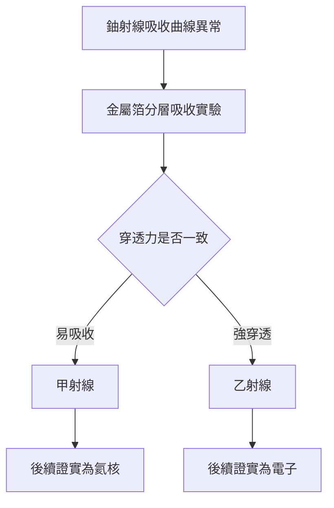

# 2.3 鈾射線與阿爾法貝塔分類

1898年前後，拉塞福將電離室對準鈾化合物的射線，發現其穿透能力並不一致。他用不同厚度的金屬箔吸收射線，證明鈾射線至少包含兩種成分：一種極易被吸收、電離能力強，稱為甲射線；另一種穿透力強、偏轉行為不同，稱為乙射線。這就是後來阿爾法射線與貝塔射線的命名起源。這項分類看似簡單，卻第一次揭示放射性並非單一現象，而是多種不同粒子或波的混合。

分類的意義在於化混沌為秩序。在此之前，居禮夫婦與多數研究者把放射性強度當作整體測量，無法解釋吸收曲線的異常拐折。拉塞福的雙成分模型立刻被實驗證實，並引導他進一步追問兩種射線的本質差異。甲射線後來被證實是氦核，乙射線是高速電子，而分類者本人將在蒙特婁與曼徹斯特親自解開這兩個謎題。可以說，沒有1898年的分類，就沒有1902年的蛻變理論與1908年的甲粒子定性。

## 因果分析

- **定量吸收實驗** ⟹ 發現單一射線假設無法解釋數據，迫使提出雙成分分類。
- **甲乙分類** ⟹ 將放射性研究從現象描述推進到本質追問，為蛻變理論提供線索。
- **分類者的先發優勢** ⟹ 使拉塞福在放射性領域站穩腳跟，成為麥吉爾與曼徹斯特爭相聘請的對象。
