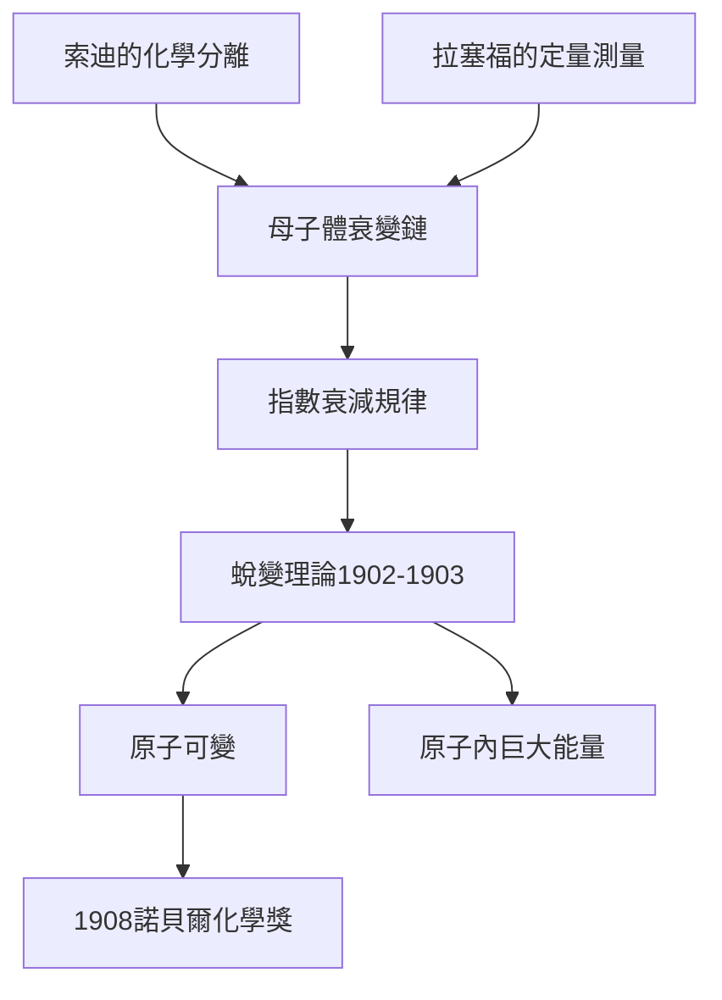

# 3.2 與索迪合作：蛻變理論

1900年，化學家弗雷德里克·索迪來到麥吉爾，成為拉塞福的助手。化學與物理的互補使合作立竿見影：索迪負責分離與化學鑑定，拉塞福負責游離測量與放射性計量。他們一起研究了釷系與後來的錒系，發現放射性物質經過一連串「母體→子體」的生成鏈，每一步的活性都以固定的指數規律衰減。1902至1903年，兩人發表系列論文，提出革命性的蛻變理論：放射性是原子自發蛻變為另一種元素的過程，每種放射性原子有固定的蛻變機率。

這一理論公然挑戰道爾頓以來「原子不可變」的化學信條，也讓質能關係有了用武之地：若原子蛻變釋放巨大能量，則元素互變不只是隱喻，而是能量來源。拉塞福測得α粒子的能量遠超化學反應，據此推斷原子內部蘊藏的巨大能量，為後世核能觀念埋下伏筆。蛻變理論還立刻解釋了射氣與衰變鏈現象，使混亂的放射性數據變成有序的譜系。

索迪於1903年離開，後來提出同位素概念；拉塞福則繼續推進。這段合作說明：當物理的定量測量遇上化學的分離鑑定，新的科學綱領就誕生了。1904年拉塞福出版《放射性》一書，系統總結該理論，並因這些成就於1908年獲諾貝爾化學獎。

$$N(t) = N_0 e^{-\lambda t}, \qquad t_{1/2} = \frac{\ln 2}{\lambda}$$

**因果分析**：蛻變理論是本傳記的第一個理論高峰，其因果鏈清晰：射氣發現（現象）→衰變鏈測量（規律）→蛻變假說（理論）→原子可變（世界觀革命）。每一步都被前一步驅動。而理論反過來又驅動新研究：既預言了同位素，又提出原子能的問題，形成「現象—理論—新問題」的正循環。

