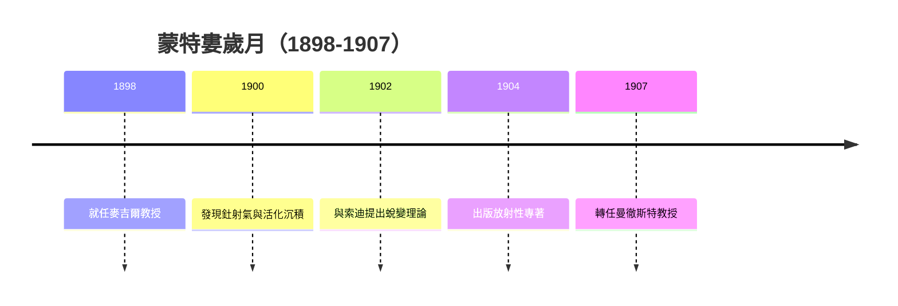

# 3.3 衰變定律與諾貝爾獎前夜

提出蛻變理論後，拉塞福進一步系統測定不同放射產物的衰變常數與半衰期，確立衰變級聯的概念。鈾、釷、鐳各有自己的衰變系列，母體衰變為子體，子體再衰變，速率由各自的衰變常數決定，不受溫度、壓力與化學狀態影響。1904年他出版《放射性》一書，全面總結蒙特婁成果，成為該領域的標準教科書。1905年當選英國皇家學會會員，1907年接受曼徹斯特大學物理講座教授職位，告別加拿大。

這段時期的因果鏈條十分清晰：甲乙分類導致射氣研究，射氣研究導致蛻變理論，蛻變理論導致衰變級聯的定量測量，而定量成就最終兌現為學術榮譽。1908年拉塞福因在元素蛻變與放射化學方面的貢獻獲諾貝爾化學獎，頒獎理由雖歸於化學，實為物理方法驅動的跨界勝利。蒙特婁九年是他發表論文最多、思想最密集爆發的時期，也證明邊陲實驗室只要問題選得準，同樣能做出世界級工作。

## 因果分析

- **衰變級聯的定量完成** ⟹ 使蛻變理論從假說變為可預測的規律，大幅提升說服力。
- **專著與教學傳播** ⟹ 將個人發現轉化為學科體系，吸引蓋革等青年人才追隨至曼徹斯特。
- **蒙特婁的積累** ⟹ 直接導致諾貝爾獎與曼徹斯特聘書，開啟以原子核為中心的新階段。
