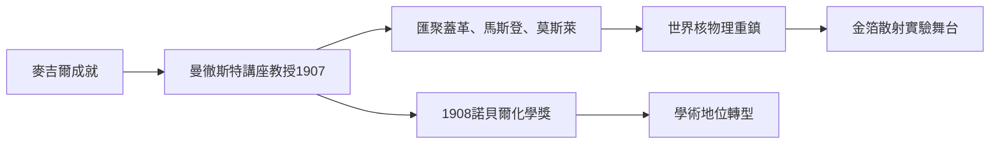

# 4.1 曼徹斯特歲月與1908年諾貝爾化學獎

1907年，拉塞福接受曼徹斯特大學的邀請，接替退休的舒斯特出任朗沃西物理講座教授。麥吉爾條件優渥，但他渴望更靠近歐洲科學中心、與更強的學術圈切磋。曼徹斯特實驗室在他手上迅速成為世界放射性與核物理的第一重鎮，培養出一批日後聞名的大師，包括蓋革、馬斯登、莫斯萊、波耳、查德威克。

1908年，他因放射性元素蛻變的研究獲頒諾貝爾化學獎。化學獎頒給物理學家，一度成為趣談，但理由充分：蛻變理論本質上是化學的元素觀革命。這個獎也標誌著他的學術身分從「放射性物理」跨入「物質結構」的更深層。同年，他與蓋革、羅伊茲合作，以電磁偏轉與光譜方法確證α粒子是二次電離的氦離子，完成了麥吉爾時代懸置的課題。

曼徹斯特時期的管理風格值得注意：他不搞獨斷，而是讓年輕人直接做實驗、直接報告，實驗室充滿「動手與爭辯」的氣氛。這種風格源於他自己的成長經歷——沒有權威可依賴，只有事實可依賴。正因如此，曼徹斯特才能孕育出金箔散射這種「由年輕人手裡做出歷史級實驗」的環境。

**因果分析**：轉赴曼徹斯特是「果」，也立刻成為下一階段的「因」：靠近歐洲中心使他吸收更多思想，實驗室的年輕人才結構使大實驗可以快速試錯。諾貝爾獎帶來的聲望又反過來吸引更多優秀學生前來，形成「成就—聲望—人才—更大成就」的正回饋，這是拉塞福學派得以建立的機制。
