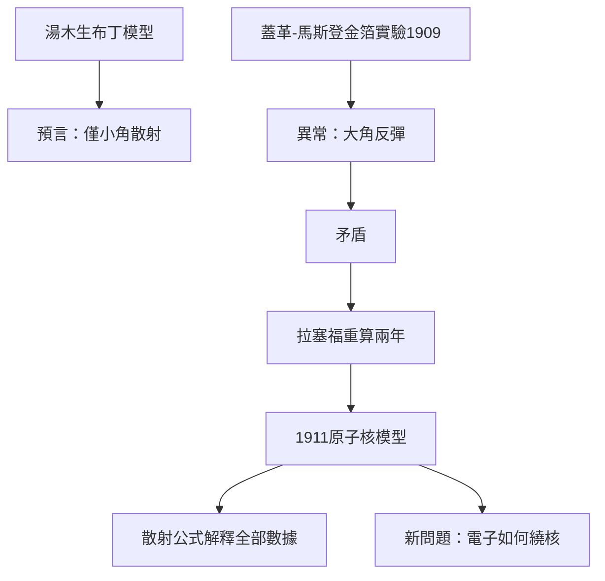

# 4.2 金箔散射實驗與原子核模型

1909年，拉塞福建議其學生蓋革與馬斯登系統研究α粒子穿過金箔後的散射角分布。按當時公認的湯木生「葡萄乾布丁」原子模型（正電荷均勻散布、電子鑲嵌其中），α粒子只應發生小角度偏轉。實驗卻發現：約每八千個α粒子中，就有一個被反彈回來，偏轉超過九十度。馬斯登回憶，拉塞福獲知結果時驚呼：「簡直像你朝一張薄紙發射十五吋砲彈，砲彈卻被彈回來打中了你自己！」

拉塞福用了近兩年反覆計算與驗證，於1911年提出革命性結論：原子中心集中了全部正電荷與幾乎全部質量，體積卻只佔原子的極小部分。他據此推導出著名的散射公式，完美解釋實驗數據：

$$N(\theta) \propto \frac{1}{\sin^4(\theta/2)}$$

原子核模型就此誕生。這一模型的因果影響立竿見影：它既解決了α散射的異常，又提出了新問題——繞核電子如何運動而不墜入核？這正是波耳理論要回答的。同時，核的微小體積意味著原子內部「幾乎全是空的」，顛覆了古典物質觀，為日後量子世界的圖像鋪路。

**因果分析**：這是「理論預言—實驗反例—新理論」的教科書式因果鏈。關鍵在於拉塞福敢於為單一異常數據（八千分之一）推翻公認模型，並以定量公式而非定性描述收尾。異常之小與決心之大成反比，正是「證據不分大小，只分真偽」的科學精神典範。
