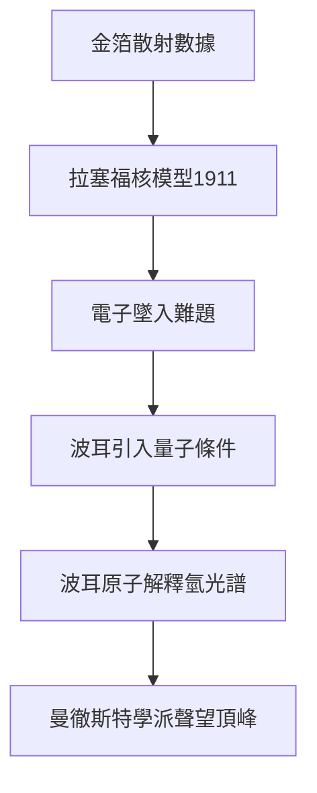

# 4.3 原子核模型與波耳原子

1911年拉塞福在曼徹斯特文學哲學學會宣讀論文，提出原子核模型：原子中心有一個帶正電、體積極小而質量集中的核，電子環繞其外，如同行星繞太陽。這一圖像簡潔有力，解釋了散射數據，卻立刻遭遇經典電動力學的困難，即環繞運動的電子應輻射能量而墜入核中。許多同行因此持保留態度，認為模型尚不完備。

轉機來自丹麥青年尼爾斯·波耳。1912年波耳來到曼徹斯特，敏銳看到核模型的價值，主動將普朗克量子假說引入電子軌道，提出定態與躍遷概念，於1913年發表波耳原子模型，成功解釋氫光譜的巴耳末公式。拉塞福慧眼識珠，力薦波耳的論文發表，並在爭議中為其辯護。核模型提供骨架，量子條件賦予靈魂，兩代人的合作完成了從經典原子到量子原子的飛躍，也確立曼徹斯特作為世界理論與實驗交匯中心的地位。

## 因果分析

- **散射數據的約束** ⟹ 使核模型成為唯一可行的電荷分布方案，雖有困難仍不得不接受。
- **波耳的量子改造** ⟹ 解決輻射坍縮難題，使核模型從假說升級為可計算光譜的理論。
- **拉塞福的提攜** ⟹ 展現學派領袖的胸襟，以實驗權威為年輕理論家背書，促成跨世代突破。
