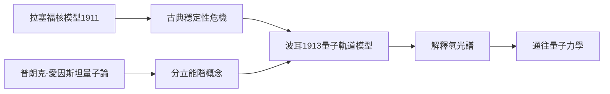

# 4.3 波耳的到來與原子結構革命

1911至1912年間，丹麥青年尼爾斯·波耳來到曼徹斯特，在拉塞福門下做博士後研究。波耳帶來的是普朗克—愛因斯坦的量子思想，而拉塞福給他的是剛剛誕生的原子核模型。兩者相遇，立刻碰撞出歷史性的問題：依古典電磁理論，電子繞核運動必須輻射能量而螺旋墜入原子核，原子不可能穩定存在——核模型反而製造了新的危機。

1913年，波耳提出著名的波耳模型：電子只能在特定的分立軌道上運行，不改變軌道就不輻射；躍遷時輻射光子，頻率由能階差決定：

$$h\nu = E_n - E_m$$

此模型成功解釋氫原子光譜，把量子假說推進到原子結構的核心。值得強調的是拉塞福在其中的角色：他親自修改波耳論文的初稿，建議精簡篇幅；他雖對量子假設有所保留，卻堅定地支持論文發表。沒有他的支持，這篇改變物理學的論文或許難以問世。

師生二人此後分頭並進：波耳在哥本哈根建立量子力學的思想中心，拉塞福在劍橋繼續深耕原子核。兩條路線分別對應「原子外層的量子革命」與「原子內核的粒子革命」，合起來正是二十世紀物理的兩大支柱。他們的分岔，是核模型內在張力的必然結果。

**因果分析**：核模型的「成功」同時製造了「危機」，這是科學進步的辯證結構。拉塞福提供結構，波耳提供規則；前者來自散射實驗的力學事實，後者來自光譜的能量事實。兩個事實域的交匯點，正是新理論的誕生地。拉塞福願意支持自己不完全理解的量子假設，顯示其判斷力超越了個人的古典直覺。
