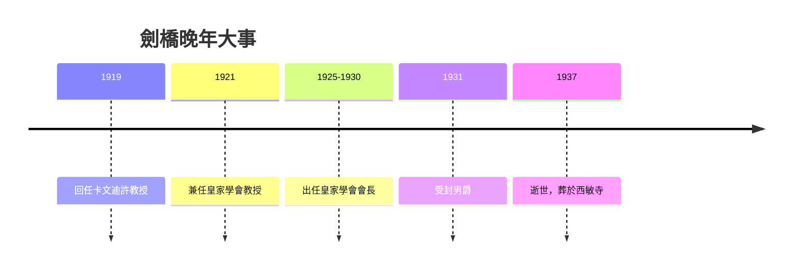

# 5.1 重返卡文迪許：掌門人時代

1919年，J. J. 湯木生卸任，拉塞福回到劍橋，接任卡文迪許實驗室教授，成為這座殿堂的第四任掌門人。他回來的時機意味深長：二十年前他在這裡起步，如今帶著曼徹斯特鍛鍊出的學派方法與核物理綱領，反過來改造母校。湯木生晚年轉向自然哲學思辨，而拉塞福把實驗室重新推向實證前沿。

他的領導風格延續曼徹斯特經驗：放手讓年輕人做實驗，經費窘迫時就親自設計廉價裝置。卡文迪許在他治下雖然設備不算頂尖，卻連續做出一流成果，靠的是「人」而非「儀器」。他培養或影響的學者包括查德威克、考克饒夫、瓦爾頓、卡皮察、奧利芬特、布萊克特等，遍布核物理的各個分支。他還於1925至1930年出任皇家學會會長，成為英國科學界的最高代表。

他本人也保持研究活力：1920年代與查德威克合作研究輕元素核蛻變，1934年與奧利芬特、哈特克完成氘—氘聚變實驗。1931年受封男爵（Baron Rutherford of Nelson），從泉林村農家之子到上議院議員，這條階梯正是帝國科學體系上升通道的極致見證。1937年10月19日，他因疝氣手術併發症在倫敦逝世，葬於西敏寺，與牛頓、達爾文為鄰。

**因果分析**：曼徹斯特學派經驗是「因」，卡文迪許的黃金時代是「果」。他把「以人為本、以簡驭繁」的治室之道帶回劍橋，使資源有限的實驗室依然領跑世界。皇家學會會長與男爵身分又反過來為實驗室爭取話語權與資源——個人聲望與機構繁榮互為因果，構成學派的放大器。
