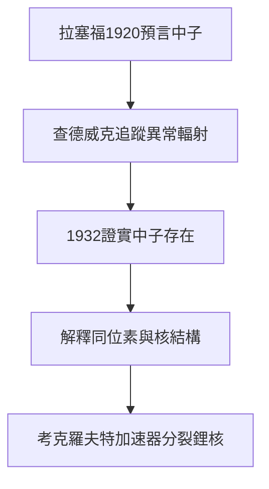

# 5.2 查德威克中子與學派傳承

1920年拉塞福在貝克里安講座上預言，原子核內可能存在一種不帶電、質量近於質子的粒子，以解釋原子量與核電荷的差異。這一預言在十二年後由弟子詹姆斯·查德威克實現。1932年查德威克用釙鈹中子源轟擊石蠟，測量反衝質子，證實中子的存在，並因此獲1935年諾貝爾物理學獎。同期在卡文迪許工作的還有考克羅夫特與沃爾頓，他們建造高壓加速器，首次實現人工加速粒子分裂鋰核，開啟加速器時代。

拉塞福學派的成功不在於個人單打獨鬥，而在於獨特的培養機制。他善於提出清晰而深刻的問題，把最有潛力的方向交給年輕人，放手讓其試錯，又在關鍵時刻以經驗指點迷津。查德威克、艾利斯、鮑威爾、卡皮察等人皆出其門下，曼徹斯特與劍橋兩代弟子構成所謂盧瑟福學派。預言中子而由弟子發現，正是這種傳承最生動的體現，導師播種，學生收穫。

## 因果分析

- **預言的引導作用** ⟹ 為弟子指明有把握的尋寶圖，使中子搜尋不是盲目碰運氣。
- **學派的培養機制** ⟹ 以問題驅動代替權威壓制，激發年輕人的主動性與創造力。
- **中子與加速器的雙突破** ⟹ 使卡文迪許在1932年達到頂峰，鞏固劍橋作為核物理中心的地位。
