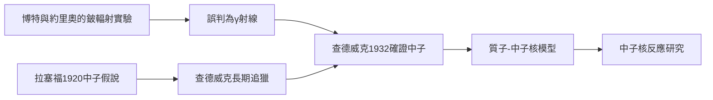

# 5.2 質子的發現與查德威克的中子

1919年，拉塞福完成氮變氧的人工核反應後，進一步用α粒子轟擊硼、氟、鋁等輕元素，證明氫核普遍可從核中打出。他於1920年提議以「質子」（proton）命名氫核，並在同一場演講中作出更大膽的預言：原子核中可能存在一種質量與質子相近、卻不帶電的粒子——中子。這一預言來自紮實的推理：若核只由質子構成，則核的電荷—質量比無法解釋；必須有中性粒子補足質量。

預言之後是長達十二年的追獵。拉塞福把這道題交給最信任的學生詹姆斯·查德威克。1930至1932年，德國的貝克與博特、法國的約里奧-居里夫婦先後發現鈹輻射能擊出質子的怪現象，卻把它誤解為γ射線。查德威克在拉塞福的中子觀念薰陶下，一眼看出γ射線動能根本不夠，1932年以一系列實驗證明該輻射是質量與質子相當的中性粒子——中子正式問世。約里奧曾嘆息，他們聽過拉塞福1920年的演講卻未放在心上，因而錯失諾貝爾獎。

這個案例最鮮明地展示了學派的因果力量：思想（中子假說）由導師提出，傳承給學生，最後由學生在導師的概念框架內完成證明。中子的發現立刻改寫了核結構圖像（質子加中子模型），開啟了中子引發核反應的研究路線——費米的中子實驗與1938年核分裂的發現，都站在這塊基石上。

$$\mathrm{Be} + \alpha \rightarrow {}^{12}\mathrm{C} + n$$

**因果分析**：同一份實驗現象，在無概念準備者眼中是γ射線，在中子假說的繼承者眼中則是中子——概念框架決定了觀察的解讀。這證明理論預先裝備了眼睛：拉塞福十二年前的假說，是查德威克能贏在終點線的真正原因，也是學派傳承的價值所在。
